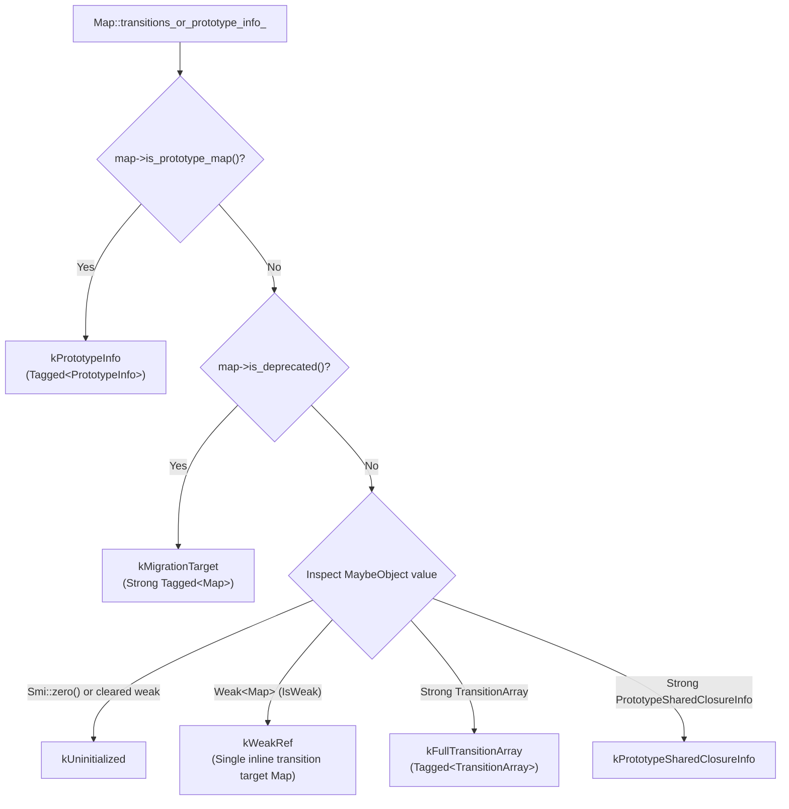

# DescriptorArrays and TransitionArrays

## Conceptual Overview

Every JavaScript object in V8 points to a hidden class (`Map`) that describes its shape. However, a `Map` itself is a fixed-size header (`Map::kSize`): it does not embed an arbitrary-length list of property names or child hidden classes directly inside itself. Instead, each `Map` delegates two variable-length structures:
1. **`DescriptorArray` (`map->instance_descriptors()`)**: An ordered list of the object's named properties, their attributes (`writable`, `enumerable`, `configurable`), their storage location (in-object field offset, backing-store slot, constant, or accessor), and their tracked `FieldType` and `Representation`.
2. **`Transitions` (`map->raw_transitions()`)**: The outgoing edges in V8's hidden-class transition tree. When a property is added (`obj.x = 1`) or an object's `ElementsKind` or prototype changes, V8 follows these transition edges to reuse an existing target `Map` instead of allocating duplicate hidden classes.

To minimize memory overhead when hidden classes branch into trees, consecutive `Map`s along a single transition chain **share a single `DescriptorArray`**, with each `Map` recording how many of the descriptors belong to it (`map->NumberOfOwnDescriptors()`).

---

## 1. `DescriptorArray` Architecture (`src/objects/descriptor-array.h`)

A `DescriptorArray` (`InstanceType::DESCRIPTOR_ARRAY_TYPE`) is a custom variable-length heap object that maps `InternalizedString` or `Symbol` property keys to `PropertyDetails` and descriptor values.

### Header Layout and Concurrent GC State

```text
+-----------------------------------------------------------------------+
| map (DescriptorArray map)                                             |
+-----------------------------------+-----------------------------------+
| number_of_all_descriptors (u16)   | number_of_descriptors (u16)       |
+-----------------------------------+-----------------------------------+
| raw_gc_state (u32, epoch & marked counts for concurrent marking)      |
+-----------------------------------------------------------------------+
| enum_cache (Tagged<EnumCache>: keys FixedArray + indices FixedArray)  |
+-----------------------------------------------------------------------+
| Entry 0: [ key (Name) | details (Smi) | value (MaybeObject) ]         |
| Entry 1: [ key (Name) | details (Smi) | value (MaybeObject) ]         |
| ...                                                                   |
+-----------------------------------------------------------------------+
```

- **`number_of_all_descriptors` (`uint16_t`)**: Total capacity of the array in entries (up to `kMaxNumberOfDescriptors = 1020`, leaving `kInvalidEnumCacheSentinel = 1023` to fit in the 10-bit `Map::BitField3::NumberOfOwnDescriptorsBits`).
- **`number_of_descriptors` (`uint16_t`)**: Number of active descriptors currently populated inside the array.
- **Descriptor Slack (`number_of_slack_descriptors()`)**: `number_of_all_descriptors() - number_of_descriptors()`. When V8 grows a shared `DescriptorArray` along a linear transition chain (`TransitionsAccessor::Insert`), it allocates extra slack entries (`NumberOfSlackDescriptors`) so subsequent property additions can append in-place (`DescriptorArray::Append`) without reallocating and copying the entire `DescriptorArray` on every property addition. Unused slack slots have `Undefined` keys/details/values.
- **`flags_` / `raw_gc_state` (`uint32_t`)**:
  - **Concurrent GC Marking State (`DescriptorArrayMarkingState`)**: Because multiple `Map`s share a single `DescriptorArray` (where Map A may only use the first 2 descriptors while Map B uses 5), the GC cannot simply mark all `number_of_descriptors` entries when visiting Map A; doing so would artificially keep alive `FieldType` maps or constants belonging only to dead child Map B. Instead, the GC uses a 32-bit atomic state (`Epoch` + `Marked` descriptor watermarks) to incrementally mark only the prefix `0 .. map->NumberOfOwnDescriptors()` reachable from live `Map`s.
  - **`FastIterableState` (`FastIterableBits`)**: Tracks whether the object's descriptors are eligible for fast-path iteration (such as `JSON.stringify` fast path: `kJsonFast`, `kJsonSlow`, `kUnknown`).
- **`enum_cache` (`TaggedMember<EnumCache>`)**: Caches `keys` (a `FixedArray` of enumerable string keys in insertion order) and `indices` (a `FixedArray` of corresponding field indices) to accelerate `for..in` loops and `Object.keys()`.

### 3-Slot Descriptor Entry Layout

Immediately following `enum_cache`, each descriptor entry (`InternalIndex`) occupies **3 contiguous tagged slots** (`kEntrySize = 3`):

1. **`kEntryKeyIndex = 0` (`GetKey(index)`)**: A strong pointer to a `Name` (`InternalizedString` or `Symbol`). Because all string keys in a `DescriptorArray` are guaranteed to be internalized, key matching is a single pointer equality check (`key == target_key`).
2. **`kEntryDetailsIndex = 1` (`GetDetails(index)`)**: A `Smi` encoding a 29-bit `PropertyDetails` bitfield (`src/objects/property-details.h`):
   - `PropertyKind` (1 bit): `kData = 0` or `kAccessor = 1`.
   - `PropertyLocation` (1 bit): `kField = 0` (value stored in the `JSObject` in-object slot or `PropertyArray`) or `kDescriptor = 1` (value stored directly in slot 2 of this `DescriptorArray` entry, used for accessor pairs or constant methods).
   - `PropertyAttributes` (3 bits): `NONE`, `READ_ONLY`, `DONT_ENUM`, `DONT_DELETE`.
   - `PropertyConstness` (1 bit): `kMutable = 0` vs `kConst = 1` (tracks whether a field has only ever been initialized once, enabling constant folding in Maglev/TurboFan via `DependentCode::kFieldConstGroup`).
   - `Representation` (3 bits): `None`, `Smi`, `Double`, `HeapObject`, or `Tagged`.
   - `FieldIndex` / `DescriptorPointer` (10 bits each):
     - **`field_index`**: The 0-based storage index for `kField` properties (translated to an in-object offset or `PropertyArray` index via `FieldIndex::ForDetails(map, details)`).
     - **`pointer` (`DescriptorPointer`)**: A 10-bit index into the `DescriptorArray` used to maintain a **sorted permutation of keys** while preserving chronological insertion order!
3. **`kEntryValueIndex = 2` (`GetValue(index)` / `GetStrongValue(index)`)**: A `MaybeObject` (strong or weak tagged pointer or `Smi`) whose meaning depends on `PropertyLocation` and `PropertyKind`:
   - **`kDescriptor` + `kData`**: The constant property value itself.
   - **`kDescriptor` + `kAccessor`**: An `AccessorPair` (JS getter/setter functions) or `AccessorInfo` (C++ API native getter/setter).
   - **`kField` + `kData`**: Encodes the **`FieldType`** (`src/objects/field-type.h`, `src/objects/field-type.cc`):
     - `FieldType::None()`: Encoded as `Smi::FromInt(2)` (or `Smi::FromInt(0)` historically; field has never been initialized).
     - `FieldType::Any()`: Encoded as `Smi::FromInt(1)` (accepts any value that matches the `Representation`).
     - `FieldType::Class(map)`: Encoded as a **weak reference** `Weak<Map>` (`MakeWeak(map)`). If `Representation` is `HeapObject`, any value stored into this field must have this exact `Map`! Using a weak reference prevents a dead class `Map` from being retained purely because another `DescriptorArray` mentions it in a field type.

### Linear vs Binary Search (`Search`)

Descriptors must stay in physical **insertion order** because ECMAScript specifies that `Object.keys()`, `for..in`, and `Object.getOwnPropertyNames()` enumerate non-index properties in the order they were added, and because child `Map`s share a prefix (`0 .. NumberOfOwnDescriptors()`) of their parent's `DescriptorArray`.

How does V8 support fast key lookups on large objects without reordering entries?
- For `number_of_own_descriptors <= kMaxElementsForLinearSearch` (`32`), V8 scans the entries linearly (`LinearSearch`).
- Above 32 descriptors (or when a full binary search is requested), V8 uses the 10-bit `DescriptorPointer` field inside each entry's `PropertyDetails`! Entry `i`'s `details.pointer()` points to the `i`-th descriptor in **hash-sorted order** (`GetSortedKey(i)` -> `GetKey(GetSortedKeyIndex(i))`), allowing `BinarySearch` in $O(\log N)$ time while keeping the physical entries in insertion order.

---

## 2. `TransitionsAccessor` and `TransitionArray` (`src/objects/transitions.h`)

A `Map` has a single versatile slot `transitions_or_prototype_info_` (`raw_transitions()`). Because most `Map`s in a real application have **zero** or **one** outgoing transition (forming linear chains as constructors initialize `this.a = 1; this.b = 2;`), allocating a separate heap `TransitionArray` for every `Map` would waste megabytes of memory.

Instead, `TransitionsAccessor` inspects the runtime state of `map` and `raw_transitions()` and decodes one of 6 encodings (`TransitionsAccessor::Encoding`):



### The 6 Encodings of `TransitionsAccessor::Encoding`

1. **`kPrototypeInfo`**: When `map->is_prototype_map()` is true, the `Map` never uses transition trees (transitions from prototype maps always allocate new maps or run through `PrototypeInfo`). The slot holds a strong pointer to `PrototypeInfo` (or `Smi::zero()`).
2. **`kMigrationTarget`**: When `map->is_deprecated()` is true (because a sibling/ancestor generalized a field's `Representation` or `FieldType`), the slot caches a **strong** pointer to the replacement `Map` so `JSObject::MigrateInstance` can migrate deprecated instances in O(1) time without re-running `MapUpdater`.
3. **`kUninitialized`**: The slot contains `Smi::zero()` (or a `Weak<Map>` whose target was garbage-collected). The `Map` currently has no outgoing transitions.
4. **`kWeakRef` (Inline Single Transition)**: When a `Map` has exactly **one** outgoing simple property transition, `raw_transitions()` stores a direct weak pointer `Weak<Map>` to the target `Map`!
   - *Where are the transition key and attributes stored if there is no `TransitionArray`?* In the target `Map`'s `DescriptorArray`! `TransitionsAccessor::GetSimpleTransitionKey(target)` reads the last descriptor owned by `target` (`target->instance_descriptors()->GetKey(target->LastAdded())`).
5. **`kFullTransitionArray`**: When a `Map` branches into 2 or more outgoing transitions (or stores special symbol transitions like `elements_transition_symbol`, prototype transitions, or side-step transitions), V8 promotes the slot to a `TransitionArray` heap object.
6. **`kPrototypeSharedClosureInfo`**: Holds shared closure metadata when applicable before full transitions are allocated.

---

## 3. `TransitionArray` Layout and `SideStepTransition`

A `TransitionArray` (`InstanceType::TRANSITION_ARRAY_TYPE`, inheriting from `WeakFixedArray`) has a 3-slot header followed by sorted 2-slot transition pairs:

```text
Index 0 (kPrototypeTransitionsIndex):  WeakFixedArray of prototype transitions (or Smi::zero())
Index 1 (kSideStepTransitionsIndex):   WeakFixedArray of SideStepTransitions (or Smi::zero())
Index 2 (kTransitionLengthIndex):      Smi count of active transitions
Index 3 (kFirstIndex):                 Entry 0 Key (Name)
Index 4:                               Entry 0 Target (Weak<Map>)
Index 5:                               Entry 1 Key (Name)
Index 6:                               Entry 1 Target (Weak<Map>)
...
```

- **Transition Entries (`[Key, Weak<Map>]`)**: Sorted by `(Name::hash(), PropertyKind, PropertyAttributes)` so `TransitionArray::Search` can binary-search outgoing transitions. Special internal transitions (such as `ElementsKind` transitions or integrity-level `Object.freeze`/`Object.seal` transitions) use dedicated non-enumerable `Symbol` keys (`roots.elements_transition_symbol()`, `roots.frozen_symbol()`, `roots.sealed_symbol()`, `roots.nonextensible_symbol()`).
- **Prototype Transitions (`kPrototypeTransitionsIndex`)**: Points to a compact `WeakFixedArray` caching target `Map`s for `Object.setPrototypeOf(obj, newProto)` / `obj.__proto__ = newProto`.

### `SideStepTransition` (`kSideStepTransitionsIndex`)

Operations like `Object.assign(target, source)` and object spread (`{ ...source }`) copy all enumerable own properties from `source` to a new or existing object. Walking the transition tree property-by-property for a 15-property object would require 15 transition lookups.

Instead, `TransitionArray` caches **side-step transitions** in a fixed-size `WeakFixedArray` at `kSideStepTransitionsIndex`, indexed by `SideStepTransition::Kind` (`src/objects/transitions.h`):

| `SideStepTransition::Kind` | Index | Purpose |
| :--- | :---: | :--- |
| **`kCloneObject`** | `0` | Target `Map` produced by `CloneObjectIC` (`{ ...source }`), jumping directly from the source `Map` to the cloned result `Map`. |
| **`kObjectAssign`** | `1` | Target `Map` produced by fast-path `Object.assign({}, source)`. |
| **`kObjectAssignValidityCell`** | `2` | Validity `Cell` guarding the `kObjectAssign` fast path (invalidated if prototypes or setters along the chain change). |

Each slot in the side-step array holds either a `Weak<Map>` / `Weak<Cell>`, `SideStepTransition::Empty` (`Smi::FromInt(0)`), or `SideStepTransition::Unreachable` (`Smi::FromInt(1)`, when the source `Map` cannot take the fast clone/assign shortcut).

---

## Key Source Files

- `src/objects/descriptor-array.h` & `src/objects/descriptor-array-inl.h`: `DescriptorArray`, `EnumCache`, `DescriptorArrayMarkingState`, and linear/binary search.
- `src/objects/property-details.h`: `PropertyDetails` bitfields (`PropertyKind`, `PropertyLocation`, `PropertyConstness`, `Representation`, `FieldIndex`, `DescriptorPointer`).
- `src/objects/field-type.h` & `src/objects/field-type.cc`: `FieldType::None()`, `FieldType::Any()`, and `FieldType::Class(map)`.
- `src/objects/transitions.h` & `src/objects/transitions.cc`: `TransitionsAccessor`, `TransitionArray`, and `SideStepTransition`.
