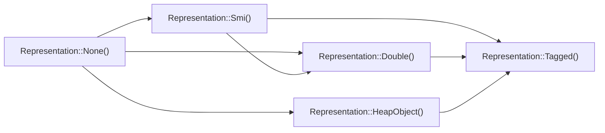
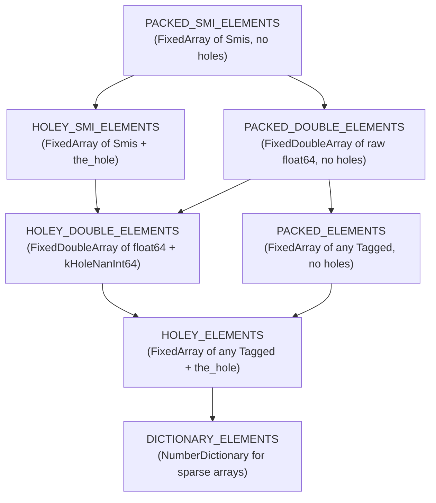

# Object Fields, Elements, and Map Generalization

## Conceptual Overview

In ECMAScript, every object looks like an arbitrary dictionary mapping string or symbol keys to values. In practice, however, JavaScript objects are used in two very different ways:
1. **Named Properties (`obj.x`, `obj.y`)**: Usually a small, fixed set of string/symbol keys shared across many instances of a class or literal.
2. **Indexed Elements (`arr[0]`, `obj[42]`)**: Array-like integer indices (`0 <= index < 2^32 - 1`) that are iterated sequentially, resized dynamically, or stored densely.

To optimize both access patterns simultaneously, every `JSObject` in V8 splits its storage into two independent tracks:
- **Properties (`properties_or_hash_`)** + **In-Object Fields**: Controlled by the `Map`'s `DescriptorArray` (in fast mode) or a `SwissNameDictionary` / `NameDictionary` (in dictionary mode).
- **Elements (`elements_`)**: Controlled by the `Map`'s `ElementsKind`, storing indexed values in contiguous arrays (`FixedArray`, `FixedDoubleArray`) or sparse dictionaries (`NumberDictionary`).

```text
+-------------------------------------------------------------------+
| JSObject                                                          |
+-------------------------------------------------------------------+
| map_                (Tagged<Map>: hidden class + ElementsKind)    |
| properties_or_hash_ (PropertyArray, SwissNameDictionary, or Smi)  |
| elements_           (FixedArray, FixedDoubleArray, or Dictionary) |
+-------------------------------------------------------------------+
| In-Object Field 0   (1 tagged word: Smi, HeapObject, HeapNumber)  |
| In-Object Field 1   (1 tagged word)                               |
| ...                                                               |
+-------------------------------------------------------------------+
```

---

## 1. Named Properties: In-Object Fields, `PropertyArray`, and `Representation`

### In-Object vs Out-of-Object (`PropertyArray`) Fields
When a `JSObject` is created, its `Map` reserves a fixed number of **in-object property slots** directly inside the `JSObject` allocation (`map->GetInObjectProperties()`).
- Accessing an in-object field requires **zero pointer indirections** beyond the `JSObject` pointer itself (`*(object_ptr + offset)`).
- Once all in-object slots are full, additional fast properties are allocated in the out-of-object **`PropertyArray`** pointed to by `properties_or_hash_` (requiring one extra load).
- Unused slack capacity at the end of a `JSObject` (`map->UnusedPropertyFields()`) allows new properties to be added in-place by simply transitioning the `Map` and writing to the next unused slot.

### Field Width and `Representation::Double()` (Field Unboxing vs Boxing)
Every named property field in a `JSObject` or `PropertyArray` is exactly **one tagged word (`kTaggedSize` bytes)** wide (`PropertyDetails::field_width_in_words() == 1`):
- On 64-bit platforms **with pointer compression** (the default on x64 and arm64), `kTaggedSize` is **4 bytes**, whereas an IEEE-754 `double` (`kDoubleSize`) is **8 bytes**.
- Because an 8-byte `double` cannot fit inline inside a 4-byte compressed tagged field slot, **`Representation::Double()` fields are NOT stored as raw 8-byte unboxed doubles directly inside the `JSObject` field slot**.
- Instead, a field with `Representation::Double()` stores a tagged pointer to a dedicated, mutable **`HeapNumber`** box (allocated via `JSObject::AllocateStorageForMap` or `JSDataObjectBuilder`).
- **Why track `Representation::Double()` if it still points to a `HeapNumber`?**
  1. **In-Place Mutation (Zero Allocation on Overwrite)**: For a generic `Representation::Tagged()` field, assigning a new float (`obj.x = 3.14; obj.x = 2.71;`) must allocate a brand-new immutable `HeapNumber` on every write because other pointers might alias the old `HeapNumber`. For a `Representation::Double()` field, the `JSObject` **exclusively owns** the `HeapNumber` box at that slot! Stores simply overwrite the 64-bit `double` payload inside the existing `HeapNumber` in-place without allocating. (Conversely, reading a `Representation::Double()` field into a generic tagged value must allocate a fresh `HeapNumber` copy or unbox the float into an FP register so external code cannot observe future in-place mutations.)
  2. **Guaranteed Unboxed Float64 in JITs**: Maglev and TurboFan know without checking the value's `Map` that the field points to a `HeapNumber` and can load/store the 64-bit `double` directly in floating-point registers.

### Field Representations Lattice
Each `kField` descriptor tracks a `Representation` (`src/objects/property-details.h`) that starts narrow and widens monotonically as values are stored:



- **`Smi` -> `Double`**: Storing `3.5` into a `Smi` field widens the field's representation to `Double`. Because a `Smi` was stored inline in the slot whereas a `Double` field requires a dedicated `HeapNumber` box, transitioning an existing instance from `Smi` to `Double` requires **instance migration** (`JSObject::MigrateInstance` allocates the `HeapNumber` box and boxes the old `Smi` value into it).
- **`Double` -> `Tagged`**: Storing a non-number (e.g., `"hello"` or `undefined` when `V8_ENABLE_UNDEFINED_DOUBLE` is not active) into a `Double` field widens it to `Tagged`.
- **`HeapObject` -> `Tagged`**: A `Representation::HeapObject()` field exclusively holds tagged `HeapObject` pointers (`MachineType::TaggedPointer()`, including immutable `HeapNumber` boxes for Smi-range numbers), allowing JIT compilers to omit Smi checks on loads. Storing a raw `Smi` generalizes the field to `Tagged`, and any compiler store or backing-store copy targeting a `HeapObject` slot must preserve its `TaggedPointer` representation.

---

## 2. Dictionary-Mode Properties: `SwissNameDictionary`

When an object has too many properties (`> kMaxNumberOfDescriptors = 1020`), uses `delete obj.prop` (which would otherwise leave holes or break shared `DescriptorArray` prefixes), or exhibits megamorphic shape churn, V8 normalizes its named properties into **dictionary mode** (`map->is_dictionary_map()`).

In modern V8 (`V8_ENABLE_SWISS_NAME_DICTIONARY_BOOL`), dictionary-mode `JSObject`s use **`SwissNameDictionary`** (`src/objects/swiss-name-dictionary.h`) instead of the legacy `NameDictionary` (which is still used on `JSGlobalObject` via `GlobalDictionary` or when Swiss dictionaries are disabled).

### `SwissNameDictionary` Architecture (SwissTable / Abseil `flat_hash_map`)

`SwissNameDictionary` adapts Abseil's SIMD-accelerated open-addressed hash table (`SwissTable`) to the V8 heap while preserving **exact property insertion order**:

```text
+-------------------------------------------------------------------------+
| Map (swiss_name_dictionary_map)                                         |
| prefix (uint32_t: identity hash) | capacity (int32_t: power of 2 or 0)  |
| meta_table_pointer (Tagged<ByteArray>: count, deleted, enum table)      |
+-------------------------------------------------------------------------+
| data_table: 2 * capacity Tagged slots [ key_0, val_0, key_1, val_1... ] |
+-------------------------------------------------------------------------+
| ctrl_table: (capacity + kGroupWidth) uint8_t bytes (H2 hash / Empty)    |
+-------------------------------------------------------------------------+
| property_details_table: capacity uint8_t bytes (1-byte PropertyDetails) |
+-------------------------------------------------------------------------+
```

1. **H1 / H2 Hash Split & SIMD Probing (`ctrl_table`)**:
   - A key's hash is split into **H1** (used to pick the starting bucket group of `kGroupWidth = 16` or `8` bytes) and **H2** (a 7-bit fingerprint stored in the `ctrl_table` byte for that bucket; high bit `1` indicates `Ctrl::kEmpty = 0b10000000` or `Ctrl::kDeleted = 0b11111110`).
   - During lookup, V8 loads a full group of 8 or 16 control bytes at once and compares them against the target H2 byte in parallel using **SSE2** (x86/x64), **NEON** (ARM64), or **SWAR** (64-bit word arithmetic). Cache misses on `data_table` keys occur only when the 7-bit H2 fingerprint matches!
2. **Compact 1-Byte `PropertyDetails` (`property_details_table`)**:
   - Because dictionary properties do not need a 10-bit `FieldIndex` or 10-bit `DescriptorPointer`, each bucket's `PropertyDetails` (`PropertyKind`, `PropertyAttributes`, `PropertyCellType`/`Constness`) fits into a **single byte** (`PropertyDetails::ToByte()` / `FromByte()`). Properties keyed by any private symbol (`Name::IsAnyPrivate()`, including internal private symbols and private names) must always have the `DONT_ENUM` attribute set in both fast descriptor arrays and dictionary properties (`SwissNameDictionary` and `NameDictionary`).
3. **Insertion-Order Enumeration (`meta_table`)**:
   - Standard open-addressed hash tables scramble insertion order, which would require sorting dictionary entries by an enumeration index on every `for..in` or `Object.keys()`.
   - `SwissNameDictionary` eliminates sorting completely: its `meta_table` (`ByteArray`) appends the bucket index of each newly inserted entry into a compact array of `uint8_t` (when `capacity <= 256`), `uint16_t`, or `uint32_t` integers. Iterating properties in insertion order simply walks the `meta_table` entries sequentially!

---

## 3. Indexed Elements and `ElementsKind` Transitions (`src/objects/elements-kind.h`)

The `elements_` pointer of a `JSObject` or `JSArray` stores integer-indexed properties (`0`, `1`, `2`, ...). A `Map`'s **`ElementsKind`** bitfield tracks both the **element representation** and whether the backing store is **packed** (dense from `0` to `length - 1`) or **holey** (may contain `the_hole_value` / `kHoleNanInt64` gaps that require prototype chain lookups if read).

### The Fast `ElementsKind` Transition Lattice

As elements are stored or deleted, a `JSArray` transitions one way from more specific to more general `ElementsKind`s:



- **`PACKED_*` vs `HOLEY_*`**: If an array has `PACKED_*` elements, any access within `0 <= i < array.length` is guaranteed not to hit an element hole, allowing Maglev and TurboFan to elide both the hole check and the fallback prototype-chain lookup (`Array.prototype` check). Once an array transitions to `HOLEY_*` (e.g., via `new Array(10)`, `arr[5] = 1` past `length`, or `delete arr[0]`), it never transitions back to `PACKED_*`.
- **`*SMI_ELEMENTS` & `*ELEMENTS` (`FixedArray`) vs `*DOUBLE_ELEMENTS` (`FixedDoubleArray`)**:
  - `FixedArray` stores tagged pointers (`kTaggedSize` bytes per element; `the_hole_value` marks holes).
  - `FixedDoubleArray` stores raw 64-bit IEEE-754 `double`s (8 bytes per element even when pointer compression is enabled; `kHoleNanInt64` marks holes -- see [Holes and Sentinels](holes-and-sentinels.md)). Transitioning from `SMI` to `DOUBLE` or from `DOUBLE` to `ELEMENTS` reallocates and converts the entire backing store.

> [!WARNING]
> **`ElementsKind` Enum Order != Transition Order!**
> In `src/objects/elements-kind.h`, the numeric enum values are ordered as:
> - `0`: `PACKED_SMI_ELEMENTS`
> - `1`: `HOLEY_SMI_ELEMENTS`
> - `2`: `PACKED_ELEMENTS`
> - `3`: `HOLEY_ELEMENTS`
> - `4`: `PACKED_DOUBLE_ELEMENTS`
> - `5`: `HOLEY_DOUBLE_ELEMENTS`
>
> Notice that `PACKED_ELEMENTS` (`2`) and `HOLEY_ELEMENTS` (`3`) have **lower** numeric enum values than `PACKED_DOUBLE_ELEMENTS` (`4`) and `HOLEY_DOUBLE_ELEMENTS` (`5`)! V8 groups the four `FixedArray`-backed kinds (`0..3`) together so generated code can check "is this a fast Smi-or-Object `FixedArray` backing store?" with a single unsigned comparison (`kind <= HOLEY_ELEMENTS`).
>
> **Never compare two `ElementsKind` enum values with `<` or `>` to test which is more general!** Always use `IsMoreGeneralElementsKindTransition(from, to)` or `GetNextTransitionElementsKind(kind)` (`src/objects/elements-kind.cc`), which consults `kFastElementsKindSequence`:
> `PACKED_SMI -> HOLEY_SMI -> PACKED_DOUBLE -> HOLEY_DOUBLE -> PACKED -> HOLEY`.

---

## 4. `MapUpdater` and Map Generalization (`src/objects/map-updater.h`)

What happens when an existing property on an instance receives a value that violates the current `Map`'s `PropertyConstness`, `Representation`, or `FieldType` (for example, storing `1.5` into a `Representation::Smi()` field, or storing a `Bar` instance into a `FieldType::Class(Foo)` field)?

Simply creating a new branched `Map` would cause polymorphic/megamorphic map explosion across instances created by the same constructor. Instead, **`MapUpdater`** (`src/objects/map-updater.cc`) **generalizes** the transition tree so all existing and future instances converge on a unified target `Map`:

### Fast Path: In-Place Reconfiguration (`TryReconfigureToDataFieldInplace`)
When the transition does **not** require reallocating field storage (for example, changing `PropertyConstness::kConst` to `kMutable`, widening `FieldType::Class(Foo)` to `FieldType::Any()`, or widening `Representation::Smi()` or `HeapObject()` directly to `Representation::Tagged()` without `Double` unboxing):
- `MapUpdater` updates the `PropertyDetails` and `FieldType` **in-place** inside the existing `DescriptorArray`!
- It triggers lazy deoptimization of any optimized code that depended on the old `kConst` or `FieldType` assumption via `DependentCode::DeoptimizeDependencyGroups` (`kFieldConstGroup`, `kFieldTypeGroup`, `kFieldRepresentationGroup`).
- No maps are deprecated, and no instances need to be migrated.

### Full Transition Tree Replay (6-State `MapUpdater` Pipeline)
When a transition requires changing physical field layout (such as widening `Representation::Smi()` to `Representation::Double()`, which requires allocating a mutable `HeapNumber` box) or changing property attributes:
1. **`FindRootMap()`**: Walks backward along `map->GetBackPointer()` up the transition tree to find the root `Map` (before any diverging field representations).
2. **`FindTargetMap()`**: Replays the updated sequence of property descriptors forward from the root `Map` through existing transitions (`TransitionsAccessor`), checking if a compatible generalized branch already exists.
3. **`BuildDescriptorArray()`**: If no complete target `Map` exists, merges the descriptor representations, constness, and `FieldType`s of the old `Map` and the new requirement into a generalized `DescriptorArray`.
4. **`FindSplitMap()`**: Finds the ancestor `Map` where the old transition branch and the new generalized branch diverge, and **deprecates** (`map->DeprecateTransitionTree()`) the superseded old `Map` subtree (setting their `raw_transitions()` to `kMigrationTarget` and deoptimizing code in `kTransitionGroup`).
5. **`ConstructNewMap()` / `ConstructNewMapWithIntegrityLevelTransition()`**: Allocates the remaining `Map` nodes along the generalized branch from the split point.
6. **`JSObject::MigrateInstance()`**: Whenever an instance with a deprecated `Map` is encountered by an IC, runtime call, or compiler check (`TryMigrateInstance`), V8 migrates the instance in-place to the new generalized `Map` (allocating `HeapNumber` boxes for any newly `Double`-represented fields).

---

## Key Source Files

- `src/objects/js-objects.h` & `src/objects/js-objects.cc`: `JSObject` layout, `MigrateInstance`, and `AllocateStorageForMap`.
- `src/objects/swiss-name-dictionary.h` & `src/objects/swiss-name-dictionary-inl.h`: `SwissNameDictionary` SIMD/SWAR hash table.
- `src/objects/elements-kind.h` & `src/objects/elements-kind.cc`: `ElementsKind` definitions and `kFastElementsKindSequence`.
- `src/objects/elements.cc`: `ElementsAccessor` implementations for each `ElementsKind`.
- `src/objects/map-updater.h` & `src/objects/map-updater.cc`: `MapUpdater` state machine and in-place field generalization.
