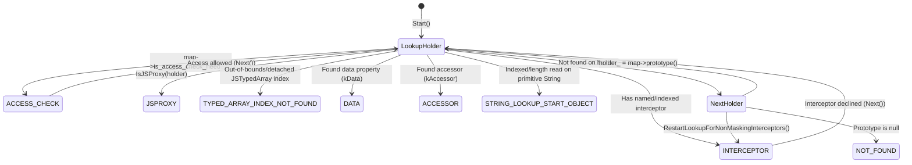

# V8 `LookupIterator`: Property Resolution State Machine

## Conceptual Overview

Looking up or assigning a property in JavaScript (`obj[key]`, `obj.prop = val`, `super.method()`, `Object.defineProperty()`) is governed by a complex set of ECMAScript rules (`[[Get]]`, `[[Set]]`, `[[GetOwnProperty]]`, `[[DefineOwnProperty]]`). A single property lookup may need to:
- Distinguish array/element indices (`obj["0"]`) from named properties (`obj["foo"]`).
- Walk up the prototype chain (`__proto__`) while keeping track of the original `this` receiver.
- Handle C++ embedder interceptors (both masking and non-masking), cross-origin security access checks (`window.location`), `Proxy` traps, TypedArray out-of-bounds integer exotic indices, and fast vs dictionary backing stores.
- Prepare hidden-class transitions (`Map` transitions) or field representation generalizations before writing a value.

Instead of duplicating this traversal across `Object::GetProperty`, `Object::SetProperty`, Inline Caches (`LoadIC`, `StoreIC`), and built-in `Object.*` functions, V8 centralizes all property resolution inside a stack-allocated state machine: **`LookupIterator`** (`src/objects/lookup.h`, `src/objects/lookup.cc`).

---

## 1. Core Participants: `receiver_`, `lookup_start_object_`, and `holder_`

A `LookupIterator` tracks three distinct object handles during its traversal (`src/objects/lookup.h`):

```text
LookupIterator
  |-- receiver_             (The JS 'this' value for getters/setters/proxies/access checks)
  |-- lookup_start_object_  (Where the property search begins; equals receiver_ except for 'super')
  +-- holder_               (The current object along the prototype chain being inspected)
```

1. **`receiver_` (`GetReceiver()`)**: The actual JavaScript `this` value of the operation (which may even be a primitive like a `Smi` or `String` during a boxed primitive property read like `"abc".length`). Whenever the lookup invokes an accessor getter/setter, triggers a `Proxy` trap (`get(target, prop, receiver)`), or performs a security access check, `receiver_` is passed as the receiver.
2. **`lookup_start_object_` (`lookup_start_object()`)**: The `JSReceiver` where the property search begins.
   - For normal property accesses (`obj.prop`), `lookup_start_object_` is identical to `receiver_` (or the `Object(receiver_)` wrapper for primitives).
   - **Why can `receiver_` and `lookup_start_object_` differ? (`super.prop`)**: When evaluating `super.prop` or `super.prop = val`, the property lookup must start on the method's **`HomeObject.__proto__`** (`lookup_start_object_`), while `this` inside any invoked getter or setter must remain the derived instance (`receiver_`)! The 4-argument constructor `LookupIterator(isolate, receiver, key, lookup_start_object, configuration)` directly models this split.
3. **`holder_` (`GetHolder<T>()`)**: Starts at `lookup_start_object_` and advances up the prototype chain (`Next()` -> `NextHolder(map)`) until the property is found (`IsFound()`) or the prototype chain ends (`NOT_FOUND`).
   - **`GetStoreTarget<T>()`**: Returns the target object for a property write (normally `receiver_`, except when configuring hidden properties on a `JSGlobalProxy`, where `GetStoreTarget` unwraps the `JSGlobalObject`).
   - **`GetHolderForApi()`**: The inverse helper for C++ API callbacks (`AccessorInfo` / interceptors): if `holder_` is a `JSGlobalObject`, it unwraps and returns its outer `JSGlobalProxy` so embedder callbacks never see the internal detached global object.

---

## 2. Keys, Indices, and `Configuration`

### Element Index vs Property Name (`IsElement()`)
When a `LookupIterator` is constructed with a `PropertyKey(isolate, key)`:
- If `key` is a valid integer index (`0 <= index < kMaxUInt32` for general elements, or `size_t` integer indices for `JSTypedArray` exotic objects), `index_` is populated.
- At each holder along the prototype chain, `IsElement(holder)` determines whether the lookup operates on `holder->elements()` (via `ElementsAccessor`) or on named properties (`DescriptorArray` / `SwissNameDictionary`).

### `Configuration` Bitmask
Callers control whether the iterator intercepts prototype traversal or C++ interceptors via `LookupIterator::Configuration`:
- **`OWN_SKIP_INTERCEPTOR = 0`**: Only inspect real own properties on `lookup_start_object_`.
- **`OWN = kInterceptor`**: Inspect own properties and own C++ interceptors on `lookup_start_object_`, stopping before the prototype chain.
- **`PROTOTYPE_CHAIN_SKIP_INTERCEPTOR = kPrototypeChain`**: Walk the prototype chain, ignoring C++ interceptors.
- **`PROTOTYPE_CHAIN = kPrototypeChain | kInterceptor` (`DEFAULT`)**: Full ECMAScript lookup including both interceptors and the prototype chain.

---

## 3. The `LookupIterator::State` Machine (`Next()`)

Upon construction, `Start<kIsElement>()` advances the iterator to its first actionable `State`. Calling `it.Next()` resumes the state machine from the current `holder_` and advances to the next state along the current object or up the prototype chain:



| `LookupIterator::State` | Meaning & Typical Caller Action |
| :--- | :--- |
| **`ACCESS_CHECK`** | `holder_` is a cross-origin security boundary (`map->is_access_check_needed()`, such as Blink's `Window` or `Location`). Caller checks `it.HasAccess()` (`Isolate::MayAccess`); if allowed, calls `it.Next()` to continue inspecting `holder_`. |
| **`INTERCEPTOR`** | `holder_` has a C++ embedder `InterceptorInfo` (`GetInterceptor()`). Caller invokes the interceptor callback; if the interceptor does not handle the property, caller invokes `it.Next()`. |
| **`JSPROXY`** | `holder_` is a `JSProxy`. Prototype walking stops inside `LookupIterator` because `JSProxy::GetProperty` / `SetProperty` must invoke the user `Proxy` handler trap. |
| **`TYPED_ARRAY_INDEX_NOT_FOUND`** | The lookup key is a canonical numeric index on a `JSTypedArray` (e.g., `ta[-1]`, `ta[1.5]`, `ta[outOfBounds]`, or detached buffer). Per ECMAScript `Integer-Indexed Exotic Objects`, such lookups **must stop immediately** and return `undefined` (or ignore/throw on write) without ever consulting `TypedArray.prototype` or `Object.prototype`! |
| **`STRING_LOOKUP_START_OBJECT`** | Resolving an in-bounds character index (`"abc"[1]`) on a primitive `String` receiver before walking `String.prototype`. |
| **`DATA`** | Found a data property (`kData`). Value can be read via `GetDataValue()` or written via `WriteDataValue()`. |
| **`ACCESSOR`** | Found an accessor property (`kAccessor`: `AccessorPair` or C++ `AccessorInfo`). Getters/setters are retrieved via `GetAccessors()`. |
| **`TRANSITION`** | Entered only after calling `PrepareTransitionToDataProperty()` (or `PrepareTransitionToAccessorProperty()`). Indicates that `transition_map()` or `transition_cell()` is ready to be committed via `ApplyTransitionToDataProperty()`. |
| **`NOT_FOUND`** | Reached the end of the prototype chain (or `OWN` boundary) without finding the property. |
| **`BEFORE_PROPERTY`** | Internal transient state before inspecting descriptors/elements on `holder_`. |

---

## 4. Masking vs Non-Masking Interceptors (`InterceptorState`)

Embedders like Blink attach C++ **named or indexed interceptors** (`v8::NamedPropertyHandlerConfiguration`) to DOM objects (for example, `window["frames"]` or `document["myFormName"]` for named DOM elements). Interceptors come in two flavors (`InterceptorInfo::non_masking()`):
1. **Masking Interceptors (`!non_masking()`, default)**: Run **before** checking normal own properties on `holder_`. They can intercept and override ("mask") real properties.
2. **Non-Masking Interceptors (`non_masking()`)**: According to the Web IDL specification for named properties on `Window` or `HTMLDocument`, normal properties defined on the object itself **or anywhere on its prototype chain** must take precedence over the interceptor!

`LookupIterator` implements this two-pass semantics using `InterceptorState` (`src/objects/lookup.h`):

```text
kUninitialized --> kSkipNonMasking / kSkipNonMaskingOwnProperty --> (if NOT_FOUND) --> kProcessNonMasking
```

1. **Pass 1 (`kUninitialized` -> `kSkipNonMasking`)**:
   - As `LookupIterator` walks from `lookup_start_object_` up the prototype chain, any **masking** interceptor stops at `State::INTERCEPTOR` immediately before own properties on that holder are checked.
   - If `LookupIterator` encounters a **non-masking** interceptor during Pass 1, it **skips** the interceptor, changes `interceptor_state_` to `kSkipNonMasking` (or `kSkipNonMaskingOwnProperty`), and continues searching real properties on `holder_` and its prototypes.
2. **Pass 2 (`RestartLookupForNonMaskingInterceptors` -> `kProcessNonMasking`)**:
   - If Pass 1 reaches the end of the prototype chain without finding a real property, `NextHolder` notices `interceptor_state_ == kSkipNonMasking`.
   - Instead of returning `NOT_FOUND`, it calls `RestartLookupForNonMaskingInterceptors()`: resetting `holder_` back to `lookup_start_object_`, setting `interceptor_state_ = InterceptorState::kProcessNonMasking`, and walking the chain a second time to fire the non-masking interceptors!

---

## 5. Property Write Preparation (`PrepareForDataProperty` & `PrepareTransitionToDataProperty`)

Modifying or adding a data property via `Object::SetProperty` or `Object::AddDataProperty` uses `LookupIterator` to preserve hidden-class invariants before writing the value:

### Case A: Updating an Existing Data Property (`State::DATA`)
When `it.state() == LookupIterator::DATA` and `it.HolderIsReceiverOrHiddenPrototype()`:
1. **`it.PrepareForDataProperty(value)`**:
   - Inspects the existing descriptor's `PropertyConstness`, `Representation`, and `FieldType`.
   - If `value` is incompatible (e.g., writing a new value to a `kConst` field, or writing a `HeapObject` to a `Representation::Smi()` field), calls `JSObject::PrepareForDataProperty` -> `MapUpdater` to generalize the `Map` in-place or migrate the receiver instance (allocating a `HeapNumber` box if transitioning `Smi -> Double`) and reloads the updated `PropertyDetails`.
2. **`it.WriteDataValue(value, initializing_store)`**:
   - Writes `value` into the in-object slot, `PropertyArray`, `SwissNameDictionary`, `GlobalDictionary` `PropertyCell`, or `ElementsAccessor`, updating write barriers and `PropertyCell` dependent code as needed.

### Case B: Adding a New Data Property (`PrepareTransitionToDataProperty`)
When the property does not yet exist on the receiver (or shadows a prototype data property):
1. **`it.PrepareTransitionToDataProperty(receiver, value, attributes, store_origin)`**:
   - Consults `TransitionsAccessor` on `receiver->map()` to see if an outgoing transition for `(name, kData, attributes)` already exists.
   - If a matching transition `Map` exists and its field `Representation` / `FieldType` covers `value`, caches that target `Map` in `transition_`. (If the target `Map`'s representation is too narrow for `value`, generalizes the target `Map` via `MapUpdater`.)
   - If no transition exists (or the receiver is in dictionary mode / becomes dictionary mode), constructs a new child transition `Map` via `Map::TransitionToDataProperty` (or prepares a `PropertyCell` for `JSGlobalObject`).
   - Transitions the `LookupIterator` to **`State::TRANSITION`**.
2. **`it.ApplyTransitionToDataProperty(receiver)`**:
   - Commits the prepared transition: reallocates `PropertyArray` backing storage if out-of-object slack was exhausted (`JSObject::AllocateStorageForMap`), updates `receiver->set_map(transition_map)`, writes the descriptor entry into `SwissNameDictionary` if in dictionary mode, and invalidates any affected `Protectors` (`it.UpdateProtector()`, such as `IsNoElementsProtector` or `ArraySpeciesProtector`) if `name_` is a tracked protector symbol/string.
   - Transitions the `LookupIterator` to **`State::DATA`** so the caller can immediately call `it.WriteDataValue(value, true)`.

---

## Key Source Files

- `src/objects/lookup.h` & `src/objects/lookup-inl.h`: `LookupIterator` class, `State`, `Configuration`, `InterceptorState`, and inline key/index classification.
- `src/objects/lookup.cc`: State machine implementation (`Next`, `LookupInRegularHolder`, `PrepareForDataProperty`, `PrepareTransitionToDataProperty`, `ApplyTransitionToDataProperty`, `UpdateProtector`).
- `src/objects/objects.cc`: High-level callers `Object::GetProperty`, `Object::SetProperty`, and `Object::AddDataProperty`.
