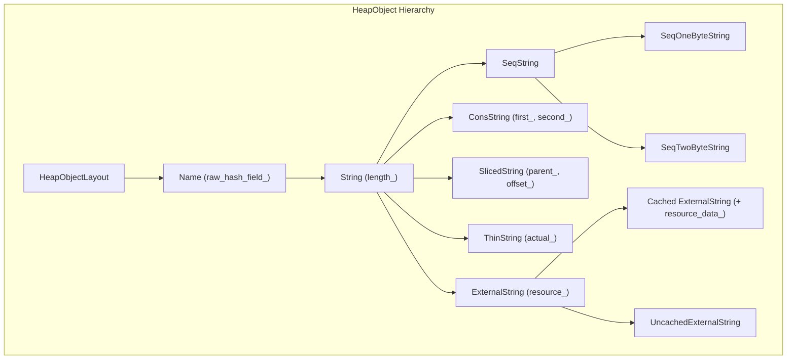

# V8 Strings: Representations, Encoding, and Hashing

## Conceptual Overview

JavaScript programs manipulate strings constantly: slicing substrings, concatenating templates, using strings as object property keys, and passing text across the C++ embedder boundary (such as Blink in Chromium). If every string operation copied character buffers or if every property lookup compared strings character-by-character, execution and memory usage would suffer severely.

V8 addresses this by separating the **JavaScript concept of a string** from its **underlying heap representation**:
- **Encoding** is chosen dynamically per string: pure Latin-1 strings use 1 byte per character (`OneByte`), while strings containing code units above `0xFF` use 2 bytes per UTF-16 code unit (`TwoByte`).
- **Operations choose specialized representations**: concatenation creates lightweight tree nodes (`ConsString`), substring extraction creates views (`SlicedString`), and C++ embedders provide zero-copy external buffers (`ExternalString`).
- **Property keys are deduplicated (`InternalizedString`)**: canonicalized in a global `StringTable` so property key equality reduces to a single pointer comparison (`a == b`), with in-place forwarding (`ThinString` and `StringForwardingTable`) when an existing string is internalized later.

---

## 1. String InstanceType Bitfield (`src/objects/instance-type.h`)

To dispatch string operations in a single bitwise instruction without chasing pointers, V8 encodes a string's core properties directly inside the low 7 bits (`0x00..0x7F`, where `kIsNotStringMask = ~0x7f`) of its `Map::instance_type()`:

```text
Bit:   6                      5             4                   3          2   1   0
     +----------------------+-------------+-------------------+----------+-----------+
     | IsNotInternalized    | IsShared    | UncachedExternal  | Encoding |  RepTag   |
     | 0 = Internalized     | 0 = Local   | 0 = Normal        | 0 = 2B   |  (3 bits) |
     | 1 = Not Internalized | 1 = Shared  | 1 = Uncached Ext  | 1 = 1B   |           |
     +----------------------+-------------+-------------------+----------+-----------+
```

### Exact Bit Masks and Tags (`src/objects/instance-type.h`)

1. **Bits 0-2: Representation (`kStringRepresentationMask = 0b111`)**:
   - `kSeqStringTag = 0x0` (`0b000`): Sequential flat characters (`SeqOneByteString`, `SeqTwoByteString`).
   - `kConsStringTag = 0x1` (`0b001`): Concatenation node (`ConsString`).
   - `kExternalStringTag = 0x2` (`0b010`): Off-heap C++ buffer (`ExternalOneByteString`, `ExternalTwoByteString`).
   - `kSlicedStringTag = 0x3` (`0b011`): Substring view (`SlicedString`).
   - `kThinStringTag = 0x5` (`0b101`): Forwarding wrapper pointing to an `InternalizedString` (`ThinString`).
   - **Fast micro-masks within Bits 0-2**:
     - **Bit 0 (`kIsIndirectStringMask = 0b001`)**: `1` for all indirect representations (`Cons`, `Sliced`, `Thin`) and `0` for direct character buffers (`Seq`, `External`). Checking whether a string must be unwrapped before reading characters is a single bit test!
     - **Bit 2 (`kThinStringTagBit = 0b100`)**: Only `kThinStringTag` (`0b101`) sets bit 2, allowing `IsThinString` checks to test a single bit.
2. **Bit 3: Character Encoding (`kStringEncodingMask = 1 << 3 = 0x8`)**:
   - `kTwoByteStringTag = 0x0`: 16-bit UTF-16 code units (`uint16_t`).
   - `kOneByteStringTag = 0x8`: 8-bit Latin-1 / ISO-8859-1 code units (`uint8_t`).
3. **Bit 4: Uncached External String (`kUncachedExternalStringMask = 1 << 4 = 0x10`)**:
   - `kUncachedExternalStringTag = 0x10`: Set on `ExternalString` instances whose C++ resource data pointer is not cached directly inside the V8 heap object (requiring a virtual call `resource()->data()`).
4. **Bit 5: Shared String (`kSharedStringMask = 1 << 5 = 0x20`)**:
   - `kSharedStringTag = 0x20`: Set when the string resides in the shared heap (`SharedSpace` or `ReadOnlySpace`) and can be accessed concurrently across multiple worker isolates (`JSAtomics` / shared structs). Only sequential and external strings can be shared (`SHARED_SEQ_*`, `SHARED_EXTERNAL_*`).
5. **Bit 6: Not Internalized (`kIsNotInternalizedMask = 1 << 6 = 0x40`)**:
   - `kInternalizedTag = 0x0`: The string is canonicalized in the `StringTable`. Only `SeqString` and `ExternalString` instances can be internalized.
   - `kNotInternalizedTag = 0x40`: Normal (non-internalized) string.
   - **Why Bit 6 is inverted and placed at the top of the 7-bit string range**: Putting `kIsNotInternalizedMask` (`0x40`) immediately adjacent to `kIsNotStringMask` (`~0x7f = 0xff80`) makes the combined mask `kIsNotStringMask | kIsNotInternalizedMask` (`0xffc0`) a single contiguous run of 1-bits. On ARM64, a contiguous bit run can be encoded as an immediate operand in a single `TST` instruction (`tst w0, #0xffc0`), checking both "is a String" and "is Internalized" at once!

---

## 2. Concrete String Layouts and Mechanics (`src/objects/string.h`)

All strings inherit from `Name` (which stores `raw_hash_field_`) and `String` (which stores `length_` as a `uint32_t` character count, up to `String::kMaxLength`).



### 1. `SeqString` (`SeqOneByteString` & `SeqTwoByteString`)
Stores characters inline immediately following the `String` header (`FlexibleBodyDescriptor`).
- Used for short literals, internalized strings, and flattened strings.
- If a `TwoByte` operation (such as `JSON.parse` or regex replacement) speculatively allocates a `SeqTwoByteString` and later discovers that all written characters fit in Latin-1, V8 can shrink and re-map it in-place into a `SeqOneByteString` (`SeqString::Truncate`).

### 2. `ConsString` (Concatenation Trees & Flattening)
Created when concatenating strings (`a + b`) whose combined length is at least `ConsString::kMinLength` (`13` characters) when an in-place append is not used.
- **Layout**: Contains two tagged pointers: `first_` (`TaggedMember<String>`) and `second_` (`TaggedMember<String>`).
- **In-Place Flattening (`String::SlowFlatten`)**: Many algorithms (regular expressions, `String.prototype.indexOf`, I/O) require a contiguous array of characters. When `String::Flatten` is called on an unflattened `ConsString`:
  1. V8 allocates a new `SeqOneByteString` or `SeqTwoByteString` of `cons->length()` and copies all leaf characters into it iteratively.
  2. Rather than returning the new `SeqString` and discarding the `ConsString` (which would force every other pointer to the `ConsString` to flatten it again!), V8 **mutates the `ConsString` in-place**:
     - `cons->set_first(flattened_seq_string)`
     - `cons->set_second(ReadOnlyRoots(isolate).empty_string())`
  3. Thus, a `ConsString` is **flat** whenever `second()->length() == 0` (`ConsString::IsFlat()`).
- **GC Shortcutting (`IsShortcutCandidate`)**: Once a `ConsString` has been flattened (`second() == empty_string()`) and is not internalized (`(instance_type & kShortcutTypeMask) == kShortcutTypeTag`), the `ConsString` is just a useless wrapper around `first()`. During garbage collection, V8's scavenger and mark-compact visitors **shortcut** references to it: any slot pointing to the flattened `ConsString` is updated directly to `cons->first()`, allowing the wrapper to be reclaimed automatically.

### 3. `SlicedString` (Substring Views)
Created when taking a substring (`str.slice(start, end)`) of length at least `SlicedString::kMinLength` (`13` characters).
- **Layout**: Holds `parent_` (`TaggedMember<String>`) and `offset_` (`TaggedMember<Smi>`, character offset into `parent_`).
- **No Nested Indirection Invariant**: A `SlicedString`'s `parent_` is guaranteed to be either a `SeqString` or an `ExternalString`. If you slice a `ConsString`, V8 flattens the `ConsString` first and points `parent_` at the underlying flat `SeqString`. If you slice an existing `SlicedString`, V8 points the new `SlicedString`'s `parent_` at the original `parent_` and adds the offsets (`offset1 + offset2`).

### 4. `ExternalString` and `UncachedExternalString`
Wraps a character buffer owned outside the V8 heap (`v8::String::ExternalStringResourceBase`, stored via external pointer table / sandbox-safe indirection in `resource_`).
- **Normal (Cached) `ExternalString`**: Caches both the `resource_` pointer and the raw character buffer pointer `resource_data_` (`resource->data()`) directly in the V8 object header so JIT code and C++ can read characters without a virtual C++ call.
- **`UncachedExternalString` (`kUncachedExternalStringTag`)**: Used when the embedder's underlying buffer address is not pinned (so `resource()->data()` must be queried dynamically on each access) or when an existing in-heap `SeqString` is externalized in-place (`String::MakeExternal`). Why during in-place externalization? A very short `SeqString` might be smaller than a full `ExternalString` (which needs space for both `resource_` and `resource_data_`), whereas `UncachedExternalString` omits `resource_data_` and fits within the smaller object size!

### 5. `ThinString` (In-Place Internalization Wrapper)
When an existing heap string (for example, a dynamically computed string stored in multiple variables) is used as a property key, V8 internalizes it in the `StringTable`.
- Because other pointers on the heap still point to the original `String` address, V8 cannot simply free or move the original object outside a GC pause.
- Instead, V8 overwrites the original `String`'s `Map` to `thin_one_byte_string_map` or `thin_two_byte_string_map` (`kThinStringTag`) and stores a pointer to the canonical `InternalizedString` in `ThinString::actual_`.
- Just like flattened `ConsString`s, the GC updates pointers to `ThinString`s directly to `thin->actual()` during collection so the `ThinString` wrapper is reclaimed.

---

## 3. Name Hash Field and `StringForwardingTable` (`src/objects/name.h`)

Every `Name` (`String` or `Symbol`) carries a 32-bit `raw_hash_field_` (`std::atomic<uint32_t>`). The lowest 2 bits (`Name::HashFieldTypeBits`) encode a 4-state tag (`Name::HashFieldType`) that serves three completely different roles depending on the string's content and concurrency state:

```text
31                                                           2  1  0
+-------------------------------------------------------------+-----+
| Payload (30 bits: Hash, Array Index, or Forwarding Index)   | Tag |
+-------------------------------------------------------------+-----+
```

| `HashFieldType` | Bits `1..0` | Bitfield Layout & Purpose |
| :--- | :---: | :--- |
| **`kEmpty`** | `0b11` | **Hash Not Computed (`kEmptyHashField = 0b11`).** Initial state of newly allocated strings; hash is computed lazily on first lookup. |
| **`kHash`** | `0b10` | **Regular String/Symbol Hash.** Bits `2..31` (`HashBits`, 30 bits) store the SipHash-like string hash (seeded per Isolate with `heap()->HashSeed()`). |
| **`kIntegerIndex`** | `0b00` | **Cached Array Index.** If a string consists entirely of ASCII digits representing a canonical non-negative integer index with at most `kMaxCachedArrayIndexLength` (`7`) digits (up to `9,999,999`), V8 encodes the parsed integer directly in the hash field! Bits `2..25` (`ArrayIndexValueBits`, 24 bits) store the integer value, and bits `26..31` (`ArrayIndexLengthBits`, 6 bits) store the string length. When indexing `arr["42"]`, V8 extracts `42` in a couple of bit shifts without parsing characters. |
| **`kForwardingIndex`** | `0b01` | **Concurrent String Forwarding Index.** Used when shared or concurrent strings are internalized or externalized across threads (`StringForwardingTable`).<ul><li>Bit 2 (`IsInternalizedForwardingIndexBit`): `1` if the forwarding entry maps to an `InternalizedString`.</li><li>Bit 3 (`IsExternalForwardingIndexBit`): `1` if the string has a pending external resource registration.</li><li>Bits `4..31` (`ForwardingIndexValueBits`, 28 bits): Index into `Isolate::string_forwarding_table()`.</li></ul> |

### Why `kForwardingIndex` Exists (Lock-Free Concurrent Transitions)
Converting a `SeqString` into a `ThinString` or `ExternalString` in-place overwrites the object's `Map` and payload words (shrinking the object and overwriting character bytes with a pointer). If a concurrent background thread (such as a concurrent compiler, concurrent marker, or another worker Isolate reading a `SharedString`) is simultaneously reading characters from that `SeqString`, overwriting its character bytes with a pointer would cause a data race and memory corruption.

Instead, V8 records the target `InternalizedString` or `ExternalStringResource` inside the lock-free `StringForwardingTable` and atomically writes a `kForwardingIndex` into `raw_hash_field_` (leaving the character payload untouched). During the next atomic GC pause (when no concurrent readers are active), the GC drains the `StringForwardingTable` and safely transitions the strings to `ThinString` or `ExternalString` (or shortcuts pointers directly to the forwarded target).

---

## Key Source Files

- `src/objects/instance-type.h`: `InstanceType` string bitmasks (`kStringRepresentationMask`, `kStringEncodingMask`, `kUncachedExternalStringMask`, `kSharedStringMask`, `kIsNotInternalizedMask`, `kShortcutTypeMask`).
- `src/objects/name.h` & `src/objects/name-inl.h`: `Name::HashFieldType` (`kHash`, `kIntegerIndex`, `kForwardingIndex`, `kEmpty`) and integer index bitfields.
- `src/objects/string.h` & `src/objects/string.cc`: `String`, `SeqString`, `ConsString`, `SlicedString`, `ThinString`, `ExternalString`, and `String::SlowFlatten`.
- `src/objects/string-forwarding-table.h`: Concurrent string internalization/externalization forwarding table.
- `src/objects/string-table.h`: Global `StringTable` for `InternalizedString` deduplication.
