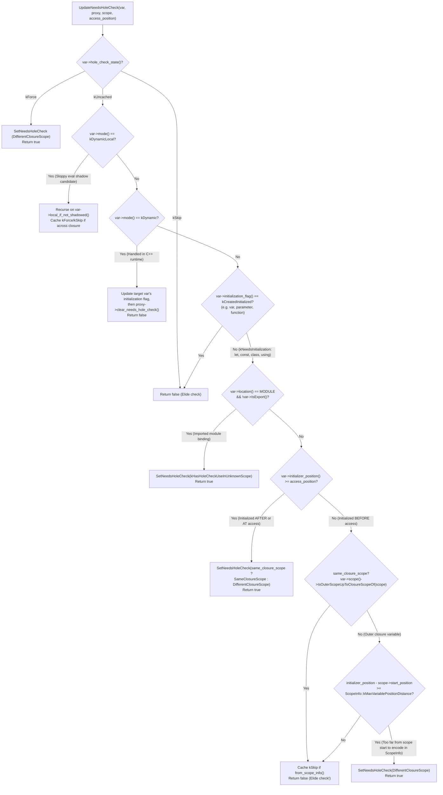

# Stage 1: Parser & Scope Hole Check Elimination

## Conceptual Overview

The cheapest TDZ hole check is one that is never emitted into the AST or bytecode in the first place. Furthermore, if V8 can prove during scope resolution that **no reference** to a lexical variable `let x = 1` can ever execute before `x`'s initializer, V8 does not even need to pre-initialize `x`'s stack register or context slot with `tdz_hole_value` (`LdaTdzHole`) at block entry!

Stage 1 of V8's hole check elision pipeline runs during **Scope Resolution (`Scope::ResolveVariable` -> `Scope::ResolveTo` -> `UpdateNeedsHoleCheck`)** in `src/ast/scopes.cc`. By comparing the source character position of a variable's declaration (`var->initializer_position()`) against the source position of each identifier reference (`access_position`), the parser statically eliminates the vast majority of TDZ checks.

---

## 1. Why Source Position Comparison Is Subtle

At first glance, it might seem sufficient to check `var->initializer_position() < proxy->position()`. Consider why that naive rule fails in two classic cases:

### Case A: Inner Closures Called Before Declaration
```javascript
{
  function readX() {
    return x; // proxy->position() is BEFORE `let x = 10`, OR what if readX() is declared AFTER `let x = 10`?
  }
  readX();    // Throws ReferenceError!
  let x = 10;
}
```
What if `readX()` is defined **after** `let x = 10`, so `proxy->position() > var->initializer_position()`, yet `readX()` is hoisted and called **before** `let x = 10`?
```javascript
{
  readX();    // Called at position 10 (BEFORE let x = 10 at position 25!)
  let x = 10; // Position 25
  function readX() {
    return x; // proxy->position() is 55 (AFTER position 25!), yet x is still in TDZ!
  }
}
```
Because `function readX()` is hoisted to the top of the block/function scope, an access inside an inner closure (`!same_closure_scope`) cannot simply compare `var->initializer_position()` against `proxy->position()` inside `readX`!

### Case B: Loops and Backward Jumps Within the Same Closure
```javascript
for (let i = 0; i < 2; i++) {
  if (i === 1) console.log(x); // Position 45 (BEFORE `let x = 10` at position 60)
  let x = 10;                  // Fresh lexical binding per iteration (or inside a switch/label loop)!
}
```

How does V8's `Scope::Lookup` and `UpdateNeedsHoleCheck` handle both cases soundly?

---

## 2. How `access_position` Is Adjusted Across Closure Boundaries (`src/ast/scopes.cc`)

When `Scope::ResolveVariable(VariableProxy* proxy)` starts looking up `proxy` from the inner scope outward (`Scope::Lookup`), it initializes:
```cpp
int access_position = proxy->position();
```
As `Scope::Lookup` walks outward from one scope `s` to `s->outer_scope_`, whenever it crosses a **closure boundary** (a `FUNCTION_SCOPE` or `DeclarationScope` where inner code could be invoked out-of-order relative to outer statements), `Lookup` updates `access_position` (`src/ast/scopes.cc`):
- If crossing out of a function scope that could be hoisted or invoked early, `access_position` is clamped to the **enclosing scope's `start_position()`** (or the outer function's earliest invocation point)!
- Consequently, by the time `Lookup` finds `var` in an outer scope, `access_position` represents the **earliest possible source position in `var->scope()`'s closure** at which the reference could execute!

---

## 3. Exact Decision Logic in `UpdateNeedsHoleCheck` (`src/ast/scopes.cc`)

Once `Scope::Lookup` finds `Variable* var`, `Scope::ResolveTo` calls `UpdateNeedsHoleCheck(var, proxy, this, access_position)` (`src/ast/scopes.cc` lines 2441-2543):



### Key Rules and Edge Cases in `UpdateNeedsHoleCheck`

1. **`kCreatedInitialized` Variables (`var`, simple parameters, hoisted `function`)**:
   - Have `var->initialization_flag() == kCreatedInitialized` (initialized to `undefined` or the function closure upon entering the scope). They never need a TDZ hole check (`return false`).
2. **Module Imports (`var->location() == VariableLocation::MODULE && !var->IsExport()`)**:
   - Even if an `import { foo } from './b.js'` declaration appears at line 1 of a module, circular ES module dependencies mean `./b.js` might not have initialized `foo` yet when this module executes! Because the exporting module's state is unknown at compile time, non-export `MODULE` bindings **always** require a hole check (`kHasHoleCheckUseInUnknownScope`).
3. **Sloppy `eval` Shadowing (`VariableMode::kDynamicLocal` and `VariableMode::kDynamic`)**:
   - When a scope contains a direct sloppy `eval()`, an outer lexical variable `let x` may be wrapped in a `kDynamicLocal` or `kDynamic` variable (in case `eval("var x = 1")` dynamically introduces a shadowing `var`).
   - For `kDynamicLocal`: `UpdateNeedsHoleCheck` recursively checks `var->local_if_not_shadowed()` so the fallback fast path (when `eval` did *not* shadow `x`) knows whether to check for `tdz_hole`.
   - For `kDynamic`: the lookup itself goes through the C++ runtime (`Runtime_LoadLookupSlot`), which performs its own TDZ check in C++; However, `UpdateNeedsHoleCheck` still recurses on `local_if_not_shadowed()` first so the underlying `Variable` is marked as needing `tdz_hole` initialization (`ForceHoleInitialization`), and then calls `proxy->clear_needs_hole_check(var)` so `BytecodeGenerator` does not emit a redundant second check!
4. **Same-Closure vs Cross-Closure Position Distance (`ScopeInfo::kMaxVariablePositionDistance`)**:
   - Within the **same closure** (`var->scope()->IsOuterScopeUpToClosureScopeOf(scope)`), full AST `Variable` objects have exact 32-bit `initializer_position()` values. If `var->initializer_position() < access_position`, the initializer is guaranteed to have executed before the access (because no statement before `initializer_position()` can jump forward over `let x = ...` into the same block without entering the block from the top), so the hole check is **elided**!
   - Across **different closures** (`!same_closure_scope`), what if the outer function was already compiled and its AST freed, so a lazily compiled inner function only has the outer function's serialized **`ScopeInfo`**?
   - `ScopeInfo` does not waste space storing a full 32-bit `initializer_position` for every context local; instead, it packs a small boolean/distance flag indicating whether `var->initializer_position() - var->scope()->start_position() < ScopeInfo::kMaxVariablePositionDistance`. To ensure eager and lazy compilation make identical hole-check decisions, any cross-closure variable whose initializer is at or beyond `kMaxVariablePositionDistance` from its scope's start forces a hole check (`SetNeedsHoleCheck`).

---

## 4. Eliding `LdaTdzHole` Initialization (`ForceHoleInitializationFlag`)

Initializing a variable slot with `tdz_hole_value` at scope entry costs bytecode size and execution time (`LdaTdzHole` + `Star rX` or `StaContextSlot`).
- A `Variable` starts with `hole_initialization_flag_ == Variable::kHoleInitializationNotForced`.
- Whenever `UpdateNeedsHoleCheck` decides that a `VariableProxy` **does** need a hole check, `SetNeedsHoleCheck` calls `var->ForceHoleInitialization(flag)` with one of:
  - `kHasHoleCheckUseInSameClosureScope`
  - `kHasHoleCheckUseInDifferentClosureScope`
  - `kHasHoleCheckUseInUnknownScope`
- If **every** reference to `let x` in the program had its hole check elided by `UpdateNeedsHoleCheck` (and no inner lazy function can observe `x` before initialization), `var->binding_needs_init()` remains **`false`**!
- When `BytecodeGenerator` enters the block, it skips emitting `LdaTdzHole` for `x` altogether -- `x`'s register is simply written once when its `let x = expr` declaration executes!

---

## Key Source Files

- `src/ast/scopes.cc`: `Scope::ResolveVariable`, `Scope::Lookup`, `Scope::ResolveTo`, `UpdateNeedsHoleCheck`, and `SetNeedsHoleCheck`.
- `src/ast/variables.h`: `Variable::HoleCheckState` (`kUncached`, `kSkip`, `kForce`) and `Variable::ForceHoleInitializationFlag`.
- `src/objects/scope-info.h`: `ScopeInfo::kMaxVariablePositionDistance`.
