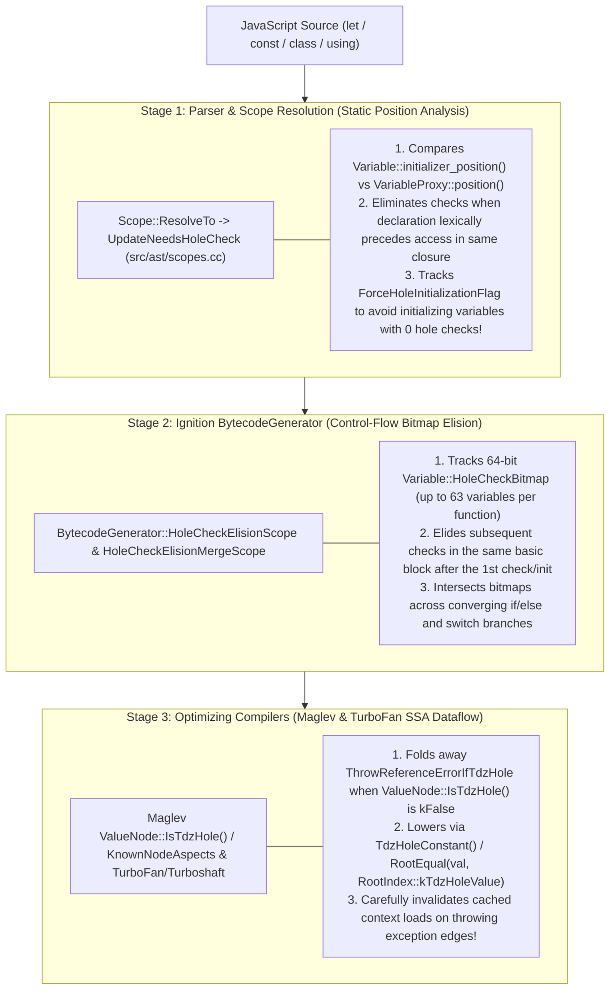

# Temporal Dead Zone (TDZ) Hole Check Elision Pipeline

## Conceptual Overview

In ECMAScript (`let`, `const`, `class`, and `using` declarations, as well as derived class `this` bindings before `super()`), a variable exists in its lexical scope from the very start of the block, but cannot be read or written until its declaration statement has been evaluated. The region between entering the scope and evaluating the initializer is called the **Temporal Dead Zone (TDZ)**:

```javascript
{
  console.log(x); // Must throw ReferenceError: Cannot access 'x' before initialization
  let x = 42;
  console.log(x); // Valid: evaluates to 42
}
```

At runtime, V8 represents an uninitialized lexical variable (or unallocated derived constructor `this` receiver) by initializing its storage slot (bytecode register, `Context` slot, `ContextCell`, or `ScriptContextTable` slot) with a dedicated internal sentinel: **`tdz_hole_value`** (`TdzHole` in `ReadOnlyRoots`; see [Holes and Sentinels](../objects/holes-and-sentinels.md)).

Whenever code reads a variable that might still be in its TDZ (or assigns to a variable before initialization), V8 emits a **TDZ Hole Check**:
- In **Ignition bytecode**: `ThrowReferenceErrorIfTdzHole` (or `ThrowSuperNotCalledIfTdzHole` / `ThrowSuperAlreadyCalledIfNotTdzHole` for derived `this`).
- In **Maglev**: `ThrowReferenceErrorIfTdzHole`, `ThrowSuperNotCalledIfTdzHole`, or `ThrowSuperAlreadyCalledIfNotTdzHole` (elided via `ValueNode::IsTdzHole()` / `IsHole(RootIndex::kTdzHoleValue)`).
- In **TurboFan / Turboshaft**: `ReferenceEqual(val, TdzHoleConstant())` + `BuildHoleCheckAndThrow` in TurboFan, and `RootEqual(val, RootIndex::kTdzHoleValue)` in Turboshaft.

Because lexical variables (`let` and `const`) are used everywhere in modern JavaScript, checking for `tdz_hole` on every single variable read and write would add substantial overhead. Therefore, V8 implements a **three-stage Hole Check Elision Pipeline** that eliminates redundant TDZ initialization and checks across the **Parser**, **BytecodeGenerator**, and **Optimizing Compilers (Maglev & TurboFan)**.

---

## The Three-Stage Elision Pipeline



---

## Detailed Stage Documentation

Each stage of the pipeline has its own invariants, data structures, and subtle edge cases:

1. **[Stage 1: Parser & Scope Analysis (`hole-check-elimination-parser.md`)](hole-check-elimination-parser.md)**
   - How `UpdateNeedsHoleCheck` (`src/ast/scopes.cc`) uses `initializer_position()` vs `access_position` across closure boundaries.
   - How `ScopeInfo::kMaxVariablePositionDistance` enables cross-closure hole check elimination even for lazily compiled inner functions.
   - How `Variable::ForceHoleInitializationFlag` avoids emitting `LdaTdzHole` initializations altogether when no access requires a hole check.
2. **[Stage 2: Ignition Bytecode Generation (`hole-checks-bytecode.md`)](hole-checks-bytecode.md)**
   - How `BytecodeGenerator` uses a 64-bit `Variable::HoleCheckBitmap` (`hole_check_bitmap_`) to track up to 63 variables (`1..63`, with bit `0` reserved for uncacheable variables).
   - How `HoleCheckElisionScope` saves/restores the bitmap across non-merging branches (`if` without `else`, loops, `try`/`catch`) and how `HoleCheckElisionMergeScope` intersects bitmaps (`merge_value_ &= *bitmap_`) across converging branches (`if`/`else`, `?:`, `switch`).
3. **[Stage 3: Optimizing Compilers: Maglev & TurboFan (`hole-checks-optimized.md`)](hole-checks-optimized.md)**
   - How Maglev (`VisitThrowReferenceErrorIfTdzHole`, `ValueNode::IsTdzHole()`, `KnownNodeAspects`) and TurboFan / Turboshaft (`BytecodeGraphBuilder`, `TurbolevGraphBuilder`) eliminate redundant checks across basic blocks and loops.
   - The **"Inverted Generator" / `try-catch` Context Load Caching bug and fix**: why caching an uninitialized `LoadContextSlotNoCells` (`kNotAssigned`) before `ThrowReferenceErrorIfTdzHole` can poison a `catch` block's `KnownNodeAspects` unless temporarily cleared across the throwing edge.
4. **[Holes and Sentinels Reference (`../objects/holes-and-sentinels.md`)](../objects/holes-and-sentinels.md)**
   - Why `tdz_hole_value` (`TdzHole`) is segregated from array `the_hole_value` (`TheHole`), how `--unmap-holes` guards hole objects in memory, and how two-phase literal initialization works.
