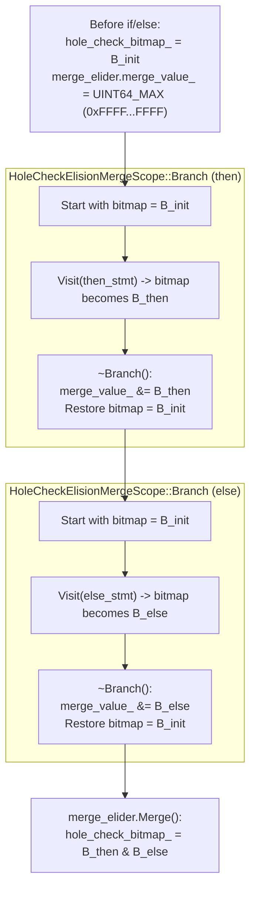

# Stage 2: Hole Checks and Bitmap Elision in `BytecodeGenerator`

## Conceptual Overview

Even after Stage 1 (the Parser's static position analysis) eliminates hole checks for references that lexically follow a variable's declaration in the same closure, many references still have `proxy->needs_hole_check() == true` -- for example, when an inner function accesses an outer `let` variable, or when code precedes the declaration inside a conditional branch.

Consider what happens if an inner function reads an outer `let x` variable three times in a single expression:

```javascript
function compute() {
  return x + x * x; // `x` is declared after `compute` in the outer scope
}
let x = 10;
```

Once the first load of `x` in `return x + x * x` executes `ThrowReferenceErrorIfTdzHole` without throwing, `x` is **guaranteed not to be `tdz_hole_value`** for the remainder of that execution path (because a variable can transition from `tdz_hole -> initialized`, never from `initialized -> tdz_hole`). Emitting three separate `ThrowReferenceErrorIfTdzHole` bytecodes in a row would waste bytecode size and dispatch cycles.

Stage 2 of V8's pipeline eliminates redundant TDZ checks during **Ignition Bytecode Generation** (`src/interpreter/bytecode-generator.cc`) using a 64-bit control-flow bitmap (`Variable::HoleCheckBitmap`) managed by `HoleCheckElisionScope` and `HoleCheckElisionMergeScope`.

---

## 1. TDZ Bytecodes in Ignition (`src/interpreter/bytecodes.h`)

Ignition uses dedicated bytecodes that operate on **`tdz_hole_value`** (`RootIndex::kTdzHoleValue`):

| Bytecode | Behavior |
| :--- | :--- |
| **`LdaTdzHole`** | Loads `ReadOnlyRoots::tdz_hole_value()` into the accumulator (used at scope entry to initialize lexical variables where `var->binding_needs_init()` is true, and to initialize derived constructor `this` before `super()`). |
| **`ThrowReferenceErrorIfTdzHole <name_index>`** | Inspects the value in the accumulator. If `accumulator == tdz_hole_value`, calls `Runtime_ThrowAccessedUninitializedVariable` with the constant pool string at `<name_index>`; otherwise acts as a no-op. |
| **`ThrowSuperNotCalledIfTdzHole`** | Inspects the accumulator (`this`). If `accumulator == tdz_hole_value`, throws a `ReferenceError` (`Must call super constructor in derived class before accessing 'this' or returning from derived constructor`). |
| **`ThrowSuperAlreadyCalledIfNotTdzHole`** | Inspects the accumulator (`this`) during a `super()` call. If `accumulator != tdz_hole_value`, throws a `ReferenceError` (`Super constructor may only be called once`). |

---

## 2. The 64-Bit `Variable::HoleCheckBitmap` (`src/ast/variables.h`)

To track which variables have already been checked for `tdz_hole` along the current control-flow path with $O(1)$ bitwise operations and zero heap/Zone allocations during branching, `BytecodeGenerator` maintains a single `uint64_t` member variable:

```cpp
// In src/ast/variables.h:
using HoleCheckBitmap = uint64_t;
static constexpr uint8_t kUncacheableHoleCheckBitmapIndex = 0;
static constexpr uint8_t kHoleCheckBitmapBits = sizeof(HoleCheckBitmap) * CHAR_BIT; // 64
```

### Why the Bitmap Tracks Up to 63 Variables (`1..63`)
- Every `Variable` starts with `hole_check_bitmap_index_ = kUncacheableHoleCheckBitmapIndex` (`0`).
- The first time `BytecodeGenerator::BuildThrowIfHole(Variable* variable)` emits a `ThrowReferenceErrorIfTdzHole` for a `variable`, `RememberHoleCheckInCurrentBlock(variable)` assigns it the next sequential bit index from `vars_with_hole_check_bitmap_`:
  - **Bit `0` (`kUncacheableHoleCheckBitmapIndex`) is reserved** as the sentinel meaning "not assigned a bitmap slot".
  - **Bits `1` through `63`** track up to **63 distinct TDZ-checked variables** per compiled function!
  - Setting bit `i` (`hole_check_bitmap_ |= (1ULL << i)`) records that variable `i` is proven initialized along the current execution path.
  - Before emitting a hole check for `variable`, `BuildVariableLoad` / `BuildVariableAssignment` checks `VariableNeedsHoleCheckInCurrentBlock(variable, proxy)`. If `(hole_check_bitmap_ & (1ULL << index)) != 0`, the `ThrowReferenceErrorIfTdzHole` instruction is **elided**!
  - If a single function contains more than 63 distinct TDZ-checked variables, the 64th+ variables keep `index == 0` (`kUncacheableHoleCheckBitmapIndex`) and conservatively emit hole checks without bitmap elision.

---

## 3. Control-Flow Scopes: `HoleCheckElisionScope` vs `HoleCheckElisionMergeScope`

A variable checked inside a conditional branch (`if (cond) { use(x); }`) is **not** guaranteed to have been checked after the `if` statement finishes if `cond` was false! `BytecodeGenerator` models control flow using two RAII C++ helper classes (`src/interpreter/bytecode-generator.cc` lines 454-543):

### 1. Non-Merging / Speculative Control Flow (`HoleCheckElisionScope`)
Used for control constructs where checks inside the nested block do **not** guarantee execution on the outer fallthrough path (e.g., an `if` statement **without** an `else` branch, short-circuit `&&` / `||` / `??` RHS expressions, loop bodies, `try`/`catch` blocks):

```cpp
class V8_NODISCARD BytecodeGenerator::HoleCheckElisionScope {
 public:
  explicit HoleCheckElisionScope(BytecodeGenerator* bytecode_generator)
      : HoleCheckElisionScope(&bytecode_generator->hole_check_bitmap_) {}
  ~HoleCheckElisionScope() { *bitmap_ = prev_bitmap_value_; }
};
```

- **Entry**: Saves a copy of the outer `hole_check_bitmap_` in `prev_bitmap_value_`. Inside the block, it inherits all bits already set before the block, and any new hole checks emitted inside the block elide subsequent checks *within that same block*.
- **Exit (`~HoleCheckElisionScope`)**: Restores `hole_check_bitmap_ = prev_bitmap_value_`, discarding any bits added inside the conditional block!

### 2. Branch Intersection (`HoleCheckElisionMergeScope`)
What if control flow splits into multiple mutually exclusive branches that **all converge** at a join point (such as `if (cond) { ... } else { ... }`, ternary `cond ? a : b`, or exhaustive `switch` statements) and **every** branch checked `x`?

```javascript
if (cond) {
  console.log(x); // Checks `x` (sets bit for `x` in then-branch)
} else {
  alert(x);       // Checks `x` (sets bit for `x` in else-branch)
}
return x;         // <-- Can elide hole check here because BOTH branches checked `x`!
```

`BytecodeGenerator::HoleCheckElisionMergeScope` (`src/interpreter/bytecode-generator.cc` lines 495-543) computes the **bitwise AND intersection** across all branches:



- **`HoleCheckElisionMergeScope`**: Initializes an accumulator `merge_value_ = UINT64_MAX` (all 1s).
- **`HoleCheckElisionMergeScope::Branch`**: Inherits from `HoleCheckElisionScope`. Each branch starts with the pre-branch `*bitmap_`. When the `Branch` destructor runs at the end of the branch, it intersects the branch's final bitmap into `merge_value_` (`*merge_into_bitmap_ &= *bitmap_`) before restoring `*bitmap_` to the pre-branch state for the next sibling branch.
- **`merge_elider.Merge()`**: After all branches have been visited, overwrites `hole_check_bitmap_ = merge_value_` (`B_branch1 & B_branch2 & ...`). Any variable checked in **every** branch remains `1` in `hole_check_bitmap_` after the merge!

---

## Key Source Files

- `src/ast/variables.h`: `Variable::HoleCheckBitmap`, `kUncacheableHoleCheckBitmapIndex`, `kHoleCheckBitmapBits`, and `AssignHoleCheckBitmapIndex`.
- `src/interpreter/bytecode-generator.h` & `src/interpreter/bytecode-generator.cc`: `HoleCheckElisionScope`, `HoleCheckElisionMergeScope`, `BuildThrowIfHole`, `VariableNeedsHoleCheckInCurrentBlock`, and `RememberHoleCheckInCurrentBlock`.
- `src/interpreter/bytecodes.h` & `src/interpreter/interpreter-generator.cc`: `LdaTdzHole`, `ThrowReferenceErrorIfTdzHole`, `ThrowSuperNotCalledIfTdzHole`, and `ThrowSuperAlreadyCalledIfNotTdzHole`.
