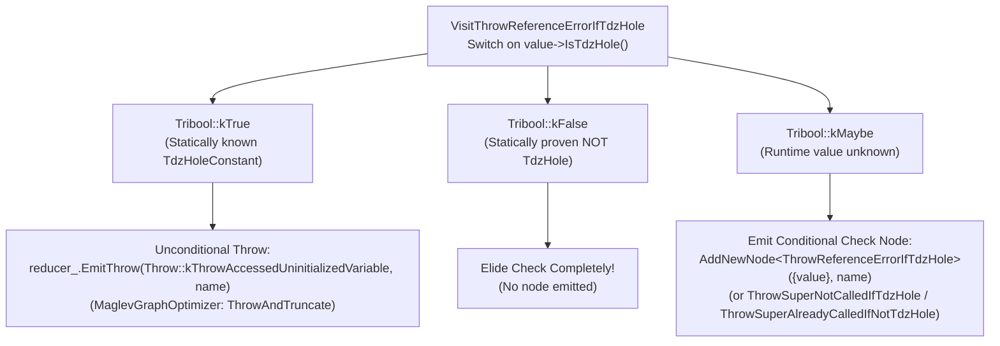
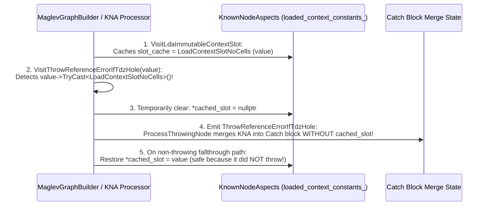

# Stage 3: Hole Check Elision in Optimizing Compilers (Maglev, TurboFan, & Turboshaft)

## Conceptual Overview

When a function becomes warm and tiers up to **Maglev** or **TurboFan / Turboshaft**, the optimizing compiler translates Ignition bytecode into a Static Single Assignment (SSA) control-flow graph. Even though Stage 1 (`Parser`) and Stage 2 (`BytecodeGenerator`) already eliminated many TDZ checks, bytecode-level elision is intentionally local:
- `BytecodeGenerator` resets its `HoleCheckBitmap` across loop headers, non-merging `if` branches, and function boundaries (before inlining).
- In an SSA graph with function inlining, global value numbering (GVN), and path-sensitive type/aspect tracking (`KnownNodeAspects` in Maglev, `ValueNode::IsTdzHole()`, and Turboshaft reducers), the optimizing compiler can prove across basic blocks and inlined calls whether a value is guaranteed to be `tdz_hole_value` (`RootIndex::kTdzHoleValue`) or guaranteed not to be `tdz_hole_value`.

---

## 1. Maglev TDZ Hole Check Elision (`src/maglev/maglev-graph-builder.cc` & `maglev-graph-optimizer.cc`)

When `MaglevGraphBuilder` encounters `ThrowReferenceErrorIfTdzHole`, `ThrowSuperNotCalledIfTdzHole`, or `ThrowSuperAlreadyCalledIfNotTdzHole` in bytecode (and later during `MaglevGraphOptimizer`), Maglev queries **`value->IsTdzHole()`** (`ValueNode::IsHole(RootIndex::kTdzHoleValue)` in `src/maglev/maglev-ir.h`), which returns a 3-state `Tribool`:



### 1. `Tribool::kTrue` (Guaranteed TDZ Violation)
If `value->IsTdzHole()` returns `Tribool::kTrue` (for example, `value` is `RootConstant(RootIndex::kTdzHoleValue)` after constant-propagating an uninitialized register or context slot), Maglev replaces the conditional check with an unconditional throw:
- In `MaglevGraphBuilder::VisitThrowReferenceErrorIfTdzHole`: calls `reducer_.EmitThrow(Throw::kThrowAccessedUninitializedVariable, GetConstant(name))` and terminates the current basic block.
- In `MaglevGraphOptimizer::VisitThrowReferenceErrorIfTdzHole`: calls `ThrowAndTruncate(Throw::kThrowAccessedUninitializedVariable, node->name())`.

### 2. `Tribool::kFalse` (Guaranteed Non-Hole -> Complete Elision)
If `value->IsTdzHole()` returns `Tribool::kFalse` (because `value`'s opcode or `NodeType` in `KnownNodeAspects` cannot produce `RootIndex::kTdzHoleValue`, such as a `SmiConstant`, `Float64Constant`, arithmetic node, newly allocated object, or already-checked value), the TDZ check is **completely elided** (`return ReduceResult::Done()`).

### 3. `Tribool::kMaybe` (Runtime Check Required)
When `value` might be `tdz_hole_value` at runtime, `MaglevGraphBuilder` emits the corresponding Maglev IR node:
- **`ThrowReferenceErrorIfTdzHole`** (`AddNewNode<ThrowReferenceErrorIfTdzHole>({value}, name)`) for lexical variables (`let`, `const`, `class`, `using`).
- **`ThrowSuperNotCalledIfTdzHole`** for derived class `this` accesses before `super()`.
- **`ThrowSuperAlreadyCalledIfNotTdzHole`** before initializing `this` in a `super()` call.

---

## 2. Sharp Edge: The "Inverted Generator" & `try`/`catch` Context Load Caching

One of the subtlest compiler bugs in TDZ hole check elimination arises from the interaction between **Immutable Context Slot Load Caching** (`loaded_context_constants_` in Maglev's `KnownNodeAspects`) and **Exception Handler Control-Flow Merges (`try`/`catch`)** when a generator yields while a `const` variable is still in its TDZ (the **"Inverted Generator"** pattern).

### The Inverted Generator Pattern
Consider an outer generator `gen()` that declares a `const x` (which has `MaybeAssignedFlag::kNotAssigned` in `ScopeInfo` because `const x` is only ever initialized once) and `yield`s **inside `x`'s initializer** before `x` is initialized:

```javascript
function* makeGen() {
  function readX(stepGenerator) {
    try {
      // 1. Because `x` is `const` (kNotAssigned), BytecodeGenerator emits:
      //    LdaImmutableContextSlot <x>
      //    ThrowReferenceErrorIfTdzHole <"x">
      return x;
    } catch (e) {
      // 2. Caught ReferenceError because `x` is still `tdz_hole_value`!
      //    Now resume the outer generator so `const x = 42` finishes initializing:
      stepGenerator();
      // 3. Read `x` again inside the catch block:
      //    LdaImmutableContextSlot <x>
      //    ThrowReferenceErrorIfTdzHole <"x">
      return x; // <-- MUST return 42, NOT reuse the cached tdz_hole from step 1!
    }
  }
  const x = (yield readX, 42);
}
```

Why is `LdaImmutableContextSlot` dangerous here?
1. Because `const x` has `kNotAssigned` in `ScopeInfo`, `BytecodeGenerator` emits **`LdaImmutableContextSlot`** (translated by Maglev to `LoadContextSlotNoCells` with `kNotAssigned`).
2. When Maglev visits `LdaImmutableContextSlot` at step 1 inside the `try` block, it caches the loaded SSA `ValueNode*` in **`known_node_aspects_->loaded_context_constants_[(context, offset)] = value`**, reasoning that an "immutable" (`kNotAssigned`) context slot can never change once loaded!
3. However, at step 1, `makeGen` yielded **before** `const x` finished initializing! Thus, at runtime, `value` loaded at step 1 is **`tdz_hole_value`**.
4. Next, Maglev visits `ThrowReferenceErrorIfTdzHole(value)`:
   - Because `ThrowReferenceErrorIfTdzHole` is a throwing node inside a `try` block, Maglev merges the current basic block's `KnownNodeAspects` into the enclosing **`catch` block's state**.
   - If `loaded_context_constants_[(context, offset)] = value` remained in `KnownNodeAspects` across the throwing edge into the `catch` block:
     - Inside the `catch` block (step 2), `stepGenerator()` resumes the generator and initializes `const x = 42` in the context!
     - Yet at step 3, when the `catch` block executes `LdaImmutableContextSlot <x>`, Maglev would see `(context, offset)` still cached in `loaded_context_constants_` from step 1 and **reuse the stale `value` (`tdz_hole_value`) instead of reloading `42` from the context**!

### The Exact Fix in Maglev (`VisitThrowReferenceErrorIfTdzHole` & `ProcessThrowingNode`)

Maglev prevents this poison merge in both `MaglevGraphBuilder::VisitThrowReferenceErrorIfTdzHole` (`src/maglev/maglev-graph-builder.cc` lines 15750-15778) and `KnownNodeAspectsProcessor::ProcessThrowingNode` (`src/maglev/maglev-kna-processor.h` lines 182-206):



1. **In `MaglevGraphBuilder::VisitThrowReferenceErrorIfTdzHole`** (and in **`RecomputeKnownNodeAspectsProcessor::ProcessThrowingNode`** for `node->TryCast<ThrowReferenceErrorIfTdzHole>()` during graph optimization passes):
   - Before emitting `AddNewNode<ThrowReferenceErrorIfTdzHole>({value}, name)` (or before `Merge(exception_handler)` in `ProcessThrowingNode`), Maglev checks whether `value` is a `LoadContextSlotNoCells` with `load->maybe_assigned() == kNotAssigned` whose `known_node_aspects().GetContextCachedValue(load->input(0).node(), load->offset(), kNotAssigned)` slot currently equals `value`.
2. **Clear Before Exception Merge**:
   - If matched, Maglev saves `cached_load = load` and temporarily clears the slot to `nullptr` (`slot = nullptr`).
   - Consequently, the `catch` block's merged `KnownNodeAspects` does **not** inherit the pre-throw `LoadContextSlotNoCells` cache entry; any `LdaImmutableContextSlot` in the `catch` block will emit a fresh load!
3. **Restore on Non-Throwing Fallthrough**:
   - Immediately after `AddNewNode<ThrowReferenceErrorIfTdzHole>` (and after `Merge(exception_handler)` in `ProcessThrowingNode`), if `cached_load` is non-null, Maglev restores `known_node_aspects().GetContextCachedValue(cached_load->input(0).node(), cached_load->offset(), kNotAssigned) = cached_load` on the normal fallthrough path -- because reaching the fallthrough path proves that `ThrowReferenceErrorIfTdzHole` did **not** throw, meaning `x` was already initialized and truly is immutable from that point onward!

---

## 3. TurboFan and Turboshaft Hole Check Lowering and Elision

When code tiers up to TurboFan / Turboshaft:
1. **TurboFan Bytecode Graph Builder (`src/compiler/bytecode-graph-builder.cc`)**:
   - In `BytecodeGraphBuilder::VisitThrowReferenceErrorIfTdzHole`, TurboFan compares the accumulator against `TdzHole` via **`javascript()->ReferenceEqual()`** with **`jsgraph()->TdzHoleConstant()`**, and passes that check to **`BuildHoleCheckAndThrow(check, Runtime::kThrowAccessedUninitializedVariable, name)`** (which builds a diamond branch that calls the runtime throw function on the slow path if `ReferenceEqual` is true).
   - Similarly, `VisitThrowSuperNotCalledIfTdzHole` and `VisitThrowSuperAlreadyCalledIfNotTdzHole` compare against `jsgraph()->TdzHoleConstant()` and conditionally call `Runtime::kThrowSuperNotCalled` or `Runtime::kThrowSuperAlreadyCalledError`.
   - During subsequent sea-of-nodes passes (`TypedOptimization`, `SimplifiedLowering`), `ReferenceEqual(x, TdzHoleConstant)` folds to `false` whenever `x`'s static `Type` excludes `Type::Hole()`.
2. **Turboshaft / Turbolev Lowering (`src/compiler/turboshaft/turbolev-graph-builder.cc`)**:
   - When lowering Maglev IR to Turboshaft in `TurbolevGraphBuilder::Process(maglev::ThrowReferenceErrorIfTdzHole* node)`, Turboshaft emits:
     ```cpp
     IF (UNLIKELY(__ RootEqual(node->ValueInput(), RootIndex::kTdzHoleValue))) {
       __ CallRuntime<runtime::ThrowAccessedUninitializedVariable>(...);
       __ Unreachable();
     }
     ```
   - Turboshaft's `MachineOptimizationReducer` and `BranchEliminationReducer` eliminate redundant `RootEqual(..., RootIndex::kTdzHoleValue)` checks along dominated paths.

---

## Key Source Files

- `src/maglev/maglev-ir.h`: `ValueNode::IsTdzHole()` (`IsHole(RootIndex::kTdzHoleValue)`), `ThrowReferenceErrorIfTdzHole`, `ThrowSuperNotCalledIfTdzHole`, and `ThrowSuperAlreadyCalledIfNotTdzHole`.
- `src/maglev/maglev-graph-builder.cc`: `MaglevGraphBuilder::VisitThrowReferenceErrorIfTdzHole`, `VisitThrowSuperNotCalledIfTdzHole`, and `VisitThrowSuperAlreadyCalledIfNotTdzHole`.
- `src/maglev/maglev-graph-optimizer.cc`: `MaglevGraphOptimizer::VisitThrowReferenceErrorIfTdzHole` (`ThrowAndTruncate`).
- `src/maglev/maglev-kna-processor.h`: `KnownNodeAspectsProcessor::ProcessThrowingNode` exception-merge invalidation for `ThrowReferenceErrorIfTdzHole`.
- `src/compiler/bytecode-graph-builder.cc`: `BytecodeGraphBuilder::VisitThrowReferenceErrorIfTdzHole` (`TdzHoleConstant` + `BuildHoleCheckAndThrow`).
- `src/compiler/turboshaft/turbolev-graph-builder.cc`: Turboshaft lowering of `ThrowReferenceErrorIfTdzHole` (`RootEqual(..., RootIndex::kTdzHoleValue)`).
