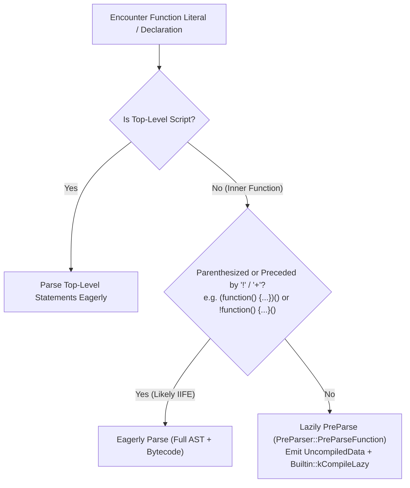

# Lazy Parsing, `PreParser`, and `PreparseData`

## Conceptual Overview

Most web applications load megabytes of JavaScript bundle code during page startup, yet a large fraction of the functions in those bundles (error handlers, modal dialogs, unvisited UI routes, library utilities) are **never called during initial page load**.

If V8 eagerly parsed every function into a full Abstract Syntax Tree (AST), performed full scope analysis, and compiled Ignition `BytecodeArray`s for the entire file upfront, startup latency and memory usage would skyrocket.

Instead, V8 uses **Lazy Parsing (Syntax-Only PreParsing)**:
1. When parsing an outer script or function, V8 decides via heuristics whether each inner function is likely to be called immediately (such as an IIFE `(function() { ... })()`) or only later.
2. For functions that are not needed immediately, V8 switches from the full `Parser` to the **`PreParser`** (`SkipFunction`).
3. The `PreParser` scans the function body at high speed without allocating AST nodes: it checks for **early syntax errors** (required by the ECMAScript spec before any code in the script runs) and records **which outer variables are referenced by the skipped function**.
4. It saves these variable-capture decisions into a compact **`PreparseData`** (`ProducedPreparseData`) attached to the function's `UncompiledDataWithPreparseData`, and configures the function's `SharedFunctionInfo` to run **`Builtin::kCompileLazy`** when first called.

---

## 1. Eager vs Lazy Heuristics (`MustEagerlyCompile`)

How does the parser decide whether to parse a function eagerly with `Parser` or lazily with `PreParser` (`src/parsing/parser.cc`)?



- **Parenthesized Hints (PIFE / IIFE)**: JavaScript bundlers and minifiers wrap functions that will execute immediately in parentheses (`(function() { ... })()`) or unary operators (`!function() { ... }()`). When `ParserBase` sees an opening `(` or unary operator immediately preceding `function`, it sets `eager_compile_hint = FunctionLiteral::kShouldEagerCompile` and parses the function eagerly in a single pass rather than PreParsing and then immediately re-parsing on the next line.
- **Standard Function Declarations and Methods**: Normal `function foo() {}` declarations, class methods, and unparenthesized callbacks default to `FunctionLiteral::kShouldLazyCompile` and are handed to `PreParser`.

---

## 2. How `Parser` and `PreParser` Share One Grammar (`ParserBase<Impl>`)

Maintaining two separate recursive-descent parsers for ECMAScript would inevitably lead to grammar drift and subtle syntax bugs. V8 solves this using `template <typename Impl> class ParserBase` (`src/parsing/parser-base.h`), parameterized by a traits struct `ParserTypes<Impl>`:

| Concept | `ParserTypes<Parser>` (`src/parsing/parser.h`) | `ParserTypes<PreParser>` (`src/parsing/preparser.h`) |
| :--- | :--- | :--- |
| **`Expression`** | `Expression*` (Heap/Zone pointer to `AstNode`) | **`PreParserExpression`** (32-bit stack-allocated bitfield value!) |
| **`Statement`** | `Statement*` (Zone pointer to `AstNode`) | **`PreParserStatement`** (Lightweight enum: `kDefault`, `kNull`, `kJump`, `kStringLiteral`) |
| **`Identifier`** | `const AstRawString*` | **`PreParserIdentifier`** (Enum tracking special names like `eval`, `arguments`, `await`, `yield`, `constructor`, `prototype`, plus `AstRawString*` when tracking variables) |
| **`ExpressionList`** | `ScopedPtrList<Expression>` | **`PreParserExpressionList`** (Stores only an integer `length_`!) |
| **`Factory`** | `AstNodeFactory` (Allocates `AstNode`s in `Zone`) | **`PreParserFactory`** (No-op factory returning dummy `PreParserExpression::Default()`) |

### Inside `PreParserExpression` (`src/parsing/preparser.h`)
Because `PreParser` never allocates AST nodes, `PreParserExpression` is a single `uint32_t` value (`base::BitField`) returned in a CPU register! Its bits encode just enough semantic classification for `ParserBase` to enforce all ECMAScript early error rules:
- `TypeField`: `kEmpty`, `kExpression`, `kIdentifier`, `kStringLiteral`, `kThisExpression`, `kThisPropertyExpression`, `kPropertyExpression`, `kCallExpression`, `kSpreadExpression`, `kPrivateNameExpression`.
- Flags for assignment targets (`IsValidReferenceExpression`), `CoverInitializedName` validation, and async/arrow parameter restrictions.

---

## 3. Why `PreparseData` Is Needed: The Outer Variable Capture Problem

Why can't `PreParser` simply count curly braces `{ ... }` and check syntax without building `Scope`s or tracking identifiers?

Consider this function `outer()`:

```javascript
function outer() {
  let x = 10;          // Can `x` live in a fast stack register, or must it live in a heap Context?
  let y = 20;          // What about `y`?
  function inner() {   // <-- Skipped by PreParser when compiling outer()!
    return x + 1;      // <-- References `x`, does NOT reference `y`!
  }
  return inner;
}
```

When V8 compiles `outer()` to Ignition bytecode:
- `outer()` is parsed eagerly by `Parser`, while `inner()` is skipped by `PreParser`.
- Before `BytecodeGenerator` can emit bytecode for `outer()`, `DeclarationScope::Analyze` **must decide right now** whether `x` and `y` in `outer()` are allocated in fast **stack registers (`VariableLocation::LOCAL`)** or in a heap **`FunctionContext` (`VariableLocation::CONTEXT`)**!
- If `PreParser` did not track variable references inside `inner()`, V8 would either have to pessimistically context-allocate *every* variable in `outer()` (destroying performance) or fail when `inner()` is later compiled and tries to read `x`!

### How `PreParser` + `VariableProxy` Solve Outer Capture
Even inside `PreParser`, V8 constructs the **`Scope` tree** (`DeclarationScope`, `BlockScope`) and records variable declarations (`DeclareVariableName`) and identifier usages (`UnresolvedList` of `VariableProxy`s) whenever `track_unresolved_variables_` is enabled!
- When `outer()` runs `DeclarationScope::Analyze()`, it resolves the `VariableProxy`s recorded inside the preparsed `inner()` scope against `outer()`'s variables:
  - Seeing that `inner()` references `x`, `x->ForceContextAllocation()` marks `x` as **`VariableLocation::CONTEXT`**.
  - Seeing that `inner()` never references `y`, `y` stays on the stack as **`VariableLocation::LOCAL`**!

---

## 4. `ProducedPreparseData` and `ConsumedPreparseData` (`src/parsing/preparse-data.h`)

Now consider a **three-level** nesting scenario:

```javascript
function level1() {              // Compiled eagerly now
  function level2() {            // PreParsed now; compiled lazily later!
    let a = 1;                   // Declared inside level2
    let b = 2;                   // Declared inside level2
    function level3() {          // Also PreParsed now; still lazy when level2 is compiled!
      return a;                  // Captures `a` from level2!
    }
    return level3;
  }
  return level2;
}
```

1. During the initial parse of `level1()`, `PreParser` scans both `level2()` and `level3()`, discovering that `level2`'s variable `a` is captured by `level3` (`maybe_assigned`, `is_used`, `has_forced_context_allocation`), whereas `b` is not.
2. However, `level2()` is **not** being compiled to bytecode right now -- its transient `Scope` tree in Zone memory is about to be discarded!
3. When `level2()` is finally called later (`CompileLazy`), V8 will parse `level2()`'s body eagerly, **but it would be wasteful to re-PreParse `level3()` all over again** just to rediscover whether `level3()` captured `a` or `b`!

### How `PreparseData` Persists Scope Allocation Decisions
To avoid quadratic re-preparsing of deeply nested functions (`level2 -> level3 -> level4`):
1. **Saving (`PreparseDataBuilder` / `ProducedPreparseData`)**:
   - While PreParsing `level2()`, `PreparseDataBuilder` (`src/parsing/preparse-data.cc`) serializes a compact byte stream (`byte_data_`) recording the exact `Scope` structure of `level2` and, for every variable declared in `level2`, a 1-byte bitfield (`VariableMaybeAssignedField`, `VariableContextAllocatedField`) plus any child `ProducedPreparseData` for `level3`.
   - When `PostProcessParseResult` materializes heap objects, this `ProducedPreparseData` is copied onto the V8 heap as a **`PreparseData`** object and attached to `level2`'s `SharedFunctionInfo` via **`UncompiledDataWithPreparseData`**.
2. **Restoring (`ConsumedPreparseData`)**:
   - When `level2()` is later invoked and compiled via `CompileLazy`, `Parser` sees `shared->HasUncompiledDataWithPreparseData()`.
   - Instead of running `PreParser` over `level3()` again, `Parser::SkipFunction` calls **`ConsumedPreparseData::RestoreScopeAllocationData`**:
     - It reads the saved bytes from `PreparseData` to immediately mark `a` in `level2` as `ForceContextAllocation()` (and `set_maybe_assigned()`) and jumps the `Scanner` directly past `level3()`'s closing `}` in $O(1)$ time!

```mermaid
sequenceDiagram
    participant P1 as 1st Parse (level1 Eager, level2/level3 PreParsed)
    participant Builder as PreparseDataBuilder
    participant Heap as UncompiledDataWithPreparseData (Heap)
    participant P2 as Later CompileLazy of level2

    P1->>Builder: PreParse level2 & level3; resolve VariableProxies
    Builder->>Builder: Save variable bits (a: ContextAllocated=1, b: ContextAllocated=0) + level3 start/end byte offsets
    Builder->>Heap: Materialize PreparseData on SharedFunctionInfo(level2)
    Note over Heap: Zone Scope tree freed!
    P2->>Heap: Read ConsumedPreparseData for level2
    P2->>P2: RestoreScopeAllocationData(a -> CONTEXT, b -> LOCAL)
    P2->>P2: Skip level3 completely (seek Scanner to level3 end_position)!
```

---

## Key Source Files

- `src/parsing/preparser.h` & `src/parsing/preparser.cc`: `PreParser`, `PreParserExpression`, `PreParserStatement`, `PreParserFactory`, and `PreParseFunction`.
- `src/parsing/parser-base.h`: Shared recursive-descent grammar implementation (`ParserBase<Impl>`).
- `src/parsing/preparse-data.h`, `src/parsing/preparse-data-impl.h`, & `src/parsing/preparse-data.cc`: `PreparseDataBuilder`, `ProducedPreparseData`, and `ConsumedPreparseData`.
- `src/objects/shared-function-info.h`: `UncompiledDataWithoutPreparseData` and `UncompiledDataWithPreparseData`.
