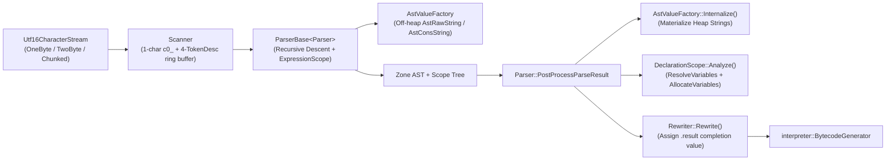
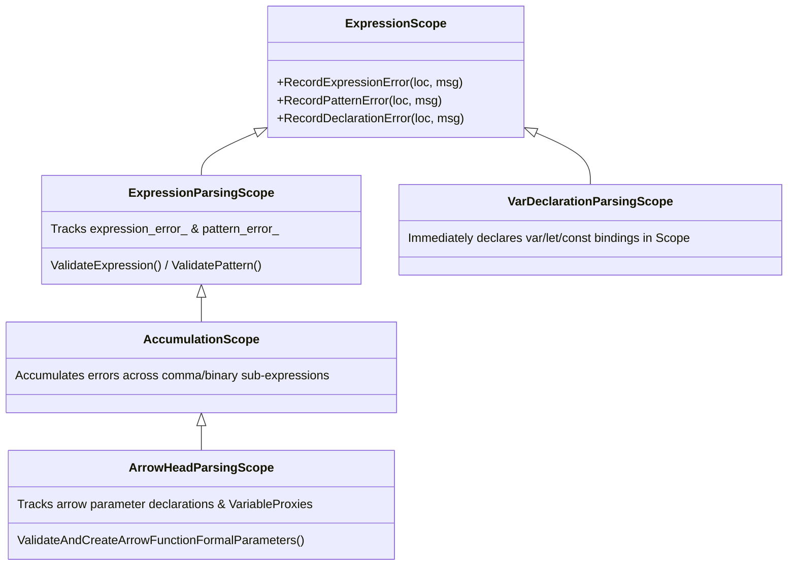

# V8 Parser, Scanner, and Abstract Syntax Tree (AST)

## Conceptual Overview

Before V8 can execute JavaScript, it must transform raw UTF-8 or UTF-16 source text into a structured representation that `BytecodeGenerator` can compile into Ignition bytecode. Because parsing sits directly on the critical path of page load and script execution, V8's parsing pipeline is engineered around four core principles:
1. **Off-Main-Thread Execution (Zero Heap Access During Parsing)**: Parsing and scanning can run on background worker threads (`BackgroundCompileTask`) without touching the V8 garbage-collected heap. All strings, AST nodes, and scopes are allocated inside arena **`Zone`** memory and only internalized onto the V8 heap during a brief post-processing phase (`Parser::PostProcessParseResult`).
2. **Single Implementation for Full Parsing and PreParsing (`ParserBase<Impl>`)**: A single C++ template class implements the entire ECMAScript recursive-descent grammar, instantiating into either **`Parser`** (which builds a full AST) or **`PreParser`** (which validates syntax and tracks variable capture for lazy inner functions without allocating AST nodes).
3. **Single-Pass Ambiguity Resolution (`ExpressionScope`)**: JavaScript contains notoriously ambiguous grammar constructs (such as `(a, {b = 1})` being either a parenthesized comma expression or an arrow function parameter list `(a, {b = 1}) => ...`). V8 resolves these in a single pass without backtracking using a stack of `ExpressionScope` trackers.
4. **Compact Arena-Allocated AST (`AstNode`)**: AST nodes omit C++ virtual method tables (`vtable`s) completely, packing their `NodeType` and bitfields into a single 32-bit `bit_field_` to minimize memory footprint and maximize CPU cache locality.

---

## 1. End-to-End Parsing Pipeline



---

## 2. `Scanner`: Character Streams and the 4-Token Ring Buffer (`src/parsing/scanner.h`)

The `Scanner` converts a `Utf16CharacterStream` (`src/parsing/scanner-character-streams.h`) into a stream of lexical tokens (`Token::Value`).

### 1-Character Lookahead (`c0_`) vs 4-Token Ring Buffer (`token_storage_[4]`)
A common point of confusion is how much lookahead `Scanner` maintains:
- **Character-Level Lookahead (`base::uc32 c0_`)**: At the character stream level, `Scanner` maintains a **single** 32-bit Unicode code point lookahead in `c0_` (`Advance()` reads the next character from `source_` into `c0_`, while `PushBack(uc32)` unreads a character when needed).
- **Token-Level Lookahead (`TokenDesc token_storage_[4]`)**: At the token level, `Scanner` maintains a **4-slot ring buffer** of `TokenDesc` structs pointed to by four sliding pointers (`src/parsing/scanner.h`):
  1. **`current_`**: The most recently consumed token (`current_token()`).
  2. **`next_`**: The immediate 1-token lookahead (`peek()`).
  3. **`next_next_`**: The 2-token lookahead (`PeekAhead()`), used to disambiguate constructs like `async` arrow functions or lexical declarations (`let [x] = ...` vs `let`).
  4. **`next_next_next_`**: The 3-token lookahead (`ScanAhead()`).

Each `TokenDesc` caches the `Token::Value`, source `Location` (`beg_pos`, `end_pos`), literal buffer (`LiteralBuffer`), and escape/line-terminator flags (`after_line_terminator`, essential for Automatic Semicolon Insertion (ASI) and restricted productions like `return \n expr`).

---

## 3. Off-Heap Strings: `AstValueFactory`, `AstRawString`, and `AstConsString` (`src/ast/ast-value-factory.h`)

Because `Scanner` and `Parser` run on background threads without locking the main V8 `Isolate` heap, the parser **cannot** allocate `SeqString` or `InternalizedString` objects on the V8 heap as it scans identifiers and string literals.

Instead, all strings are managed off-heap in Zone memory by **`AstValueFactory`**:
1. **`AstRawString`**: Stores an immutable byte slice (`Vector<const uint8_t>`, tagged as one-byte or two-byte) plus its pre-computed V8 string `hash_field_` inside a `Zone` hash table (`string_table_`).
   - **Compile-Time Deduplication**: Before parsing even finishes, `AstValueFactory::GetOneByteString` / `GetTwoByteString` deduplicates all identifier tokens in `string_table_`. Consequently, comparing two identifier names anywhere in the `Parser` or `Scope` resolution is a single **pointer equality check** (`ast_raw_string_a == ast_raw_string_b`)!
2. **`AstConsString`**: Represents compile-time string concatenations as a linked list of `AstRawString` segments in Zone memory without copying character buffers.
3. **Deferred Heap Internalization (`Parser::PostProcessParseResult`)**:
   - Once parsing completes and returns to a thread with heap access (`Isolate` or `LocalIsolate`), `Parser::PostProcessParseResult` invokes **`AstValueFactory::Internalize(isolate)`**.
   - `Internalize` iterates through the deduplicated `AstRawString`s and `AstConsString`s, allocates their corresponding `InternalizedString`s in the V8 heap `StringTable` once per unique string, and caches the `IndirectHandle<String>` inside each `AstRawString::string_` slot so `BytecodeGenerator` can read the heap handle directly.

---

## 4. `ParserBase<Impl>` and Single-Pass `ExpressionScope` (`src/parsing/parser-base.h`)

V8 avoids maintaining two separate parsers for full compilation and lazy syntax checking by using the **Curiously Recurring Template Pattern (CRTP)**:
- `template <typename Impl> class ParserBase` implements all grammar rules (`ParseStatement`, `ParseAssignmentExpression`, `ParsePrimaryExpression`, etc.).
- `ParserTypes<Parser>` maps `ExpressionT` to `Expression*` (real AST pointers) and `IdentifierT` to `const AstRawString*`.
- `ParserTypes<PreParser>` maps `ExpressionT` to `PreParserExpression` (a 32-bit bitfield value class) and `IdentifierT` to `PreParserIdentifier` -- see [Lazy Parsing and PreParser](lazy-parsing-and-preparser.md).

### Resolving Grammar Ambiguities via `ExpressionScope` (`src/parsing/expression-scope.h`)
In ECMAScript, when the parser sees `({ a = 1 })`, it does not know until after the closing `)` whether it is parsing:
- An **Object Literal** inside parentheses: `({ a = 1 }.a)` -> **SyntaxError!** (`a = 1` is a `CoverInitializedName`, illegal in a normal object literal), OR
- An **Object Destructuring Assignment**: `({ a = 1 } = obj)` -> **Valid!** (`a = 1` is a default assignment target), OR
- An **Arrow Function Parameter List**: `({ a = 1 }) => a` -> **Valid!** (`a` is a parameter declaration in the arrow head's `Scope`).

Instead of backtracking and re-parsing from scratch, `ParserBase` pushes a lightweight stack of **`ExpressionScope<Types>`** instances (`parser->expression_scope()`):



- When parsing `( { a = 1 } )`, `ParserBase` opens an ambiguous `ArrowHeadParsingScope` (or `ExpressionParsingScope`).
- Encountering `a = 1` inside `{ ... }` calls `expression_scope()->RecordExpressionError(...)`: recording the source location where an expression would be invalid, without throwing yet!
- Once the token after `)` is inspected:
  - If followed by `=>`, `ValidateArrowHead()` succeeds (ignoring `expression_error_`), converts the tracked `VariableProxy`s into parameter `Variable` declarations inside the arrow scope, and discards `pattern_error_`.
  - If followed by `=` (assignment), `ValidatePattern()` succeeds (ignoring `expression_error_`).
  - Otherwise, `ValidateExpression()` is called, which immediately reports the recorded `expression_error_` (`Invalid shorthand property initializer`)!

---

## 5. AST Architecture (`src/ast/ast.h`)

All AST node classes are generated by the `AST_NODE_LIST(V)` macro in `src/ast/ast.h` and inherit from `AstNode` (`ZoneObject`).

### Vtable-Free `AstNode` Layout
To save 8 bytes per AST node and eliminate indirect call branch mispredictions, **`AstNode` has no virtual functions**:

```cpp
class AstNode : public ZoneObject {
 protected:
  uint32_t bit_field_;  // Bits 0..5: NodeType (6 bits); Bits 6..31: subclass flags!
 private:
  int position_;        // Source character offset (for stack traces & TDZ checks)
};
```

- Downcasting and visitor dispatch (`AstVisitor<SubClass>::Visit(AstNode* node)`) switch directly on `node->node_type()` (`NodeTypeBits`, 6 bits covering ~60 statement, expression, and declaration node types).
- Subclasses pack their own boolean flags and small enums into the remaining 26 bits of `bit_field_` using `base::BitField<T, offset, size>::Next` (for example, `VariableProxy` packs `IsAssignedField`, `IsResolvedField`, `NeedsHoleCheckField`, and `IsNewTargetField` into `AstNode::bit_field_`).

---

## 6. Post-Parse Phases: `DeclarationScope::Analyze` and `Rewriter::Rewrite`

After `Parser` constructs the AST and `PostProcessParseResult` internalizes strings, two mandatory AST transformations run before `BytecodeGenerator`:

### 1. Scope Analysis (`DeclarationScope::Analyze` in `src/ast/scopes.cc`)
1. **`ResolveVariablesRecursively`**: Links every unresolved `VariableProxy` identifier reference in the AST to its target `Variable` declaration (or inserts a `kDynamicGlobal` / `kDynamic` variable if undeclared or shadowed by sloppy `eval`). During this step, `UpdateNeedsHoleCheck` computes static TDZ hole-check elimination (see [Parser Hole Check Elimination](hole-check-elimination-parser.md)).
2. **`AllocateVariables`**: Inspects each `Variable` via `MustAllocate` and `MustAllocateInContext`. Variables accessed across closure boundaries (`has_forced_context_allocation()`) are assigned `VariableLocation::CONTEXT` indices; purely local variables are assigned `VariableLocation::LOCAL` or `PARAMETER`; unused variables are elided.

### 2. Completion Value Rewriting (`Rewriter::Rewrite` in `src/parsing/rewriter.cc`)
According to the ECMAScript specification, top-level **scripts**, **`eval("...")` calls**, and **`do` expressions** return the **completion value** of the last value-producing statement executed (for example, `eval("1 + 2; if (false) 3;")` returns `3` -> `undefined` or `3` depending on the spec rules for `IfStatement`).
- Teaching `BytecodeGenerator` to track implicit completion values across loops, `try`/`catch`/`finally`, `switch`, and `if`/`else` statements would complicate every bytecode visitor.
- Instead, **`Rewriter::Rewrite`** (`AstVisitor<Processor>`) runs over top-level script / `eval` ASTs before bytecode generation: it allocates a single synthetic temporary variable named **`.result`** (`roots.dot_result_string()`) and rewrites value-producing tail statements into explicit `Assignment` AST nodes (`.result = expr`) followed by returning `.result`!

---

## Key Source Files

- `src/parsing/scanner.h` & `src/parsing/scanner.cc`: `Scanner`, `c0_`, and the 4-entry `TokenDesc` ring buffer.
- `src/ast/ast-value-factory.h` & `.cc`: Off-heap `AstRawString`, `AstConsString`, and `AstValueFactory::Internalize`.
- `src/parsing/parser-base.h`, `src/parsing/parser.h`, & `src/parsing/parser.cc`: `ParserBase<Impl>`, `Parser`, and `PostProcessParseResult`.
- `src/parsing/expression-scope.h`: `ExpressionScope`, `ExpressionParsingScope`, `ArrowHeadParsingScope`, and `VarDeclarationParsingScope`.
- `src/ast/ast.h`: `AST_NODE_LIST` and vtable-free `AstNode` hierarchy.
- `src/parsing/rewriter.h` & `src/parsing/rewriter.cc`: `Rewriter::Rewrite` (`.result` completion value assignment).
