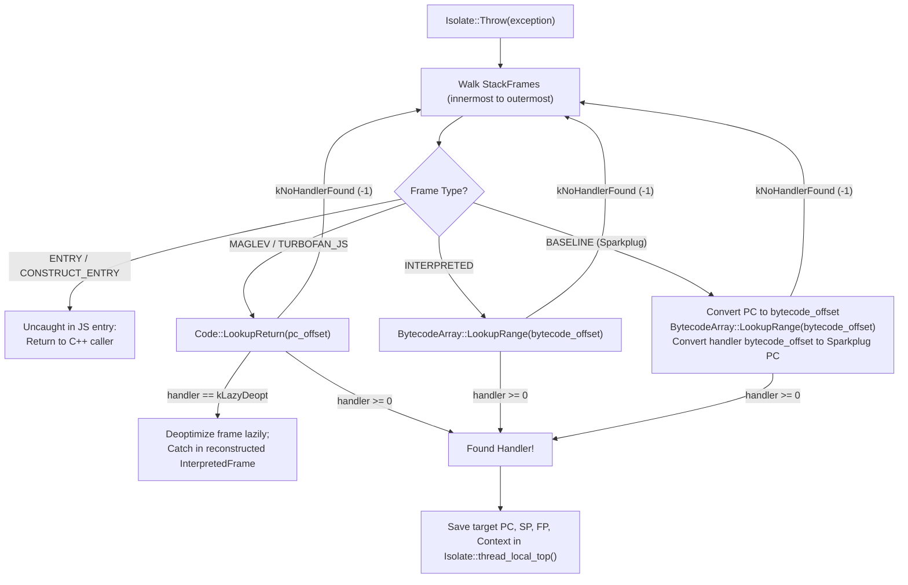

# Exception Handling in V8

## Conceptual Overview

When JavaScript code executes `throw new Error()`, or when a runtime operation fails (such as dereferencing `undefined.foo` or exhausting the call stack), V8 must locate the nearest enclosing `try`/`catch` or `try`/`finally` block across a mixed call stack of Ignition bytecode frames, Sparkplug baseline frames, Maglev/TurboFan optimized frames, C++ builtins, and Wasm frames.

To make zero-exception execution completely free ("zero-cost try blocks"), V8 does **not** execute setup instructions when entering or leaving a `try` block. Instead, every compiled unit attaches a static side table (`HandlerTable`) that maps program counter (PC) or bytecode offsets to catch handler targets. Only when an exception is actually thrown does `Isolate::Throw` walk the stack and consult each frame's `HandlerTable`.

---

## 1. `pending_exception` vs `scheduled_exception` (`src/execution/isolate.h`)

V8's `Isolate` tracks two distinct exception slots in `ThreadLocalTop` (`src/execution/thread-local-top.h`) to bridge JavaScript stack unwinding and C++ embedder/runtime boundaries:

| Slot on `Isolate` | Meaning & Lifecycle |
| :--- | :--- |
| **`pending_exception()`** | **Active Unwinding Exception.** Set by `Isolate::Throw(raw_exception)` when an exception is actively being thrown and the stack has already been searched for a handler (`FindHandler`). C++ `RUNTIME_FUNCTION`s signal that `pending_exception` is set by returning the sentinel `ReadOnlyRoots(isolate).exception()` (`ExceptionHole`), and `MaybeHandle<T>` / `MaybeDirectHandle<T>` functions return an empty handle (`kNullMaybeHandle`). |
| **`scheduled_exception()`** | **Deferred C++ API / Interrupt Exception.** Set when C++ embedder code (`v8::Isolate::ThrowException`) or an asynchronous interrupt/termination requests an exception while inside C++ helper frames before returning to a JS/runtime boundary (`Isolate::ScheduleThrow`). When crossing back to JS or finishing a C++ API call, `Isolate::PromoteScheduledException()` moves `scheduled_exception` into `pending_exception` and invokes `Isolate::Throw` to compute the handler unwinding targets. |

### Uncatchable Termination (`TerminationException`)
When an embedder calls `v8::Isolate::TerminateExecution()` (for example, to stop a runaway worker or script timeout), V8 throws `ReadOnlyRoots(isolate).termination_exception()` (`TerminationException`).
- Unlike normal JS exceptions (`IsTheHole` / `IsException`), `TerminationException` is **uncatchable** by user JavaScript: `Isolate::Throw` ignores user `try`/`catch`, `finally`, and `StubFrame` handlers, unwinding all frames up to the nearest C++ `JSEntry` boundary (`Execution::Invoke`).
- Because unwinding stops at the nearest `JSEntry` frame, any C++ runtime or builtin path that invokes nested JavaScript (`Execution::Call`) and clears or wraps a resulting exception (for example, `ErrorUtils::ThrowShadowRealmTypeErrorCopy` or `IteratorClose`) must check `isolate->is_execution_terminating()` (or `!isolate->is_catchable_by_javascript(exception)`) before calling `isolate->clear_exception()` so termination continues unwinding outer JS frames.

---

## 2. `HandlerTable` Layouts and Bitfields (`src/codegen/handler-table.h`)

Depending on the compiler tier, `HandlerTable` uses one of two physical layouts (`HandlerTable::EncodingMode`):

```text
1. kRangeBasedEncoding (Ignition BytecodeArray & Sparkplug BaselineFrame)
+----------------+----------------+-----------------------------+---------------+
| try_start (i32)| try_end (i32)  | handler_offset_bitfield(i32)| context (i32) |
+----------------+----------------+-----------------------------+---------------+
                                    bits 0..2:  CatchPrediction
                                    bit  3:     HandlerWasUsed
                                    bits 4..31: HandlerOffset (28 bits)

2. kReturnAddressBasedEncoding (Maglev, TurboFan, Turboshaft, Wasm)
+---------------------------------+---------------------------------------------+
| return_address_offset (i32)     | handler_offset_bitfield (i32)               |
+---------------------------------+---------------------------------------------+
                                    bits 0..2:  CatchPrediction (TurboFan)
                                    bits 3..31: HandlerOffset
```

### 1. `kRangeBasedEncoding` (Ignition & Sparkplug)
Stored in `BytecodeArray::handler_table()` (`TrustedByteArray`) with 4 `int32_t` integers per row (`kRangeEntrySize = 4`):
- **`try_start` and `try_end`**: Half-open bytecode offset interval `[try_start, try_end)` covered by the `try` block. Nested `try` blocks appear earlier in the table than outer `try` blocks so the first matching interval in `LookupRange` is always the innermost handler!
- **`handler` bitfield (`HandlerOffsetField` + `HandlerPredictionField` + `HandlerWasUsedField`)**:
  - **Bits `0..2` (`HandlerPredictionField`, 3 bits)**: Static `CatchPrediction` (`UNCAUGHT`, `CAUGHT`, `PROMISE`, `ASYNC_AWAIT`, `UNCAUGHT_ASYNC_AWAIT`), used by the debugger and DevTools "Pause on uncaught exceptions" to predict whether the handler will swallow or rethrow the exception.
  - **Bit `3` (`HandlerWasUsedField`, 1 bit)**: Mutable feedback bit set via `MarkHandlerUsed(index)` whenever `Isolate::Throw` actually takes this handler! Optimizing compilers (Maglev/TurboFan) read `HandlerWasUsed` to know whether a `catch` block has ever executed at runtime; if `HandlerWasUsed` is `false`, the compiler can emit `HandlerTable::kLazyDeopt` instead of compiling cold `catch` block machine code!
  - **Bits `4..31` (`HandlerOffsetField`, 28 bits)**: Bytecode offset of the `catch` or `finally` landing pad.
- **`context` (`range_data`)**: The bytecode register index holding the saved `Context` that must be restored into the interpreter's `context` register upon jumping to the handler!

### 2. `kReturnAddressBasedEncoding` (Maglev, TurboFan, Wasm)
Stored inside `InstructionStream`'s metadata section (`handler_table_offset`) with 2 `int32_t` integers per row (`kReturnEntrySize = 2`), sorted by `return_address_offset`:
- Because optimized code only throws at calls (or deoptimizes eagerly before throwing on inline checks), it maps the **call return PC offset** (`LookupReturn(pc_offset)`) via binary search to a machine code `handler_offset`.

### Critical Sentinel Constants (`kNoHandlerFound` vs `kLazyDeopt`)

> [!IMPORTANT]
> Do not confuse the two `HandlerTable` sentinel constants in `src/codegen/handler-table.h`:
> - **`HandlerTable::kNoHandlerFound = -1`**: Returned by `LookupRange` or `LookupReturn` when a frame has **no catch handler** covering the current PC/bytecode offset. Unwinding continues to the caller frame.
> - **`HandlerTable::kLazyDeopt = HandlerOffsetField::kMax` (`0x0fffffff`)**: Stored inside `HandlerOffsetField` in an **optimized frame's** `kReturnAddressBasedEncoding` table when the `try` block **does** have a handler in the source code, but the optimizing compiler chose **not to compile the `catch` block into machine code** (for example, because `HandlerWasUsed` was `false` when the function was optimized).
>   - When `LookupReturn` returns `HandlerTable::kLazyDeopt`, `Isolate::Throw` does **not** skip the frame! Instead, it marks that frame for lazy deoptimization so the exception is caught in the reconstructed unoptimized `InterpretedFrame`!

---

## 3. How Each Execution Tier Unwinds Exceptions (`Isolate::Throw` / `FindHandler`)

When `Isolate::Throw` runs, `FindHandler` walks the stack using `StackFrameIterator` from innermost frame to outermost entry frame (`src/execution/isolate.cc`):



### How Sparkplug (`BaselineFrame`) Handles Exceptions (No Deoptimization!)
A common misconception is that Sparkplug lazy-deoptimizes to Ignition on exceptions. **Sparkplug never deoptimizes!**
- A `BaselineFrame` shares the exact same `BytecodeArray` (and its `kRangeBasedEncoding` `HandlerTable`) as Ignition.
- During `FindHandler` on a `BaselineFrame`:
  1. V8 translates the current Sparkplug return PC into a bytecode offset using the baseline `BytecodeOffsetTable`.
  2. It queries `bytecode_array->LookupHandler(bytecode_offset)` in the range-based `HandlerTable` (and calls `MarkHandlerUsed`).
  3. It translates the resulting **handler bytecode offset** forward into a **Sparkplug machine PC offset** (`BaselinePCForNextExecutedBytecode`), restores the saved `Context` from the frame's register slot, and jumps directly to the Sparkplug landing pad!

### How Unwinding Transfers Control (`Throw` Stub / CEntry)
Once `FindHandler` locates the catching frame and landing pad:
1. It records the target `handler_address`, `handler_fp`, `handler_sp`, and `handler_context` in `Isolate::thread_local_top()`, and places the thrown exception object in `pending_exception`.
2. The C++ runtime function returns `ReadOnlyRoots::exception()` to the `CEntry` stub (or builtin).
3. Seeing the `exception` sentinel, `CEntry` invokes the architecture-specific unwinding sequence: popping all intermediate stack frames by setting `sp = handler_sp` and `fp = handler_fp`, loading `context = handler_context` and `accumulator = pending_exception`, clearing `pending_exception`, and jumping straight to `handler_address`!

---

## 4. `finally` Blocks and Bytecode Re-Dispatch

In JavaScript, a `try { ... } finally { cleanup(); }` block must execute `cleanup()` whether the `try` block:
1. Finishes normally (fallthrough),
2. Executes `return val`, `break`, or `continue`, or
3. Throws an exception (which must be re-thrown after `cleanup()` finishes, unless `cleanup()` itself throws or returns).

`BytecodeGenerator` compiles `try`/`finally` using a single unified landing pad controlled by a hidden **`token` register** and a **`message` / `result` register**:
- On **normal exit / `return` / `break`**, bytecode stores the return value (if any) in `result`, loads a small integer `Smi` dispatch token (`0, 1, 2, ...`) into `token`, and jumps to the `finally` block.
- On **exception**, the `HandlerTable` catches the exception, preserves the pending exception message (`SetPendingMessage`), stores the caught exception into `result`, sets `token = -1` (or the rethrow token), and falls into the exact same `finally` block.
- At the end of `finally`, bytecode switches on `token`: if it matches the exception token, it restores the pending message and executes `ReThrow`; otherwise it executes the deferred `Return`, `Jump`, or fallthrough.

---

## Key Source Files

- `src/codegen/handler-table.h` & `src/codegen/handler-table.cc`: `HandlerTable`, `EncodingMode`, `CatchPrediction`, `kNoHandlerFound`, and `kLazyDeopt`.
- `src/execution/isolate.cc`: `Isolate::Throw`, `Isolate::ReThrow`, `Isolate::FindHandler`, `PromoteScheduledException`, and `PredictExceptionCatcher`.
- `src/execution/frames.h` & `src/execution/frames.cc`: `StackFrame::ComputeParameters`, `VisitSpillSlots`, `InterpretedFrame`, `BaselineFrame`, and `OptimizedJSFrame`.
