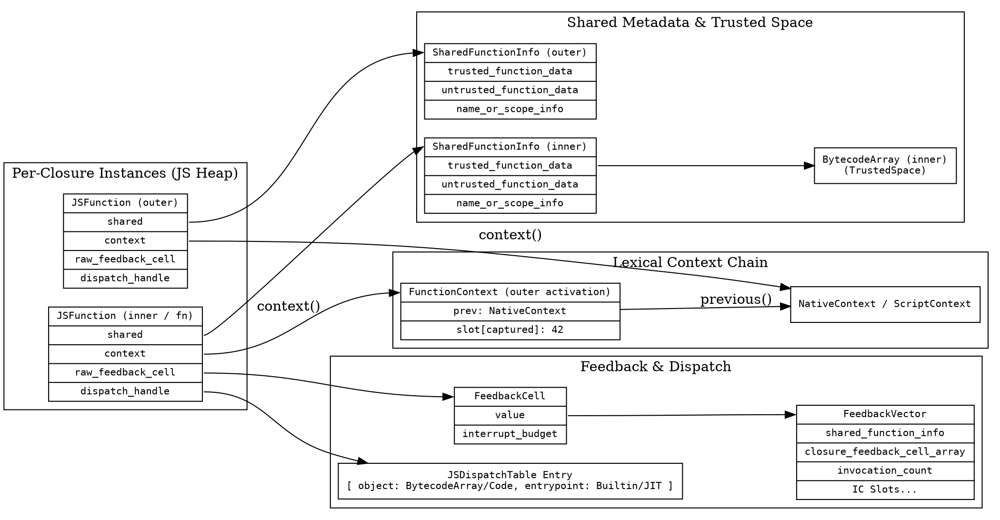
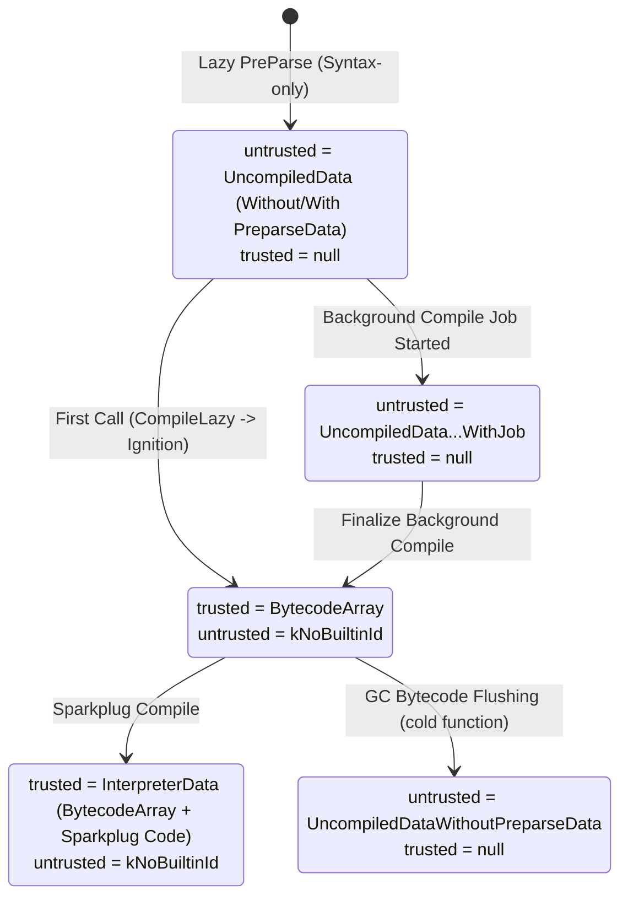
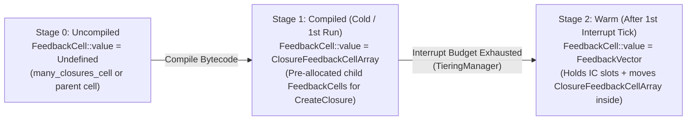

# Function Architecture in V8 (`JSFunction`, `SharedFunctionInfo`, `Context`, `FeedbackVector`)

## Conceptual Overview

Consider what happens when a JavaScript function is defined inside a loop or method:

```javascript
function makeAdder(x) {
  return function add(y) {
    return x + y;
  };
}
const add5 = makeAdder(5);
const add10 = makeAdder(10);
```

Here, `add5` and `add10` are two distinct JavaScript function closures (`add5 !== add10`) because `add5` captures `x = 5` while `add10` captures `x = 10`. However, both closures execute the **exact same source code**, have the same AST and Ignition bytecode, and share the same scope layout.

If V8 duplicated the source metadata and bytecode inside every closure instance, memory usage would explode. Conversely, if V8 attached optimization and Inline Cache (IC) feedback strictly to the shared source definition without per-closure cells, closures with different lifecycles could not manage their feedback allocations cleanly.

V8 solves this by splitting a JavaScript function into four cooperating objects:
1. **`SharedFunctionInfo` (`SFI`)**: The static, closure-independent representation of a function definition in source code (one per syntactic function literal).
2. **`JSFunction`**: The lightweight, per-closure heap object instantiated each time a function expression or declaration is evaluated at runtime.
3. **`Context`**: The heap-allocated lexical environment holding variables (`x`) captured from enclosing scopes.
4. **`FeedbackCell` & `FeedbackVector`**: The runtime profiling and IC state that drives V8's tiering pipeline (`JSDispatchTable` + `TieringManager`).

---

## 1. Object Topology and Closure Graph

Let us trace a complete example with an outer function and an inner closure:

```javascript
function outer(a) {
  let captured = a * 2;
  return function inner(b) {
    return captured + b;
  };
}
const fn = outer(21);
fn(1);
```

When `const fn = outer(21)` is called, V8 creates an activation `FunctionContext` (`Outer_Ctx`) to store `captured = 42`, and instantiates the `inner` `JSFunction` (`Inner_JSF`) pointing its `context()` slot at `Outer_Ctx`:



> [!IMPORTANT]
> **`JSFunction::context()` Invariant**:
> Notice that `Inner_JSF -> Outer_Ctx [label="context()"]`. A `JSFunction`'s `context_` field always points to the **enclosing scope's `Context`** active when the `JSFunction` closure was created (`CreateClosure`). An `Inner_Ctx` (if `inner` itself had variables captured by a deeper nested function) is only allocated **when `inner()` is called**, never stored as `Inner_JSF->context()`.

---

## 2. `SharedFunctionInfo` (`SFI`) and Dual Function Data Slots (`src/objects/shared-function-info.h`)

A `SharedFunctionInfo` represents the static identity of a function across all closures created from that source location. It holds source positions (`StartPosition`, `EndPosition`), parameter count (`internal_formal_parameter_count`), syntax flags (`FunctionKind`, `LanguageMode`), `ScopeInfo` (`name_or_scope_info_`), and the function's compilation state.

### Sandbox-Hardened Dual Function Data Slots (`trusted_function_data_` vs `untrusted_function_data_`)

Under the V8 Sandbox (`V8_ENABLE_SANDBOX`), executable artefacts like `BytecodeArray`, `InterpreterData`, and `Code` live in **Trusted Space** outside the attacker-mutable main heap, while uncompiled parser metadata (`UncompiledData`) and `Smi` builtin IDs live on the untrusted heap.

Therefore, `SharedFunctionInfo` splits its function data into two paired fields (`src/objects/shared-function-info.h`):
1. **`trusted_function_data_` (`TrustedPointerMember<ExposedTrustedObject, kUnknownIndirectPointerTag>`)**:
   - An indirect pointer index into the `TrustedPointerTable` (or `kNullTrustedPointerHandle` when unused).
   - Valid target types: `BytecodeArray`, `InterpreterData` (when Sparkplug or debug bytecode wrappers are attached), `Code` (for trusted builtins/wasm), `WasmExportedFunctionData`, `WasmJSFunctionData`, `WasmCapiFunctionData`.
2. **`untrusted_function_data_` (`TaggedMember<Object>`)**:
   - A regular tagged field in the main cage (set to `Smi::FromInt(Builtin::kNoBuiltinId)` when `trusted_function_data_` is active).
   - Valid target types: `Smi` (encoding a `Builtin` ID, such as `Builtin::kCompileLazy`), `UncompiledDataWithoutPreparseData`, `UncompiledDataWithPreparseData`, `UncompiledDataWithoutPreparseDataWithJob`, `UncompiledDataWithPreparseDataAndJob`, `FunctionTemplateInfo` (for C++ API callbacks), or `AsmWasmData`.

### Lifecycle of `SharedFunctionInfo` Function Data



---

## 3. `JSFunction` and the `JSDispatchTable` (`src/objects/js-function.h`)

A `JSFunction` is a `JSObject` (so user code can attach custom properties like `fn.customProp = 123`) with four core execution fields:
1. **`shared_` (`TaggedMember<SharedFunctionInfo>`)**: Points to the `SharedFunctionInfo`.
2. **`context_` (`TaggedMember<Context>`)**: Points to the enclosing lexical `Context` (or `NativeContext` if no outer variables were captured).
3. **`raw_feedback_cell_` (`TaggedMember<FeedbackCell>`)**: Points to the closure's `FeedbackCell`.
4. **`dispatch_handle_` (`JSDispatchHandle`)**: A 32-bit handle indexing into the **`JSDispatchTable`** (`src/sandbox/js-dispatch-table.h`).

### How Calls Dispatch via `JSDispatchTable` (`V8_ENABLE_LEAPTIERING`)
In modern V8 (Leaptiering), `JSFunction` does **not** store a direct `Code` pointer in the untrusted heap. Instead, calling a `JSFunction` indexes into the trusted `JSDispatchTable` using `function->dispatch_handle()`:

```text
JSDispatchTable Entry (128 bits in Trusted Memory)
+-----------------------------------+-----------------------------------+
| ObjectPointer (BytecodeArray/Code)| Entrypoint (Raw Machine PC)       |
| + ParameterCount (uint16_t)       | + Tiering Request State           |
+-----------------------------------+-----------------------------------+
```

- **Parameter Count Validation**: The `JSDispatchTable` entry stores the function's expected `parameter_count`. Call sites compare the actual argument count against the dispatch table entry's `parameter_count` to prevent stack corruption if a `JSFunction` is swapped inside the sandbox.
- **Zero-Indirection Tier Switching & Tiering Requests**:
  - When uncompiled: `entrypoint` points to `Builtin::kCompileLazy`.
  - In Ignition: `ObjectPointer` holds the `BytecodeArray` and `entrypoint` points to `InterpreterEntryTrampoline`.
  - In Sparkplug / Maglev / TurboFan: `ObjectPointer` holds the `Code` object and `entrypoint` points directly to `code->instruction_start()`.
  - When `TieringManager` requests optimization (`JSDispatchTable::SetTieringRequest`), it temporarily patches `entrypoint` to a `TieringBuiltin` (e.g., `Builtin::kStartMaglevOptimizeJob`) while leaving `ObjectPointer` pointing to the existing `Code` / `BytecodeArray`!

---

## 4. `FeedbackCell` and `FeedbackVector` Lifecycle (`src/objects/feedback-vector.h`)

Allocating a full `FeedbackVector` (which contains an array of IC slots for every load, store, call, and binary operation in a function) for every single function in a web page immediately upon bytecode compilation would waste huge amounts of memory, because many functions are only called **once** (such as IIFEs, module initializers, or setup functions).

V8 avoids allocating `FeedbackVector`s for cold functions through a **three-stage `FeedbackCell::value()` lifecycle**:



### Why `ClosureFeedbackCellArray` Exists Before `FeedbackVector`
Suppose function `outer()` contains an inner closure `const f = () => ...` (compiled to the `CreateClosure` bytecode).
- Even on `outer()`'s very first execution (before `outer()` has a `FeedbackVector`), executing `CreateClosure` requires a `FeedbackCell` to pass to the newly allocated `JSFunction` `f`!
- Therefore, when `outer()`'s bytecode is compiled (`Compiler::Compile`), V8 allocates a lightweight **`ClosureFeedbackCellArray`** (containing one `FeedbackCell` per `CreateClosure` site in `outer`) and stores it in `outer`'s `FeedbackCell::value()`.
- Only when `outer()` runs long enough to exhaust its initial `FeedbackCell::interrupt_budget_` does `TieringManager::OnInterruptTick` call `JSFunction::CreateAndAttachFeedbackVector`:
  1. It allocates the full **`FeedbackVector`**.
  2. It transfers the existing `ClosureFeedbackCellArray` from `FeedbackCell::value()` into `FeedbackVector::closure_feedback_cell_array()`.
  3. It updates `FeedbackCell::value()` to point to the new `FeedbackVector`!

---

## Key Source Files

- `src/objects/js-function.h` & `src/objects/js-function-inl.h`: `JSFunction`, `dispatch_handle_`, and `CreateAndAttachFeedbackVector`.
- `src/objects/shared-function-info.h` & `-inl.h`: `SharedFunctionInfo`, `trusted_function_data_`, and `untrusted_function_data_`.
- `src/objects/feedback-cell.h` & `src/objects/feedback-vector.h`: `FeedbackCell`, `ClosureFeedbackCellArray`, and `FeedbackVector`.
- `src/sandbox/js-dispatch-table.h`: `JSDispatchTable` layout and tiering request mechanics.
