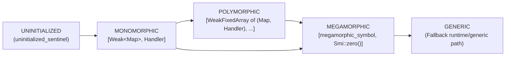

# Hidden Classes (`Map`) and Inline Caches (ICs)

## Conceptual Overview

JavaScript is dynamically typed and classless at the object level: two objects `{ x: 1, y: 2 }` and `{ x: 10, y: 20 }` have no static C++ struct declaration, and properties can be added at any time. If V8 looked up `"y"` in a hash table every time `point.y` executed, property access would be an order of magnitude slower than C++ struct field access.

V8 bridges this gap with two tightly coupled mechanisms:
1. **Hidden Classes (`Map`s)**: Every `HeapObject` begins with a pointer to a `Map` that describes its exact layout (its `InstanceType`, in-object property count, `ElementsKind`, prototype pointer, and `DescriptorArray`). Objects created in the same way follow the same **Transition Tree** of `Map`s and end up sharing the exact same final `Map`, guaranteeing that property `y` lives at the exact same memory offset in all of them.
2. **Inline Caches (ICs)**: Every property load (`LoadIC`), store (`StoreIC`), or element access (`KeyedLoadIC`, `KeyedStoreIC`) in bytecode has an associated slot in the function's **`FeedbackVector`**. On the first execution, the IC performs a full property lookup (`LookupIterator`), computes a compact **Handler** describing how to read or write the property (for example, "read in-object field at word offset 3"), and caches the `(Map, Handler)` pair in the `FeedbackVector` slot. Subsequent executions check `obj->map() == cached_map` and execute the handler directly in a few instructions!

*(For a step-by-step introductory walkthrough of how transition trees evolve, see the [Hidden Classes Tutorial](hidden-classes-tutorial.md). For deep dives into `DescriptorArray`, `TransitionArray`, and `SwissNameDictionary`, see [Descriptor and Transition Arrays](../objects/descriptor-and-transition-arrays.md) and [Fields and Elements](../objects/fields-and-elements.md).)*

---

## 1. The IC State Lattice (`InlineCacheState`)

Each IC slot in a `FeedbackVector` occupies **2 tagged words** (configured by `FeedbackSlotKind` in `src/objects/feedback-vector.h`) and progresses monotonically through a lattice of states (`src/common/globals.h`):



| State | `FeedbackVector` Slot `[0]` & `[1]` | Behavior |
| :--- | :--- | :--- |
| **`UNINITIALIZED`** | `[uninitialized_symbol, Smi::zero()]` | Never executed. Calls into the IC miss builtin/runtime to initialize. |
| **`MONOMORPHIC`** | `[Weak<Map>, Handler]` (or `[Name, WeakFixedArray]` for keyed access to a single dynamic property name) | Seen **1** receiver `Map`. Checks `receiver->map() == expected_map` and runs `Handler`. Fastest path; directly inlined as a single `CheckMaps` + field load by Maglev and TurboFan. |
| **`POLYMORPHIC`** | `[WeakFixedArray, uninitialized_symbol / Name]` | Seen **2 to `kMaxPolymorphicMapCount` (`4`)** distinct receiver `Map`s. The `WeakFixedArray` stores interleaved `[Weak<Map_1>, Handler_1, Weak<Map_2>, Handler_2, ...]`. Baseline/JIT code emits a linear switch over the maps. |
| **`MEGAMORPHIC`** | `[megamorphic_symbol, Smi]` | Seen **more than 4** receiver `Map`s. Stops recording per-site maps and probes the isolate-wide **`StubCache`** (`load_stub_cache_`, `store_stub_cache_`, or `define_own_stub_cache_`). |

---

## 2. Handler Configurations: `LoadHandler`, `StoreHandler`, and `DataHandler`

What is the `Handler` stored in slot `[1]` of a monomorphic IC (or odd indices of a polymorphic `WeakFixedArray`)? Depending on the complexity of the lookup, a handler is one of three things:

### 1. Smi-Encoded Bitfield (`LoadHandler` / `StoreHandler` in `src/ic/handler-configuration.h`)
For the most common fast paths (loading or storing an in-object or `PropertyArray` field on the receiver, loading a constant descriptor, reading `Array.length`, or loading an element), the entire handler fits into a **single 31-bit `Smi`**!

#### `LoadHandler` Bitfield Layout (`kField` / General Kinds)
`LoadHandler::Kind` occupies bits `0..3` (`KindBits`, 4 bits):
- `kElement`, `kIndexedString`, `kNormal` (dictionary mode), `kGlobal`, `kField`, `kConstantFromPrototype`, `kAccessorFromPrototype`, `kNativeDataProperty`, `kApiGetter`, `kInterceptor`, `kProxy`, `kNonExistent`, `kModuleExport`.

When `Kind == LoadHandler::Kind::kField`, the remaining bits of the `Smi` encode the exact memory layout of the field (`src/ic/handler-configuration.h`):

```text
30               19        18          17                      6                     5                            4     3      0
+------------------+---------+-----------+----------------------+---------------------+----------------------------+------------+
| DescriptorIndex  |IsDouble |IsInobject | StorageOffsetInWords | LookupOnLookupStart | DoAccessCheckOnLookupStart |  KindBits  |
|    (11 bits)     | (1 bit) |  (1 bit)  |      (11 bits)       |       (1 bit)       |          (1 bit)           |  (4 bits)  |
+------------------+---------+-----------+----------------------+---------------------+----------------------------+------------+
```

- **`KindBits` (4 bits)**: `LoadHandler::Kind::kField`.
- **`DoAccessCheckOnLookupStartObjectBits` (1 bit)**: Set if the receiver/lookup-start object requires a cross-origin security access check before reading.
- **`LookupOnLookupStartObjectBits` (1 bit)**: Set for `LoadSuperIC` (`super.prop`) when the property lookup started on the prototype chain rather than the receiver.
- **`StorageOffsetInWordsBits` (11 bits)**: The offset in `kTaggedSize` words, either directly from the `JSObject` header (if `IsInobject == 1`) or inside `obj->property_array()` (if `IsInobject == 0`).
- **`IsInobjectBits` (1 bit)**: `1` for in-object fields, `0` for out-of-object `PropertyArray` fields.
- **`IsDoubleBits` (1 bit)**: `1` if the field has `Representation::Double()` (meaning the slot holds a mutable `HeapNumber` whose float64 value must be unboxed or copied into a fresh `HeapNumber` upon load so subsequent in-place mutations to the field do not mutate the returned number!).
- **`DescriptorIndexBits` (11 bits)**: Index into `DescriptorArray` (used when needed for metadata/accessors).

*(Similarly, `StoreHandler::Kind` encodes `kField`, `kConstField`, `kNormal`, `kProxy`, `kGlobalProxy`, `kSharedStructField`, `kSlow`, and `RepresentationBits` (`kSmi`, `kDouble`, `kHeapObject`, `kTagged`) so the store IC stub validates the incoming value's representation before writing!)*

### 2. Heap `DataHandler` (`LoadHandler` / `StoreHandler` : `DataHandler` in `src/objects/data-handler.h`)
What if a load or store requires **extra object pointers** beyond a 31-bit `Smi` -- for example:
- Loading a property from a **prototype** (requires checking a prototype **`validity_cell`** and reading from the prototype **`holder`** object), or
- Performing a **hidden-class transition store** (requires the target **`transition_map`** and prototype **`validity_cell`**), or
- Executing a fast **`JSProxy` IC** (`kProxyDataFieldCount = 5`)?

In these cases, the IC allocates a variable-length **`DataHandler`** heap object (`LoadHandler` or `StoreHandler` subclassing `DataHandler`, `src/objects/data-handler.h`):

```text
+-------------------------------------------------------------------+
| Map (load_handler1_map / load_handler2_map / load_handler3_map...)|
+-------------------------------------------------------------------+
| smi_handler_   (Tagged<UnionOf<Smi, Code>>: Smi bitfield or stub) |
+-------------------------------------------------------------------+
| validity_cell_ (Tagged<UnionOf<Smi, Cell>>: prototype guard cell) |
+-------------------------------------------------------------------+
| data1          (Optional: e.g. Weak<Holder>, Weak<TransitionMap>) |
| data2          (Optional: e.g. AccessorPair / PropertyCell)       |
| data3..data5   (Optional: e.g. Proxy target/handler fields)       |
+-------------------------------------------------------------------+
```

### 3. Direct `Code` Handler (`Builtin` / IC Trampoline)
For specialized element accesses or slow paths, the handler slot (or `DataHandler::smi_handler_`) can point directly to a trusted `Code` object (such as a dynamically selected element-load or transition stub).

---

## 3. Prototype Validity Cells (`Map::GetOrCreatePrototypeChainValidityCell`)

Suppose `obj` has hidden class `Map_Obj`, its prototype `proto` has `Map_Proto`, and `proto.toString` lives on `Object.prototype` (`Map_ObjProto`).
Without prototype validity cells, a monomorphic load `obj.toString()` would have to check **every `Map` along the prototype chain** (`obj->map() == Map_Obj && proto->map() == Map_Proto && objProto->map() == Map_ObjProto`) on every call, because someone might have added a shadowing `proto.toString` property!

V8 reduces this $O(\text{depth})$ prototype walk to a **single `Cell` load**:
1. Every prototype `Map` (`map->is_prototype_map()`) has a `PrototypeInfo` holding a **`validity_cell`** (`Cell` containing `Map::kPrototypeChainValid = Smi::zero()`).
2. A prototype `DataHandler` stores `validity_cell_` from the receiver's immediate prototype `Map`.
3. On load, the IC only checks:
   - `obj->map() == expected_receiver_map`, AND
   - `handler->validity_cell()->value() == Smi::FromInt(Map::kPrototypeChainValid)`.
   Then it reads the property directly from `handler->data1()` (the cached prototype `holder`)!
4. Whenever **any** prototype `Map` is modified (a property is added/reconfigured, a dictionary prototype is mutated, or `__proto__` changes), V8 overwrites its `validity_cell` with `Map::kPrototypeChainInvalid` (`Smi::FromInt(1)`) and invalidates all downstream prototype maps' validity cells via `JSObject::InvalidatePrototypeChains`.

---

## 4. Megamorphic `StubCache` Architecture (`src/ic/stub-cache.h`)

When an IC site sees more than 4 distinct receiver `Map`s, it transitions to **`MEGAMORPHIC`**. Instead of storing maps in the local `FeedbackVector` slot, megamorphic ICs query an Isolate-wide hash table called the **`StubCache`**.

### Three Separate `StubCache` Instances per `Isolate`
Each `Isolate` owns **three** independent `StubCache` instances (`src/execution/isolate.h`):
1. **`load_stub_cache_`**: Queried by megamorphic `LoadIC` and `KeyedLoadIC` sites.
2. **`store_stub_cache_`**: Queried by megamorphic `StoreIC` and `KeyedStoreIC` sites (regular assignment `obj.x = v`).
3. **`define_own_stub_cache_`**: Queried by megamorphic `DefineNamedOwnIC` and `DefineKeyedOwnIC` sites (object literals, class fields, and private fields).

### Two-Level Direct-Mapped Tables (`primary_` and `secondary_`)
Each `StubCache` consists of two fixed-size direct-mapped arrays of `StubCache::Entry` structs (`{ Tagged<Name> key, Tagged<MaybeObject> value, Tagged<Map> map }`):
- **`primary_` table**: `kPrimaryTableSize = 1 << 12 = 4096` entries.
- **`secondary_` table**: `kSecondaryTableSize = 1 << 10 = 1024` entries.

When a megamorphic IC executes with `(receiver_map, property_name)` (`src/ic/stub-cache.cc`):
1. **Probe `primary_`**: Computes `PrimaryOffset(name, map)` (using XOR + shift hashing of the compressed `Name` and `Map` addresses). If `primary_[idx].key == name && primary_[idx].map == map`, it immediately executes `primary_[idx].value` (which holds a `Smi` handler, `DataHandler`, or `Code` handler).
2. **Probe `secondary_`**: On a primary miss, computes `SecondaryOffset(name, primary_offset)` and checks `secondary_[sec_idx]`.
3. **Cache Fill (`StubCache::Set`)**: If both miss, the IC falls back to C++ (`Runtime_LoadIC_Miss` / `StoreIC_Miss`), computes the handler, **evicts** the existing `primary_[idx]` entry into `secondary_[sec_idx]`, and writes the new `(name, map, handler)` entry into `primary_[idx]`.
- Because `StubCache::Entry` holds raw pointers inside the Isolate, both tables are cleared on Garbage Collection (`StubCache::Clear()`).

---

## Key Source Files

- `src/ic/ic.h` & `src/ic/ic.cc`: `IC`, `LoadIC`, `StoreIC`, `KeyedLoadIC`, `KeyedStoreIC`, `DefineNamedOwnIC`, and state transitions.
- `src/ic/handler-configuration.h` & `-inl.h`: `LoadHandler` and `StoreHandler` Smi bitfields and `DataHandler` factories.
- `src/objects/data-handler.h`: `DataHandler` heap object layout (`smi_handler_`, `validity_cell_`, `data1..data5`).
- `src/ic/stub-cache.h` & `src/ic/stub-cache.cc`: `StubCache` primary/secondary tables and hash functions.
- `src/ic/accessor-assembler.cc`: CodeStubAssembler fast paths for IC dispatch and `StubCache` probing.
