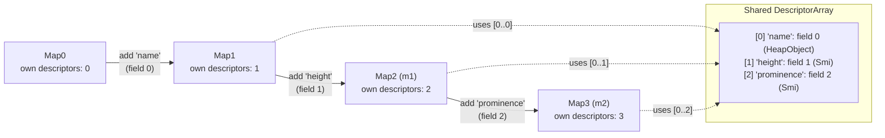
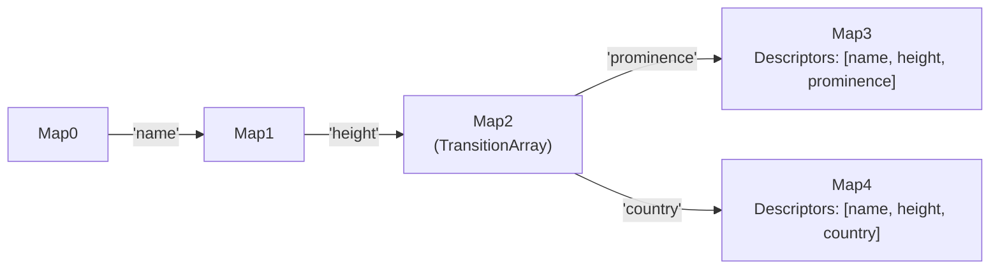

# Hidden Classes in V8: A Step-by-Step Walkthrough

## Conceptual Overview

This tutorial walks through how V8 builds and uses **Hidden Classes** (`Map`s in V8's C++ codebase) from the ground up, showing how dynamic JavaScript objects gain the memory layout and property-access speed of compiled C++ structs, and how `PropertyConstness::kConst` enables aggressive constant folding in Maglev and TurboFan.

*(For the low-level bitfields of `DescriptorArray`, `TransitionArray`, `LoadHandler`, and `StubCache`, see [Hidden Classes and ICs](hidden-classes-and-ics.md) and [Descriptor and Transition Arrays](../objects/descriptor-and-transition-arrays.md).)*

---

## 1. Why Hidden Classes Exist

In a statically typed language like C++ or Java, a class's field layout is fixed at compile time:
- Every instance of `struct Point { int x; int y; }` stores `x` at byte offset `0` and `y` at byte offset `4`.
- Reading `p->y` compiles to a single machine load instruction (`mov eax, [rdi + 4]`).

JavaScript has no static struct declarations, and properties can be added to any object on the fly. Without hidden classes, every object would have to store its properties in a hash table (dictionary), turning every `point.y` read into a string hash computation, bucket probe, and key comparison.

V8 avoids dictionary lookups by observing that **most JavaScript objects are initialized in predictable, repeatable patterns**. Every `HeapObject` in V8 starts with a pointer to a **`Map`** (its hidden class). The `Map` acts as a blueprint describing:
- Which properties the object has (`DescriptorArray`).
- Which offset inside the object (or out-of-object `PropertyArray`) each property lives at.
- Which child `Map` to transition to when a new property is added (`TransitionsAccessor` / `TransitionArray`).

---

## 2. Step-by-Step: Building a Transition Chain

Consider this constructor function:

```javascript
function Peak(name, height, extra) {
  this.name = name;
  this.height = height;
  if (extra) {
    this.prominence = extra;
  }
}

const m1 = new Peak("Matterhorn", 4478);
const m2 = new Peak("Mont Blanc", 4810, 4695);
```

### Step 1: Newly Allocated `this` (`Map0`)
When `new Peak("Matterhorn", 4478)` begins, V8 allocates a fresh `JSObject` with slack space for in-object properties (`this.name`, `this.height`, `this.prominence`). Initially, it points to `Peak`'s initial hidden class, **`Map0`**, which has **0 descriptors**.

### Step 2: `this.name = name` (`Map0 -> Map1`)
When `this.name = "Matterhorn"` executes:
1. V8 checks `Map0`'s transitions and creates **`Map1`**.
2. `Map1`'s `DescriptorArray` records that `"name"` is stored at **in-object field index 0** (`Representation::HeapObject()`, `FieldType::Class(String)`).
3. `Map0` records an inline weak transition (`TransitionsAccessor::kWeakRef`) to `Map1`: `Map0 --("name")--> Map1`.

### Step 3: `this.height = height` (`Map1 -> Map2`)
When `this.height = 4478` executes:
1. V8 transitions from `Map1` to **`Map2`**.
2. Rather than copying `Map1`'s `DescriptorArray`, **`Map1` and `Map2` share the same `DescriptorArray`**, with `Map1->NumberOfOwnDescriptors() == 1` and `Map2->NumberOfOwnDescriptors() == 2`!
3. Descriptor 1 records `"height"` at **in-object field index 1** (`Representation::Smi()`).
4. Because `extra` is `undefined`, `m1` finishes construction with **`Map2`**.

### Step 4: Constructing `m2` (`Map0 -> Map1 -> Map2 -> Map3`)
When `new Peak("Mont Blanc", 4810, 4695)` runs:
1. It starts at `Map0`, follows the existing `"name"` transition to `Map1`, and follows the existing `"height"` transition to `Map2` -- allocating **zero** new `Map`s for the first two properties!
2. Because `extra` is truthy (`4695`), `this.prominence = 4695` executes on `Map2`, creating **`Map3`** (which appends `"prominence"` at **in-object field index 2** to the shared `DescriptorArray` using pre-allocated descriptor slack).



---

## 3. Branching Transition Trees

What if another function adds a different property after `height`?

```javascript
const m3 = new Peak("K2", 8611);
m3.country = "Pakistan/China";
```

Now `Map2` has **two** outgoing transitions: one for `"prominence"` (`Map3`) and one for `"country"` (`Map4`):
1. `Map2`'s `raw_transitions()` upgrades from an inline single weak pointer (`kWeakRef`) to a **`TransitionArray`** (`kFullTransitionArray`) containing two sorted `[Key, Weak<Map>]` entries: `["country" -> Map4, "prominence" -> Map3]`.
2. Because `Map3` already claimed index 2 of the original `DescriptorArray` for `"prominence"`, `Map4` cannot overwrite index 2 with `"country"`. Therefore, `Map4` allocates its own `DescriptorArray` (`["name", "height", "country"]`).



### Why Property Insertion Order Matters
Because transitions depend on the exact sequence of property additions, creating `{ a: 1, b: 2 }` and `{ b: 2, a: 1 }` dynamically walks two different paths in the transition tree (`Map0 --"a"--> MapA --"b"--> MapAB` vs `Map0 --"b"--> MapB --"a"--> MapBA`), producing two distinct `Map`s where `a` and `b` sit at swapped field offsets. Initializing properties in a consistent order ensures all instances share a single `Map` and keeps Inline Caches **monomorphic**.

---

## 4. `PropertyConstness::kConst` and Compiler Constant Folding

Every descriptor in a `DescriptorArray` tracks a 1-bit **`PropertyConstness`** flag (`src/objects/property-details.h`):
- **`PropertyConstness::kConst`**: The property has been initialized once (when transitioning to the `Map`) and **has never been overwritten with a different value on any instance of this `Map`**.
- **`PropertyConstness::kMutable`**: The property has been overwritten at least once after initialization.

### How `kConst` Powers Code Generation and Deoptimization
Consider a top-level configuration object or prototype method holder:

```javascript
const config = { scale: 10 };

function compute(x) {
  return x * config.scale;
}
```

1. When `config` is created, its `Map` marks the `"scale"` descriptor as **`PropertyConstness::kConst`** (`Representation::Smi()`).
2. When `compute(x)` becomes hot and is compiled by Maglev or TurboFan:
   - The compiler sees that `config` is a constant object reference, checks its `Map`, and inspects the `"scale"` descriptor in `config->map()->instance_descriptors()`.
   - Seeing `PropertyConstness::kConst`, the compiler reads `config.scale` (`10`) at compile time, registers this compiled `Code` object in the `Map`'s **`DependentCode`** under **`DependentCode::kFieldConstGroup`**, and compiles `compute(x)` directly to `return x * 10` -- completely eliminating the property load from `config`!

```nasm
; Conceptual x64 optimized assembly for compute(x) with kConst folding:
; No load from `config` at all!
imul eax, edi, 10
jo deopt_exit_overflow
```

3. **What if user code later mutates `config.scale = 20`?**
   - The store passes through `StoreIC` / `LookupIterator::PrepareForDataProperty`.
   - `MapUpdater` sees that `"scale"` is currently `PropertyConstness::kConst` and the new value (`20`) differs from the existing value (`10`).
   - `MapUpdater` updates the descriptor in-place to **`PropertyConstness::kMutable`** and invokes `DependentCode::DeoptimizeDependencyGroups(isolate, map, DependentCode::kFieldConstGroup)`.
   - `compute`'s optimized `Code` is immediately marked for lazy deoptimization! The next call to `compute` falls back to Ignition (and if re-optimized later, compiles a normal field load instead of constant-folding `10`).

---

## 5. Inspecting Hidden Classes in `d8`

You can inspect `Map`s, `DescriptorArray`s, and `TransitionArray`s directly using a debug build of `d8` with `--allow-natives-syntax`:

```javascript
// Run with: out/x64.debug/d8 --allow-natives-syntax
function Peak(name, height) {
  this.name = name;
  this.height = height;
}
const m1 = new Peak("Matterhorn", 4478);
%DebugPrint(m1);
```

In the `%DebugPrint(m1)` output, look for:
- `map: 0x... <Map[24](HOLEY_ELEMENTS)>`
- `instance descriptors #2: 0x... <DescriptorArray[2]>` showing `(const data field 0:s, p: 0, Representation: HeapObject)` and `(const data field 1:s, p: 1, Representation: Smi)`.
- `back pointer: 0x... <Map>` linking back up the transition chain to `Map1` and `Map0`.
