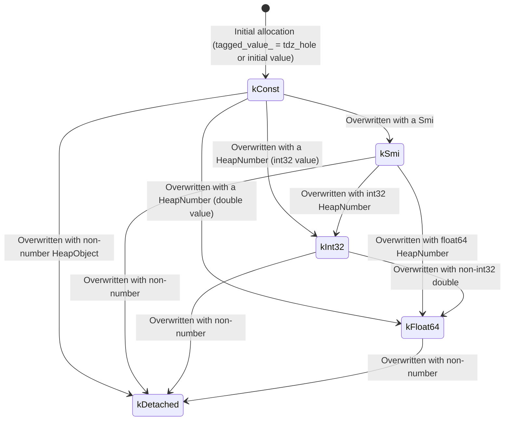

# Scopes, Contexts, `ScopeInfo`, and `ContextCell`

## Conceptual Overview

JavaScript is lexically scoped: an inner function can read and write variables declared in any outer function, block, class, or script, even long after the outer function has returned.

In V8, variables have two possible physical storage locations (`VariableLocation` in `src/ast/variables.h`):
1. **Stack-Allocated (`PARAMETER` or `LOCAL`)**: If a variable is only ever accessed by the function in which it is declared (never captured by an inner closure, `eval`, or generator suspension across closures), V8 allocates it in a virtual register on the CPU stack frame. Stack variables require zero heap allocation and vanish automatically when the function returns.
2. **Context-Allocated (`CONTEXT`, `LOOKUP`, or `MODULE`)**: If a variable is referenced by an inner function (or forced by direct `eval` / `with`), V8 allocates it inside a heap object called a **`Context`**. A `Context` contains a pointer to its enclosing `previous` `Context`, forming a linked **Scope Chain** on the heap.

To bridge compile-time AST analysis and runtime execution, V8 uses three core structures:
- **`Scope` (`src/ast/scopes.h`)**: A transient, Zone-allocated tree built during parsing to resolve identifiers (`VariableProxy`) to declarations (`Variable`) and decide which variables can stay on the stack vs which must move to a heap `Context`.
- **`ScopeInfo` (`src/objects/scope-info.h`)**: A compact, immutable heap object serialized from a `Scope` after parsing. It survives for the lifetime of the `SharedFunctionInfo` and `Context` to support lazy compilation of inner functions, deoptimization, stack traces, and debugger variable inspection.
- **`Context` & `ContextCell` (`src/objects/contexts.h`)**: The runtime heap storage for context-allocated variables, enhanced with **`ContextCell`** slots that track constancy and unboxed `Smi`/`int32`/`float64` states for optimizing compilers.

---

## 1. Compile-Time `Scope` vs Runtime `ScopeInfo` & `Context`

```mermaid
flowchart LR
    subgraph Compile-Time (Zone Memory, Freed After Compile)
        AST["Parser / AST"] --> Scope["Scope Tree<br/>(DeclarationScope, BlockScope...)"]
        Scope --> Analyze["DeclarationScope::Analyze()<br/>ResolveVariables + AllocateVariables"]
    end

    subgraph Persistent Heap Metadata
        Analyze -->|"ScopeInfo::Create"| SI["ScopeInfo<br/>(Packed variable names, modes, indices)"]
        SI --> SFI["SharedFunctionInfo::name_or_scope_info_"]
    end

    subgraph Runtime Execution (JS Heap)
        SI -->|"Context::scope_info()"| Ctx["Context<br/>(NativeContext, ScriptContext, FunctionContext, BlockContext)"]
        Ctx --> CC["ContextCell<br/>(kConst / kSmi / kInt32 / kFloat64 / kDetached)"]
    end
```

### Empty Scopes Elision
Not every syntactic `{ ... }` block in JavaScript creates a `ScopeInfo` or allocates a runtime `BlockContext`. During `Scope::MustAllocateInContext`, if a block scope has **zero** context-allocated variables, V8 elides the runtime `Context` completely: the variables live in stack registers, and no `ScopeInfo` or `PushContext` bytecode is emitted for that block.

### How Lazy Inner Functions Resolve Outer Variables (`kParsedScope` vs `kDeserializedScope`)
Suppose `outer()` has already been compiled to bytecode (and its AST/`Scope` Zone memory freed), while an inner function `inner()` was skipped by the PreParser (`CompileLazy`). When `inner()` is called later:
1. V8 reconstructs the enclosing scope chain from the outer `SharedFunctionInfo`s' **`ScopeInfo`** objects (`Scope::DeserializeScopeChain`).
2. `Scope::Lookup<kDeserializedScope>` queries `ScopeInfo::ContextSlotIndex(name)` on those deserialized scopes to find the exact `(context_chain_depth, slot_index)` for any outer variable captured by `inner()`.

---

## 2. `ScopeInfo` Packed Layout (`src/objects/scope-info.h`, `src/objects/scope-info.tq`)

Because every compiled `SharedFunctionInfo` and every runtime `Context` points to a `ScopeInfo`, `ScopeInfo` is heavily bit-packed as a variable-length Torque-defined object (`src/objects/scope-info.tq`):

1. **`Flags` (32-bit packed bitfield)**:
   - `ScopeType` (`FUNCTION_SCOPE`, `SCRIPT_SCOPE`, `EVAL_SCOPE`, `MODULE_SCOPE`, `CATCH_SCOPE`, `BLOCK_SCOPE`, `WITH_SCOPE`, `CLASS_SCOPE`, `SHADOW_REALM_SCOPE`).
   - `LanguageMode` (`kSloppy` vs `kStrict`), `FunctionKind`, `CallsSloppyEval`, `HasContextAllocation`, `HasContextCells`, `IsSimpleParameterList`, `PrivateNameLookupSkipsOuterClass`, etc.
2. **Counts**: `ParameterCount`, `ContextLocalCount` (number of slots allocated in this `Context`).
3. **Variable Metadata Arrays (`ContextLocalNames` & `ContextLocalInfos`)**:
   - **`ContextLocalNames`**: Either inline `InternalizedString` pointers (for small scopes) or a pointer to a deduplicated **`NameToIndexHashTable`** (when `ContextLocalCount >= kMaxInlinedLocalNamesSize`) for $O(1)$ variable lookup by name.
   - **`ContextLocalInfos`**: One packed `Smi` per context slot encoding:
     - `VariableMode` (`kLet`, `kConst`, `kVar`, `kUsing`, `kAwaitUsing`, private methods/accessors).
     - `InitializationFlag` (`kNeedsInitialization` vs `kCreatedInitialized`).
     - `MaybeAssignedFlag` (`kNotAssigned` vs `kMaybeAssigned`, computed statically during parsing!).
     - `ParameterNumber` and **`InlinedLocalNameLookup`** / **Position Distance** (whether the variable's initializer is within `ScopeInfo::kMaxVariablePositionDistance` of the scope start, used for cross-closure TDZ hole-check elimination -- see [Parser Hole Check Elimination](../parsing/hole-check-elimination-parser.md)).

---

## 3. Runtime `Context` Hierarchy (`src/objects/contexts.h`)

Every `Context` on the heap is a variable-length array of tagged slots prefixed by a fixed 3-slot header (`kScopeInfoIndex = 0`, `kPreviousIndex = 1`, and an optional 3rd slot such as `kExtensionIndex`):

```text
+-----------------------------------------------------------------------+
| Map (function_context_map, block_context_map, script_context_map...)  |
| length (Smi: total slots)                                             |
+-----------------------------------------------------------------------+
| [0] kScopeInfoIndex : Tagged<ScopeInfo>                               |
| [1] kPreviousIndex  : Tagged<Context> (enclosing lexical Context)     |
| [2] MIN_CONTEXT_SLOTS: Context local 0 (or kExtensionIndex if Ext)    |
| [3]                  : Context local 1                                |
| ...                                                                   |
+-----------------------------------------------------------------------+
```

- **`NativeContext`**: The root context of a JavaScript realm (`window` / `globalThis`). Holds all intrinsic constructors (`Array`, `Object`, `Promise`), default maps, and the `ScriptContextTable`.
- **`ScriptContext`**: Holds top-level lexical declarations (`let`, `const`, `class`) of a script.
- **`FunctionContext`**: Created by `CreateFunctionContext` on entry to a function that has context-allocated variables.
- **`BlockContext` / `CatchContext` / `WithContext`**: Created by `CreateBlockContext`, `CreateCatchContext` (single variable slot for the caught exception), or `CreateWithContext` (stores the `with (obj)` target in `kExtensionIndex`).

---

## 4. `ContextCell`: Typed Specialization for Context Variables (`src/objects/contexts.h`)

### The Problem with Raw `Context` Slots
Historically, every variable in a `Context` was stored as a plain tagged value directly in `context->get(slot_index)`.
- If a variable was assigned more than once (`MaybeAssignedFlag::kMaybeAssigned`), optimizing compilers could not constant-fold it, even if at runtime it was only ever initialized once!
- Worse, if a loop counter or numeric accumulator (`let sum = 0.0; sum += x;`) was captured in a `FunctionContext` or `ScriptContext`, every single write had to allocate a brand-new `HeapNumber` box because raw `Context` slots had no `Representation::Double()` tracking or `DependentCode` invalidation!

### How `ContextCell` Solves This
When `Scope::has_context_cells()` is true (used in `ScriptContext`s and `FunctionContext`s with mutable context-allocated variables when `--script-context-cells` / `--function-context-cells` is active), mutable context variables are wrapped in a **`ContextCell`** heap object (`src/objects/contexts.h`, `src/objects/contexts.tq`) stored in the `Context` slot:

```text
+-------------------------------------------------------------------+
| Map (context_cell_map)                                            |
+-------------------------------------------------------------------+
| tagged_value_   (TaggedMember<Object>: JS value or tdz_hole)      |
| dependent_code_ (TaggedMember<DependentCode>: deopt dependents)   |
| state_          (std::atomic<State>: int32_t enum)                |
| double_value_   (double: 64-bit unboxed float64 or int32 payload) |
+-------------------------------------------------------------------+
```

### The `ContextCell::State` Lattice

A `ContextCell` transitions monotonically through five states (`ContextCell::State`):



| `ContextCell::State` | Value Storage Location | Compiler & Runtime Behavior |
| :--- | :--- | :--- |
| **`kConst = 0`** | `tagged_value_` (initially `tdz_hole_value`, then the first assigned value) | **Constant Folding!** Maglev and TurboFan read `tagged_value_` at compile time, register in `dependent_code_` (`LazyDeoptimizeReason::kContextCellChange`), and fold the constant directly into the IR without emitting a runtime load! (While `tagged_value_` is still `tdz_hole_value`, the cell remains in `kConst` without registering constant-folding code until the first real assignment initializes it.) |
| **`kSmi = 1`** | `tagged_value_` (`Tagged<Smi>`) | Guaranteed to hold a `Smi`. Compilers load/store `tagged_value_` directly as a tagged `Smi`. |
| **`kInt32 = 2`** | `double_value_` (low 32 bits as `int32_t`, `tagged_value_ = Smi::zero()`) | **Unboxed 32-bit Integer!** Compilers load and store raw 32-bit signed integers directly inside `double_value_` with **zero `HeapNumber` allocations**! |
| **`kFloat64 = 3`** | `double_value_` (64-bit IEEE-754 `double`, `tagged_value_ = Smi::zero()`) | **Unboxed 64-bit Float!** Compilers load and store raw `double` values in-place inside `double_value_` with **zero `HeapNumber` allocations**! |
| **`kDetached = 4`** | Detached (`tagged_value_ = Smi::zero()`) | Once a variable holds varied non-numeric `HeapObject`s (or transitions out of tracked states), the `ContextCell` is **detached**: V8 replaces the `ContextCell` pointer inside the `Context` slot directly with the raw `Tagged<Object>` value, and future accesses read/write the `Context` slot directly! |

Whenever a write (`LdaContextSlot` / `StaContextSlot` or `ScriptContext` IC/runtime helper) causes a `ContextCell` to transition from one `State` to another (e.g., `kConst -> kSmi` or `kInt32 -> kFloat64`), V8 triggers `DependentCode::DeoptimizeDependencyGroups(..., DependentCode::kContextCellGroup)` (`LazyDeoptimizeReason::kContextCellChange`), safely deoptimizing any Maglev/TurboFan code that specialized on the narrower state.

---

## Key Source Files

- `src/ast/scopes.h` & `src/ast/scopes.cc`: `Scope`, `DeclarationScope::Analyze`, `MustAllocate`, and `ResolveVariable`.
- `src/objects/scope-info.h`, `src/objects/scope-info.tq`, & `src/objects/scope-info.cc`: `ScopeInfo` bit-packing and variable lookup tables.
- `src/objects/contexts.h`, `src/objects/contexts-inl.h`, & `src/objects/contexts.tq`: `Context`, `ScriptContextTable`, and `ContextCell` (`State::kConst`, `kSmi`, `kInt32`, `kFloat64`, `kDetached`).
