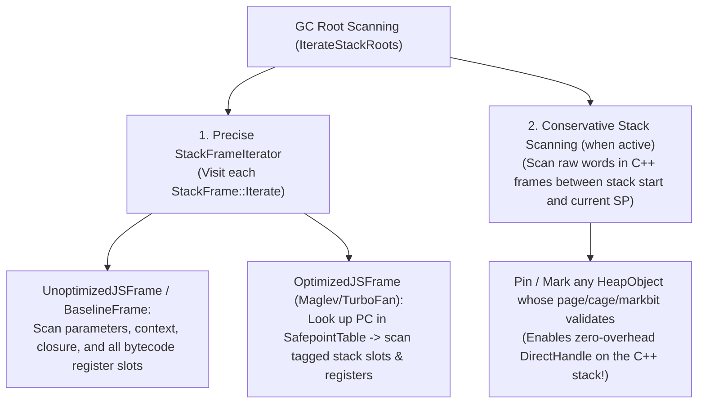

# Stack Walking and Frame Layouts in V8

## Conceptual Overview

At any moment during execution, a V8 thread's call stack contains an interleaved mix of frames: C++ entry frames, Ignition bytecode interpreter frames, Sparkplug baseline frames, Maglev and TurboFan optimized frames, builtin continuation frames, and WebAssembly frames.

Four critical subsystems in V8 rely on walking this heterogeneous stack accurately:
1. **Garbage Collection (Root Scanning)**: The GC must find every live heap object pointer on the stack (using a combination of precise frame-slot / `SafepointTable` iteration and **Conservative Stack Scanning**).
2. **Exception Unwinding (`Isolate::Throw`)**: Walks from the throwing PC outward until a frame's `HandlerTable` catches the exception.
3. **Deoptimization**: Replaces an optimized `TURBOFAN_JS` or `MAGLEV` frame on the physical stack with one or more reconstructed `INTERPRETED` and `BUILTIN_CONTINUATION` frames.
4. **CPU Profiling & Stack Traces (`Error.stack`, DevTools)**: Samples the call stack asynchronously from a signal handler or walks frames synchronously to symbolize function names and line numbers.

---

## 1. Standard Frame Pointer (`fp`) Chain and Frame Type Markers

V8 maintains a contiguous linked list of **Frame Pointers (`fp` / `rbp` on x64 / `x29` on ARM64)** across all generated frames. At `fp + 0`, every frame stores the caller's saved `fp`, and at `fp + kSystemPointerSize`, it stores the caller's return `pc`:

```text
Higher Memory Addresses (Caller Frames)
+-----------------------------------------------------------------------+
| Caller Parameter N ... Parameter 0 / Receiver                         |
+-----------------------------------------------------------------------+
| Return Address (saved PC in caller)             [ fp + kPCOnStackSize ]|
+=======================================================================+
| Saved Caller Frame Pointer (prev FP)            [ fp + 0 ]            | <-- Current FP
+-----------------------------------------------------------------------+
| Context OR Frame Type Marker (Smi)              [ fp - kPointerSize ] |
+-----------------------------------------------------------------------+
| JSFunction (or Frame Type Marker for Stubs)     [ fp - 2*kPointerSize]|
+-----------------------------------------------------------------------+
| Frame-Specific Header & Local Slots / Registers                       |
+-----------------------------------------------------------------------+
Lower Memory Addresses (Current Stack Pointer SP)
```

### How V8 Distinguishes JavaScript Frames from Internal/Stub Frames
How does `StackFrame::ComputeType` know what kind of frame sits at a given `fp`?
- **Standard JavaScript Frames (`INTERPRETED`, `BASELINE`, `MAGLEV`, `TURBOFAN_JS`)**:
  - Store a valid `Tagged<Context>` heap pointer at `[fp + StandardFrameConstants::kContextOffset]` and the `Tagged<JSFunction>` at `[fp + StandardFrameConstants::kFunctionOffset]`.
  - To distinguish which tier a JS frame belongs to without adding extra words to every JS frame:
    - **`INTERPRETED` (`InterpretedFrame`)**: Identified because the return `pc` (or current PC) lies inside an Ignition bytecode handler builtin (`Isolate::builtins()->IsBytecodeHandlerPc(pc)`) or `InterpreterEntryTrampoline`! It adds `[fp + UnoptimizedFrameConstants::kBytecodeArrayFromFp]` and `[fp + kBytecodeOffsetOrFeedbackCellFromFp]`.
    - **`BASELINE` / `MAGLEV` / `TURBOFAN_JS`**: Identified by looking up the `Code` object for `pc` (or reading the `Code` / marker slot) and checking `code->kind()` (`CodeKind::BASELINE`, `CodeKind::MAGLEV`, `CodeKind::TURBOFAN_JS`).
- **Typed / Marker Frames (`ENTRY`, `CONSTRUCT`, `EXIT`, `BUILTIN_CONTINUATION`, `WASM`, etc.)**:
  - Store a **tagged `Smi` encoding `StackFrame::Type`** (`StackFrame::TypeToMarker(type)`) in the context/marker slot (`[fp + TypedFrameConstants::kFrameTypeOffset]`)! Because every `HeapObject` (like a `Context`) has a low tag bit of `1` while every `Smi` has a low tag bit of `0`, a single bit test tells the stack walker whether the slot holds a `Context` or a `StackFrame::Type` marker!

---

## 2. Complete `StackFrame::Type` Taxonomy (`src/execution/frames.h`)

`FRAME_TYPE_LIST` in `src/execution/frames.h` defines the concrete `StackFrame` subclasses:

| Category | `StackFrame::Type` Enum (`StackFrame` Class) | Role |
| :--- | :--- | :--- |
| **C++ -> JS Entry** | `ENTRY` (`EntryFrame`)<br/>`CONSTRUCT_ENTRY` (`ConstructEntryFrame`) | Pushed by `JSEntryTrampoline` when C++ invokes JS (`Execution::Call` / `Construct`). Saves C++ callee-saved registers and links to the previous `c_entry_fp`. |
| **JS -> C++ Exit** | `EXIT` (`ExitFrame`)<br/>`BUILTIN_EXIT` (`BuiltinExitFrame`)<br/>`API_CALLBACK_EXIT` (`ApiCallbackExitFrame`)<br/>`API_ACCESSOR_EXIT` (`ApiAccessorExitFrame`) | Pushed by `CEntry` or API stubs when JS calls into a C++ `RUNTIME_FUNCTION`, C++ builtin, or `v8::FunctionCallback`. Records `Isolate::c_entry_fp()` so stack walking can jump across arbitrary C++ compiler frames! |
| **JavaScript Execution Tiers** | `INTERPRETED` (`InterpretedFrame`)<br/>`BASELINE` (`BaselineFrame`)<br/>`MAGLEV` (`MaglevFrame`)<br/>`TURBOFAN_JS` (`TurbofanJSFrame`) | The four JavaScript execution tiers (`UnoptimizedJSFrame` base for Ignition/Sparkplug; `OptimizedJSFrame` base for Maglev/TurboFan). |
| **Construct & Argument Adapters** | `CONSTRUCT` (`ConstructFrame`)<br/>`FAST_CONSTRUCT` (`FastConstructFrame`) | Wraps `new Foo()` calls to enforce ECMAScript constructor return-value semantics (returning the allocated `receiver` if the constructor returns a primitive). |
| **Deopt & Builtin Continuations** | `IRREGEXP` (`IrregexpFrame`)<br/>`INTERNAL` (`InternalFrame`)<br/>`TURBOFAN_STUB_WITH_CONTEXT` (`TurbofanStubWithContextFrame`)<br/>`BUILTIN_CONTINUATION` (`BuiltinContinuationFrame`)<br/>`JAVASCRIPT_BUILTIN_CONTINUATION` (`JavaScriptBuiltinContinuationFrame`)<br/>`JAVASCRIPT_BUILTIN_CONTINUATION_WITH_CATCH` (`...WithCatchFrame`) | Internal helper frames and synthetic frames reconstructed by the Deoptimizer when an inlined builtin deoptimizes mid-operation. |
| **WebAssembly & JSPI** | `WASM` (`WasmFrame`), `WASM_TO_JS`, `JS_TO_WASM`, `WASM_INTERPRETER_ENTRY`, `WASM_DEBUG_BREAK`, `C_WASM_ENTRY`, `WASM_EXIT`, `WASM_LIFTOFF_SETUP`, `WASM_SEGMENT_START` (`WasmSegmentStartFrame`) | WebAssembly execution, JS/Wasm boundary wrappers, and JS Promise Integration (JSPI) stack-switching segment headers. |

### Bridging C++ Frames (`c_entry_fp` and `handler` Chain)
When V8 is executing inside C++ (e.g., `Runtime_LoadIC_Miss`), the C++ compiler's stack frames on top of `ExitFrame` do not have V8 frame headers. How does `StackFrameIterator` start from C++ and find the topmost JS frame?
1. When JS enters C++ through an `ExitFrame`, the stub stores the `ExitFrame`'s `fp` in `Isolate::c_entry_fp()`.
2. If that C++ code recursively re-enters JS (pushing a new `EntryFrame`), the `EntryFrame` saves the outer `c_entry_fp` on the stack (`EntryFrameConstants::kDirectCallerFPOffset`) and links into `ThreadLocalTop`.
3. Thus, `StackFrameIterator` starts at `Isolate::c_entry_fp()`, walks `fp` links upward through JS frames until it hits an `EntryFrame`, and then jumps across the C++ gap directly to the previous saved `c_entry_fp`!

---

## 3. `StackFrameIterator` vs `StackFrameIteratorForProfiler` (`src/execution/frames.h`)

V8 provides two distinct frame iterators for very different operating environments:

### 1. `StackFrameIterator` (Synchronous, Exact In-Runtime Walking)
Used by GC root scanning, `Isolate::Throw`, `Deoptimizer`, and synchronous `Error.stack` capture.
- **Precondition**: Runs **only at well-defined safepoints** (inside a C++ runtime call, builtin, or GC pause) when every frame on the stack has a completely constructed header and valid `fp` chain.
- **Inlined Frame Expansion (`FrameSummary` / `JavaScriptFrameIterator`)**: A single physical `MAGLEV` or `TURBOFAN_JS` frame may represent multiple inlined JS functions. Calling `frame->Summarize(&frames)` decodes the `SafepointEntry`'s `deoptimization_index` in `DeoptimizationData` to expand the single physical frame into a vector of logical `FrameSummary` records (innermost to outermost).
- **Placeholder Constructor Receivers (`TdzHole`)**: When a derived class constructor throws before `super()` (or while a builtin/API constructor frame is on the stack), `frame->receiver()` is `tdz_hole_value()` (`TdzHole`). All three stack-trace receiver consumers -- `CallSiteBuilder::AppendFrame` (`src/execution/isolate.cc`), `StringStream::PrintPrototype` (`src/strings/string-stream.cc`), and `DebugStackTraceIterator::GetReceiver` (`src/debug/debug-stack-trace-iterator.cc`) -- must check `IsTdzHole` (rather than `IsTheHole`) to avoid dereferencing `TdzHole` as a `JSReceiver`.

### 2. `StackFrameIteratorForProfiler` (Asynchronous Signal-Handler Safe Walking)
Used by V8's sampling CPU profiler (`TickSample` / `CpuProfiler`), which interrupts the target thread at **completely arbitrary machine instructions** via an OS signal (`SIGPROF` on POSIX) or thread suspension.

Why can't a signal handler use `StackFrameIterator`?
- **Prologue / Epilogue Hazards**: The signal might arrive in the middle of a function prologue (before `push rbp; mov rbp, rsp` has finished) or epilogue (after `pop rbp` before `ret`), or inside a frameless stub (`IsNoFrameBytecodeHandlerPc`).
- **Validation Guards (`StackFrameIteratorForProfiler`)**:
  - Checks pointer alignment (`IsAligned(..., kSystemPointerSize)`) alongside stack bounds for every candidate `sp` and `fp` (`IsValidStackAddress` / `IsValidFramePointer` / `IsValidState`), preventing misaligned reads if `SIGPROF` interrupts a signal handler (such as the Wasm trap handler) or frame-pointer-less C++ helper while `js_entry_sp` is active and `c_entry_fp` is null.
  - Validates `IsValidFrameType` before dereferencing frame markers.
  - Inspects `top_frame_type_` and registers from `TickSample` (`pc`, `fp`, `sp`, `lr`) to recover the caller when stopped mid-prologue/epilogue.

> [!CAUTION]
> **Never Add `V8_EXPORT_PRIVATE` to `StackFrameIteratorForProfiler`!**
> As documented in `src/execution/frames.h`, `StackFrameIteratorForProfiler` runs inside an asynchronous POSIX signal handler (`SIGPROF`) on the interrupted thread's stack -- which may be right at the edge of a stack overflow! If `StackFrameIteratorForProfiler` methods were exported across shared-library boundaries (`V8_EXPORT_PRIVATE` in component builds), calling them would invoke the dynamic linker's lazy PLT resolver (`_dl_runtime_resolve`), which allocates a large stack frame and **crashes with a stack overflow inside the signal handler**.

---

## 4. Garbage Collection & Conservative Stack Scanning (CSS)

Historically, every V8 C++ runtime function had to wrap all heap pointers in indirect `Handle<T>` slots allocated in a `HandleScope` table because the GC only knew how to scan `HandleScope`s and tagged slots described by `SafepointTable`s in JIT frames.

Modern V8 combines **Precise Frame Scanning** with **Conservative Stack Scanning (CSS)** (`src/heap/base/stack.h`, `ConservativeStackVisitor`):



1. **Precise Scanning (`StackFrame::Iterate`)**:
   - In `InterpretedFrame` and `BaselineFrame`, every bytecode register slot on the stack is guaranteed to hold a valid tagged value (initialized to `undefined` or `stale_register` / `tdz_hole`), so the GC visits all parameter and register slots directly.
   - In `MaglevFrame` and `TurbofanJSFrame`, local stack slots and CPU registers may hold raw unboxed 32-bit/64-bit integers or floats that look like heap pointers! Therefore, the compiler emits a **`SafepointTable`** (or `MaglevSafepointTable`) recording a bitmap of which stack spill slots (`VisitSpillSlots`) and callee-saved registers hold **tagged pointers** at each call PC.
2. **Conservative Stack Scanning (`ConservativeStackVisitor`)**:
   - In C++ frames (between `c_entry_fp` segments), modern V8 allows `DirectHandle<T>` -- a zero-indirection wrapper holding a direct `Tagged<T>` pointer on the C++ CPU stack or in a CPU register!
   - When a GC occurs while C++ frames are on the stack, `ConservativeStackVisitor` scans raw words on the C++ stack, checks whether each word falls within a valid V8 heap page in the pointer-compression cage and points to a valid `HeapObject` allocation boundary (`MarkingBitmap`), and conservatively marks and pins those objects so they are not moved while C++ holds direct stack pointers to them.

---

## Key Source Files

- `src/execution/frames.h`, `src/execution/frames-inl.h`, & `src/execution/frames.cc`: `StackFrame` hierarchy, `StackFrameIterator`, `StackFrameIteratorForProfiler`, and `FrameSummary`.
- `src/execution/frame-constants.h`: Architecture-independent and architecture-specific frame slot offsets (`StandardFrameConstants`, `UnoptimizedFrameConstants`, `TypedFrameConstants`).
- `src/codegen/safepoint-table.h` & `src/codegen/maglev-safepoint-table.h`: Safepoint bitmaps for tagged spill slots and registers in optimized frames.
- `src/heap/conservative-stack-visitor.h` & `.cc`: Conservative Stack Scanning (CSS) for `DirectHandle<T>`.
