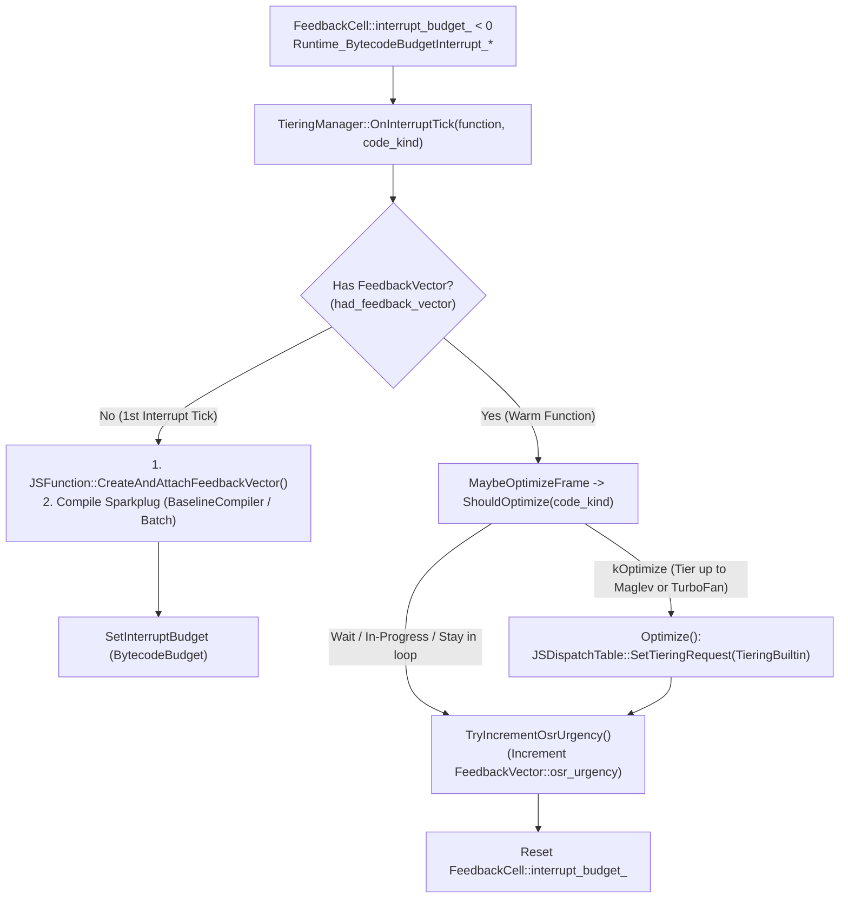

# V8 Execution Tiers and the `TieringManager`

## Conceptual Overview

V8 executes JavaScript across **four execution tiers**, trading off compilation latency and memory overhead against peak execution speed:

1. **Ignition (Interpreter)**: Compiles AST to compact bytecode (`BytecodeArray`). Fast startup, lowest memory footprint, collects type feedback into a `FeedbackVector` once warm.
2. **Sparkplug (Baseline Compiler)**: Translates `BytecodeArray` 1-to-1 into native machine code in a single linear pass (~1 ms) without an intermediate IR or register allocation graph. Calls the exact same IC builtins as Ignition, runs ~20-40% faster by eliminating bytecode dispatch overhead, and **never deoptimizes**.
3. **Maglev (Mid-Tier Optimizing SSA Compiler)**: Builds a fast CFG/SSA graph (`MaglevGraphBuilder`), consumes `FeedbackVector` IC state to inline monomorphic/polymorphic property accesses, unboxes numbers, tracks `KnownNodeAspects` along control flow, and generates machine code ~10x faster than TurboFan.
4. **TurboFan / Turboshaft (Top-Tier Optimizing Compiler)**: Performs deep sea-of-nodes / CFG-based Turboshaft optimizations (escape analysis, scalar replacement, loop-invariant code motion, range analysis, instruction selection, and graph coloring register allocation) for maximum peak throughput on hot functions.

All transitions between these four tiers are orchestrated by **`TieringManager`** (`src/execution/tiering-manager.h`, `src/execution/tiering-manager.cc`) using per-closure **interrupt budgets** (`FeedbackCell::interrupt_budget_`) and the **`JSDispatchTable`**.

---

## 1. Interrupt Budgets and `TieringManager::OnInterruptTick`

Instead of checking invocation counters on every function entry and loop back-edge, V8 maintains a single countdown timer in **`FeedbackCell::interrupt_budget_`** (a 32-bit byte budget):
- Every time Ignition or Sparkplug executes a **`JumpLoop`** (loop back-edge) or **`Return`** bytecode, it subtracts the number of bytecode bytes just executed (the loop body size or function bytecode length) from `feedback_cell->interrupt_budget()`.
- While `interrupt_budget >= 0`, execution continues at full speed with a single subtraction and sign check.
- When `interrupt_budget < 0`, the function calls into **`Runtime_BytecodeBudgetInterrupt_*`** (with distinct entry points for Ignition vs Sparkplug, and `JumpLoop` vs `Return`), which invokes **`TieringManager::OnInterruptTick`**.



---

## 2. Step-by-Step Tiering Progression (`src/execution/tiering-manager.cc`)

### Phase 1: Cold Execution (Ignition Without a `FeedbackVector`)
When a function is first compiled to Ignition bytecode (`Compiler::Compile`):
- It does **not** allocate a `FeedbackVector` yet (`FeedbackCell::value()` holds only a `ClosureFeedbackCellArray` or `Undefined` -- see [Function Architecture](function-architecture.md)).
- Ignition executes in feedback-less mode (`Ignite` without recording IC feedback), and `FeedbackCell::interrupt_budget_` is initialized to `TieringManager::InterruptBudgetFor(..., kNone)` (~`kInvocationCountForFeedbackAllocation * bytecode->length()`).

### Phase 2: First Interrupt Tick (`!had_feedback_vector` -> Feedback Allocation + Sparkplug)
When the cold budget expires (`!had_feedback_vector` in `TieringManager::OnInterruptTick`):
1. **Allocate `FeedbackVector`**: V8 calls `JSFunction::CreateAndAttachFeedbackVector(isolate, function, &is_compiled_scope)`. From this point on, Ignition and Sparkplug record type feedback in IC slots.
2. **Compile Sparkplug Immediately**: If `CanCompileWithBaseline(isolate, shared)` is true and Sparkplug is not already compiled on `shared`:
   - With `--baseline-batch-compilation` (default): enqueues `shared` in `BaselineBatchCompiler` (which batches small functions together on a background thread once a byte threshold is reached, or compiles large functions immediately).
   - Without batching: compiles Sparkplug synchronously right inside `OnInterruptTick` and installs the `Baseline` `Code` object.

### Phase 3: IC Stabilization (`TieringManager::NotifyICChanged`)
Wait: why doesn't V8 optimize a function with Maglev immediately after allocating its `FeedbackVector`? Because on the very first run with a fresh `FeedbackVector`, the ICs are still transitioning from `UNINITIALIZED` to `MONOMORPHIC` or `POLYMORPHIC`! Optimizing before ICs stabilize causes immediate deoptimization.

Whenever an IC changes state (`IC::OnFeedbackChanged` -> `TieringManager::NotifyICChanged`):
- If no `FeedbackVector` existed yet and the function is small enough, `NotifyICChanged` records a `CachedTieringDecision` (`kEarlySparkplug` -> `kNormal`) on the `SharedFunctionInfo` for Profile-Guided Optimization (PGO) heuristics.
- If a `FeedbackVector` already exists and the function is still warming up, `NotifyICChanged` **extends `FeedbackCell::interrupt_budget_`** (to at least `minimum_invocations_after_ic_update * bytecode_length`, e.g. `500 * length`) so Maglev waits until the ICs stop changing!

### Phase 4: Tiering Up to Maglev and TurboFan (`ShouldOptimize` & `SetTieringRequest`)
On subsequent interrupt ticks (`had_feedback_vector == true`), `TieringManager::ShouldOptimize` inspects the current active tier (`GetActiveTier()`), `FeedbackVector::invocation_count()`, bytecode size (`max_optimized_bytecode_size`), and whether a background job is already running (`tiering_in_progress()`):
- **Sparkplug / Ignition -> Maglev**: Triggered after `invocation_count_for_maglev` (~`400` invocations scaled by bytecode length).
- **Maglev -> TurboFan**: Inside Maglev code, function prologues and loop back-edges decrement `FeedbackVector::interrupt_budget_for_maglev_` (or `FeedbackCell::interrupt_budget_`). When exhausted (~`invocation_count_for_turbofan`, e.g. `3000` invocations), it triggers a tier-up request to `CodeKind::TURBOFAN_JS`.

#### How `JSDispatchTable::SetTieringRequest` Spawns the Compilation Job
When `TieringManager::Optimize(function, decision)` decides to tier up to Maglev or TurboFan, it does **not** compile the function directly inside `OnInterruptTick`! Instead:
1. It computes the corresponding **`TieringBuiltin`** (from `TieringState`: `StartMaglevOptimizeJob`, `OptimizeMaglevEager`, `StartTurbofanOptimizeJob`, `OptimizeTurbofanEager`, `MarkReoptimizeLazyDeoptimized`, etc.).
2. It calls `function->RequestOptimization(isolate, target_kind, concurrency_mode)` -> **`JSDispatchTable::SetTieringRequest(dispatch_handle, tiering_builtin, isolate)`**.
3. This overwrites the **`entrypoint`** pointer in the function's `JSDispatchTable` entry with the `TieringBuiltin`'s instruction start (while leaving the `ObjectPointer` in the dispatch table intact!).
4. On the **next call** to `function`, the call site jumps into the `TieringBuiltin`, which spawns the concurrent `MaglevCompilationJob` or `TurbofanCompilationJob` on a background worker thread (`OptimizingCompileDispatcher`), clears the tiering request in the `JSDispatchTable` entry back to the existing `Code` entrypoint, and resumes execution while the background compiler runs!
5. When the background thread finishes compiling, the main thread finalizes the job on a stack guard interrupt (`InstallOptimizedFunctions`) and updates the `JSDispatchTable` entry to the new `Maglev` or `TurboFan` `Code` object.

---

## 3. On-Stack Replacement (OSR) Mechanics

What if a function enters a long-running `for` or `while` loop on its very first call (for example, a top-level benchmark loop) and never returns to trigger a normal function-entry tier-up?

V8 handles hot loops via **On-Stack Replacement (OSR)**, switching execution tiers **in the middle of a running loop** at a `JumpLoop` back-edge:

```mermaid
sequenceDiagram
    participant Loop as Running Loop (Ignition / Sparkplug / Maglev)
    participant TM as TieringManager (OnInterruptTick)
    participant FV as FeedbackVector
    participant OSR as Runtime_CompileOptimizedOSR

    Loop->>TM: JumpLoop exhausts interrupt_budget_
    TM->>FV: TryIncrementOsrUrgency() -> osr_urgency++ (1, 2, ... kMaxOsrUrgency)
    TM-->>Loop: Resume loop
    Loop->>Loop: Next JumpLoop: compare loop_depth < osr_urgency
    Loop->>OSR: JumpLoop triggers OSR! Call Runtime_CompileOptimizedOSR
    OSR->>FV: Check JumpLoop FeedbackSlot for cached OSR Code
    OSR->>OSR: Spawn/finalize OSR compilation (Maglev or TurboFan targeting JumpLoop offset)
    OSR-->>Loop: Reconstruct/patch frame & jump into OSR Code at OsrPcOffset!
```

### 1. `FeedbackVector::osr_urgency()` vs `JumpLoop` `loop_depth`
- Every `JumpLoop` bytecode encodes its static 0-based **`loop_depth`** operand (`0` for outermost loops, `1` for singly nested loops, etc.).
- `FeedbackVector` stores a 3-bit **`osr_urgency`** counter (`0 .. FeedbackVector::kMaxOsrUrgency = 7`).
- When `TieringManager::OnInterruptTick` runs inside a loop that is already waiting for tier-up (or stays in a lower tier while the function already has optimized code), `TryIncrementOsrUrgency` increments `vector->osr_urgency()`.
- At every `JumpLoop` instruction, Ignition, Sparkplug, and Maglev compare `loop_depth` against `osr_urgency`. As soon as `osr_urgency > loop_depth`, the back-edge calls `Runtime_CompileOptimizedOSR`!
- **Why start with `osr_urgency = 1` (outermost loop `depth == 0` first)?** In a nested loop (`for i { for j { ... } }`), the inner loop (`depth == 1`) exhausts the interrupt budget first. If V8 immediately OSR-compiled only the inner loop, every outer iteration would fall back to unoptimized code and re-enter OSR! Incrementing `osr_urgency` from `0 -> 1` first tries to OSR at the **outermost** loop (`depth == 0`) if it steps soon; if the inner loop spins so long that another interrupt tick fires before the outer loop steps, `osr_urgency` increments to `2`, allowing the inner loop (`depth == 1`) to OSR.

### 2. Per-`JumpLoop` OSR Code Cache (`FeedbackSlotKind::kJumpLoop`)
Each `JumpLoop` bytecode has its own dedicated 1-word slot in the `FeedbackVector` (`FeedbackSlotKind::kJumpLoop`), which caches a weak pointer (`Weak<Code>`) to the compiled OSR `Code` object for that specific loop header (`osr_offset`), along with a `maybe_has_optimized_osr_code` flag on the `FeedbackVector`.

### 3. How Maglev OSRs into TurboFan (Deopt-to-OSR!)
When an Ignition or Sparkplug frame triggers OSR, its stack frame already has the exact `UnoptimizedJSFrame` register layout expected by the OSR entry point.
What if a function is already running in **Maglev** (`CodeKind::MAGLEV`) and spins in a loop long enough to trigger OSR tier-up to **TurboFan**?
- Maglev's register-allocated stack frame layout does **not** match the Ignition register layout that TurboFan's OSR entry expects!
- Therefore, when Maglev triggers OSR (`Runtime_CompileOptimizedOSRFromMaglev` / `DeoptimizeReason::kPrepareForOnStackReplacement`), V8 **intentionally deoptimizes the Maglev frame** (using `IsDeoptimizationWithoutCodeInvalidation` so the Maglev `Code` object is *not* discarded!) back into an Ignition `InterpretedFrame` at the `JumpLoop` bytecode, which then immediately enters the compiled TurboFan OSR code!

---

## Key Source Files

- `src/execution/tiering-manager.h` & `src/execution/tiering-manager.cc`: `TieringManager`, `OnInterruptTick`, `ShouldOptimize`, `NotifyICChanged`, and `TryIncrementOsrUrgency`.
- `src/sandbox/js-dispatch-table.h`: `JSDispatchTable::SetTieringRequest` and `TieringBuiltin` dispatch.
- `src/objects/feedback-vector.h` & `-inl.h`: `FeedbackVector::osr_urgency`, `GetOptimizedOsrCode`, and `invocation_count`.
- `src/runtime/runtime-compiler.cc`: `Runtime_BytecodeBudgetInterrupt_*` and `Runtime_CompileOptimizedOSR`.
