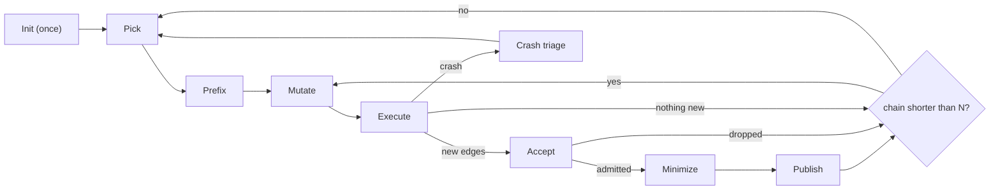

# Redline design

This document describes how Redline works and why. It does not describe the commands.
[README.md](README.md) gives an overview and the build steps. [TUTORIAL.md](TUTORIAL.md) shows the commands.
[CONTRIBUTE.md](CONTRIBUTE.md) shows how to change each part.
Source paths are relative to `experimental/redline/`. Paths such as `test/mjsunit` are relative to the root of the V8 checkout.
`OUT` is the output directory of a session.

## 1. Goals

Redline is a coverage-guided JavaScript fuzzer for V8.
It mutates JavaScript programs, runs them in an instrumented d8, and keeps the programs that reach new code in V8.
It is C++ code in the V8 tree, so that the V8 team can own and change it. It builds on Linux only, because it uses Linux process and memory APIs.

1. **Understandable.** A V8 engineer can follow and debug every step.
2. **Changeable.** An engineer can change one step without changes to the other steps. Each decision is a strategy behind one interface.
3. **Configurable.** One configuration sets every part of a session. A preset is a configuration for one area of V8, for example Maglev.
4. **Plain JavaScript.** Redline imports any script that V8 parses, for example the tests in `test/mjsunit`.
   Each corpus program and each crash is a plain JavaScript file.
5. **Observable.** Each stage and each component reports statistics. A session writes an event log.
6. **Useful crash reports.** Redline groups crashes, makes reproducible crashes smaller, and searches for the conditions that reproduce the other crashes.

## 2. Principles

- **KISS.** The fuzzing loop is a fixed sequence of stages in plain C++ code. There is no plugin framework and no dynamic graph.
  Strategies make the decisions that can change from one session to the next.
- **DRY.** One interface and one registry template serve the four selection points.
  One configuration holds every setting, and the command-line flags are shorthands for its keys.
- **In-tree C++.** Redline builds with the V8 build files and links V8. The V8 parser in the Redline process is the syntax oracle.
- **No magic numbers.** A new number in a generator, a mutator or a reducer must be a tunable:
  a named number with a default, a range and one line of documentation (`core/tunable.h`).
- **Each component runs alone.** The shell (`redline shell`) applies one mutator, generator or reducer to one program.
  `redline mutate`, `redline minimize`, `redline exec` and `redline amplify` run one part on files.
- **Missing data is normal.** A stage must work, possibly with less effect, when optional data is missing.
  For example, a generator must also work at the start of a program, where no variable is visible.
- **Pinned behavior.** Golden traces record the picks of the default strategies and the output of each generator and mutator for fixed seeds.
  A change of behavior shows as a diff.

## 3. Terms

| Term | Meaning |
|---|---|
| target | The instrumented d8 that Redline runs. It speaks the REPRL protocol and writes edge coverage to shared memory. |
| worker | A thread that owns one target and runs the fuzzing loop. |
| program | A JavaScript program, held as a FAST tree and its printed source. Its tree and its source do not change. |
| FAST | The typed JavaScript AST of Redline (`fast/`). |
| corpus | The programs that Accept admitted. All workers share one corpus. |
| candidate | A program that reached new edges. Accept decides if it enters the corpus. |
| component | A generator, a mutator or a reducer. A component has a name, a description and statistics. Generators and mutators also have a weight. |
| strategy | A pluggable policy for one decision, for example the choice of the next seed. |
| prelude | JavaScript that Redline puts in front of each program when it runs the program. The corpus does not store it. |

## 4. Architecture

### 4.1 Code layout

| Directory | Contents |
|---|---|
| `main.cc`, `commands/` | The command-line tool, with one file per command. |
| `base/` | Flags, logging, JSON, files, subprocesses, and the V8 parser in the Redline process. |
| `exec/` | The REPRL client, the coverage map, the target options, and one plain d8 run for the amplify step. |
| `d8/` | The code that d8 links for Redline (`v8_redline=true`): the REPRL file descriptors, the `redline()` builtin and the coverage runtime. It started as a copy of `src/fuzzilli`. |
| `fast/` | FAST: the AST, the arena, the lexer, the parser, the printer and the scope analysis. |
| `core/` | `Program`, `Builder`, `Environment`, `Component`, the random generator, the selection interface and the tunables. |
| `generators/`, `mutators/` | The generators with their shared expression synthesis (`CodeGen`), and the mutators. |
| `corpus/` | The shared corpus and the seed and partner strategies. |
| `minimizer/` | The minimizer and its reducers. |
| `engine/` | The configuration, the stages, the fuzzer and its workers, the shared coverage, the crash signatures, the amplify step, the importer and the prelude. |
| `presets/`, `testdata/` | The presets, and the golden traces of the offline selftest. |

### 4.2 The fuzzing loop



Init runs first (5.1). Then each worker runs this loop:

1. The worker picks a corpus program, the seed. While the corpus is small, it sometimes starts from the empty program (5.1).
2. It puts fresh value declarations at the top of the seed (the prefix, 5.3). The empty program also gets a prefix, unless `stages.prefix.from_scratch` is false.
3. It applies a chain of up to N mutations (`stages.mutate.consecutive`) and runs each result in its target.
   A result that runs without an error becomes the parent of the next link. After a failure or a timeout, the next link uses the same parent.
4. A result with new edges goes to Accept. If Accept admits it, Minimize makes a smaller copy, and Publish adds the copy to the corpus.
   The chain continues from the result as it ran, because minimization would remove material that the next mutations can use.
5. A result that crashes goes to crash triage, and the chain ends.
6. After N links, the worker picks a new seed.

### 4.3 Observability

- Each component counts its invocations, results, executions, outcomes, new edges and time (`core/component.h`).
  Each stage counts its invocations, executions, time, timeouts and successes (`engine/stages.h`). A session prints these tables at an interval.
- The event log `OUT/events.jsonl` has one JSON object per event. The `start` event records the effective configuration and the strategies.
  The `stats` event records the counters of the session and of the stages.
- Each stage has three switches. `log` writes one event per occurrence. `capture` saves the programs of the stage when a trigger fires.
  `stats` adds a row to the stage table.
- Each corpus file starts with its lineage: its origin, its parent and its position in the chain.

## 5. Stages

The worker loop in `engine/fuzzer.cc` calls the stages in a fixed order. The stages delegate their decisions to strategies and components.
The stage statistics use the names `pick`, `prefix`, `mutate`, `check`, `minimize` and `publish`. `check` is the determinism check of Accept.

| Stage | What it does | Configuration |
|---|---|---|
| Init | fills the corpus with imported files, or lets the workers generate programs | `init` |
| Pick | picks a seed and, for `Splice` and `Combine`, a partner | `selection.seeds`, `selection.partners` |
| Mutate | adds a prefix, then applies a chain of mutations | `selection.mutators`, `selection.generators`, `stages.prefix`, `stages.mutate` |
| Execute | runs a program in the target of the worker | `d8`, `d8_args`, `timeout_ms` and other target keys |
| Accept | decides if a candidate enters the corpus | `accept`, `stages.check` |
| Minimize | makes a new corpus program or a crash smaller | `stages.minimize`, `crash_minimizer` |
| Publish | adds the program to the corpus and saves it | `stages.publish` |
| Crash triage | groups, reproduces, amplifies, minimizes and saves crashes | `amplify` and the crash keys |

### 5.1 Init

The `init` block selects one of two strategies:

- `import` loads JavaScript files (`paths`). With `keep: new-coverage`, a file stays only if it runs without an error and reaches new edges.
  With `keep: all`, each file that runs without an error stays. Use `keep: all` to continue a session from its corpus directory.
- `generate` imports nothing. Its parameter `programs` sets `initial_programs`.

While the corpus has fewer than `initial_programs` programs, a worker starts a chain from the empty program with a probability of one half.
It always does so while the corpus is empty. This rule also applies after an import.
A chain from the empty program starts with a prefix, like a program of Fuzzilli's `GenerativeEngine`. Then the first generators have values to use.
The chain uses only the `CodeGen` mutator until 3 of its results run without an error, so a new program gets several rounds of generated code.
`stages.prefix.from_scratch` and `stages.mutate.scratch_codegen` change these two rules.

The importer replaces top-level `load()` and `d8.file.execute()` calls with the statements of the loaded file, so that each program is self-contained.
It removes the loads of `mjsunit.js`, because the prelude supplies their functions. It also removes the loads that it cannot resolve.
The V8 parser in the Redline process checks each imported file before the file runs in a target.

### 5.2 Pick

Pick chooses the next seed. For `Splice` and `Combine`, it also chooses a partner: a second corpus program that supplies code.
The seed strategy and the partner strategy share one registry. The corpus calls them with its lock held, so they can keep plain state.

| Strategy | Picks |
|---|---|
| `uniform` | each program with the same probability. This is the default seed strategy. |
| `recency` | a part of the picks from the newest programs, and the other picks uniformly |
| `tournament` | the program with the fewest picks among a few random programs |
| `productive` | the program with the most children among a few random programs |
| `rarity` | the program with the highest energy (see below) |
| `uniform-partner` | a random program other than the seed. This is the default partner strategy. |
| `rarity-partner` | the program with the highest energy among a few random programs |

The `rarity` strategy prefers programs that reach rare edges, run fast, are small and had few picks (`corpus/corpus.cc`):

```text
energy(p) = rarity(p) / ((age(p) + 1)^age_exponent * (1 + ln(size(p))^size_exponent) * (1 + (exec_time_ms(p) / time_unit_ms)^time_exponent))
rarity(p) = sum over the tracked edges e of p with count(e) < rare_edge_limit (or IsTarget(e)) of w(e) / count(e)^rarity_exponent
```

- `count(e)` is the number of corpus programs that reach edge `e`. Target features stay active past `rare_edge_limit`. The age grows with each pick.
- A new corpus program records its rarest features from its full edge set (5.7), or from its new edges if the set is missing. Target features come first so the per-program cap does not drop them.
- The edges of a reproducible crash count as one more program. This lowers the energy of the programs that lead to a known crash.

### 5.3 Mutate

A **generator** makes new statements for one insertion point. It declares what its code needs from the context, for example a loop for `continue`.
Redline uses a generator only where the context allows it. Generated code uses only the variables that are visible and initialized at that point.
Like Fuzzilli's `CodeGenMutator`, `CodeGen` also inserts into existing class bodies and object literals. At such a member slot, only the member generators `ClassMember` and `LiteralMember` run.

**Facts about variables.** A variable has a coarse type guess (`JsType`). The `Builder` also keeps facts about variables (`BindingInfo`): the parameter types of a function or class constructor, and the property keys of a value.
Generators record the facts for the variables that they declare. For variables of earlier mutations, the `Builder` derives them from the tree, for example from the arguments of the first call of a function.
A new function gets parameter types that enough visible variables have, as in Fuzzilli. Calls then pass values of these types, so that the function gets stable feedback.
`JitOptimize` and `LazyDeopt` reuse at most two argument lists for the warm-up calls and the optimized call. `HotLoop` calls a function 100 times with the same arguments.

A **mutator** changes a program. Mutators insert generated code (`CodeGen`, `JitStress`), change code in place (`Input`, `Operation`, `Expression`, `Call`),
copy code from a partner (`Splice`, `Combine`), change the structure (`Remove`, `Wrap`, `Duplicate`, `Reorder`), or ask the target (`Explore`, `Probing`).
`redline mutate --list` shows the mutators and generators with their weights. A weight of 0 disables a mutator or a generator.

One link of the chain works like this:

1. The mutator strategy picks a mutator. A mutator that needs a partner is eligible only when the corpus has at least two programs.
2. `ApplyMutation` copies the tree of the parent. The mutator edits the copy through a `Builder` (9.3).
   It makes from one change up to its own maximum, or exactly `stages.mutate.rounds` changes if that value is above 0.
3. If the mutator finds nothing to do, the link costs no execution. Otherwise, the worker prints the tree and runs the source.

**Prefix.** The prefix gives the mutators new values to work with. It uses only generators whose code cannot throw,
because an exception in the prefix would make each result of the chain fail. Minimize removes the values that a new corpus program does not use.
The `Prefix` mutator makes the prefix. Its weight is 0, so that the mutator strategy does not pick it.
It sets `GenContext::cannot_throw`. Then `CodeGen` makes only variables and literals as values, without operators, calls or constructors.
The prefix values are primitives, arrays, objects, regexps, symbols, typed arrays, functions and templates.
`generators/values_generators.cc` adds builtin instances, constructor functions, iterables and disposables.
It also adds resizable buffers and special values such as `%GetHoleNaN()`.

**Runtime-assisted mutators.** A type guess from the source does not tell which properties a value has. `Explore` and `Probing` ask the target instead.
They insert probes, and the worker runs the instrumented program once with a helper script in front.
The helper writes its findings to the fuzzout channel. The mutator turns the findings into ordinary code and removes the probes.
`Explore` examines a variable and does an action that fits its value. `Probing` installs properties that the program asks an object for but the object does not have.

**Environment.** Generators use a hand-written model of the globals, methods and runtime functions of d8 (`core/environment.h`).
The typed part of the model (`core/environment_typed.cc`, after Fuzzilli's JavaScriptEnvironment) gives a builtin its full parameter list.
A parameter can be an index, a length, an integer range, an iterable or a callback.
It can also be an enum string, an options bag or an instance of a builtin type.
`CodeGen::ArgumentFor()` uses a visible variable of the kind, or it makes a value of the kind (`generators/codegen_typed.cc`).
At the start of a session, one target runs an introspection script that lists its globals and their members.
With this list, the `DiscoveredApi` generator and `Explore` also reach builtins that the model does not describe.
Where the model knows the signature of a discovered callable, `DiscoveredApi` uses it instead of the arity that the target reports.
The deny list of the script also removes members that end the process, for example `d8.terminateNow`.

**Members.** Classes, object literals and property accesses draw member names from small shared pools (`generators/members.cc`).
The Builder also knows the keys of a value: the keys of its object literal, the members of its class and the stores `x.p = v` (`core/known_keys.cc`).
`Property()` and `MethodCall()` use these keys, so that many accesses find a real member.
`PrivateAccess` and `SuperAccess` use the private names of the enclosing classes and the home object of the enclosing method.

**Strategies.** `weighted` is the default: one weighted random draw among the eligible components.
`adaptive` moves the weights toward the components with a higher recent yield (`core/adaptive_selector.h`).
With `reward: edges`, the yield is new edges per target execution spent. These executions include the reruns, the minimizer tests and the crash triage of the results.
The weight stays between `min_factor` and `max_factor` times the base weight, because the yield of a component changes as the corpus grows.

### 5.4 Execute

The target is the fuzzing build of d8, which has sanitizer coverage and the REPRL interface. [TUTORIAL.md](TUTORIAL.md) shows how to build it.
This build uses `v8_redline=true`. Then d8 links `d8/` instead of `src/fuzzilli`, and V8 uses the code paths of `v8_fuzzilli=true`.
Redline also runs a d8 built with `v8_fuzzilli=true` and without `v8_redline`.
Redline starts the target once and sends it many programs over the REPRL protocol (`exec/reprl.h`).
The target gets two control pipes and two data channels.
One data channel carries the script. The other carries the text that the script sends back through the builtin `redline('REDLINE_PRINT', text)` or `fuzzilli('FUZZILLI_PRINT', text)` (fuzzout).
For each execution, Redline writes the script, sends a command and waits for a status word, the death of the target or the timeout.

| Outcome | Meaning |
|---|---|
| `succeeded` | The script ended with status 0. |
| `failed` | The script ended with an uncaught exception or a nonzero exit status. |
| `crashed` | The target died from a signal. |
| `timed_out` | The script ran longer than the timeout. Redline kills the target. |

- Redline replaces the target after a timeout, after a crash and after `max_execs_before_respawn` executions. This limits the state in one process.
- With `randomize_d8_flags`, each new target process gets a random set of extra d8 flags, for example `--maglev-assert` or `--maglev-non-eager-inlining` (`engine/d8_flags.h`).
  `d8_flag_profile` selects the flag list: `maglev` (the default) or `turbolev`. The `turbolev` list has Turbolev, Turboshaft and inlining-limit flags.
  Both lists also have tier-up, deoptimization, CPU feature and garbage collection flags from the V8 profile of Fuzzilli and the fuzz configurations of V8.
  The probabilities are tunables (`flags.*`). The random flags come before the other d8 flags, so that a flag of the configuration wins.
  Accept, Minimize and crash triage keep the flags of the process that ran the program, also in a new process.
  These steps run most executions, so most respawns keep the flags. Thus the worker replaces a process at the end of such a step if its flags ran `max_execs_before_respawn` executions.
  The crash report, the `crash` event and the `corpus_add` event record the random flags (`d8_random_args`).
- After an infrastructure failure, Redline tries the execution again once with a fresh target. Ten such failures in a row stop the session.
- A session uses a short timeout (`FuzzConfig::Load` in `engine/config.cc`), because a mutant that runs longer is almost always an endless loop.
- By default, the target decides if a program is valid: an uncaught SyntaxError without a stack frame marks it invalid.
  With `syntax_check`, the V8 parser in the Redline process checks each mutant first.
- The default prelude defines the mjsunit assertion functions so that they do not throw.

**Coverage.** Each target has its own coverage map: POSIX shared memory with a header and one bit per edge (`d8/cov.h`).
The header has the mode of the instrumentation, the number of edges, the regions and the build ID of d8.
The regions are the code edges, the builtins blocks and the optimized code features of `--fuzzilli-enable-optimized-code-coverage`.
All three modes of `sanitizer_coverage_flags` (`trace-pc-guard`, `inline-bool-flag` and `inline-8bit-counters`) use this header. With `inline-8bit-counters`, d8 writes one counter per edge instead of one bit.
When a target starts again, Redline compares its header with the header of the first process, so a different binary stops the session.
Redline clears the bitmap before each execution and reads it after the execution.
Only successful executions count for coverage, so the corpus holds only programs that run to the end. Crashes have a separate set of crash bits.
All workers share one map of the edges that the session found (`engine/shared_coverage.h`).
A worker claims new edges with atomic operations, so two workers never claim the same edge. If no corpus program results, the worker gives the edges back.

**Fuzzilli targets.** After the REPRL handshake, Redline detects the layout of the shared memory (`--target-kind=auto|redline|fuzzilli`, or `target_kind` in the configuration).
A d8 built with `v8_fuzzilli=true` writes a 4-byte edge count at offset 0 and one bit per edge from offset 4 (`src/fuzzilli/cov.cc`).
It writes no region table, no coverage counters and no build ID.
Thus all edges count as code edges, and `--targets` stops with an error.
With `--fuzzilli-enable-optimized-code-coverage`, a Fuzzilli target also counts the optimized-code features as code edges.
They enter the `cov` percentage, get weight 1, and stay in the minimizer property (`engine/fuzzer.cc`).
A Redline d8 does not count them as code edges.

**Optimized code features.** The flag `--fuzzilli-enable-optimized-code-coverage` turns them on.
Maglev and Turbolev then hash each chain of up to 3 graph nodes, a node and its inputs (`Graph::ExtractOptimizedCodeCoverage`).
d8 sets the feature of each hash in the last region of the bitmap.
Redline uses these features in the same way with one bit per edge and with counters.
The `cov` percentage does not count them, and the status line shows them apart (`opt`).
They weigh in the rarity strategy (`--optimized-weight`, `corpus/feature_weights.h`).
They do not make a candidate unless `--focus-optimized` is true, and the minimizer does not keep them.

**Coverage counters.** A d8 built with `sanitizer_coverage_flags="inline-8bit-counters,pc-table"` writes one counter per edge instead of one bit (`d8/cov.cc`).
After each execution, `CoverageMap::Refresh()` builds a derived bitmap.
It has one bit for each edge that ran, plus eight bucket bits for each watched edge (AFL's hit count buckets).
A bucket bit is a feature like an edge, so the rest of Redline (accept, reruns, minimizer, corpus) sees one bitmap.
The watched edges are the targets of change-based fuzzing and the optimized code region.
The `cov` percentage does not count the bucket features. The status line shows them apart (`buckets`).
Crash deduplication uses the edges only.

**Change-based fuzzing.** `tools/edge_map.py` maps each edge of a counters build to a source line (the PC table of d8 and `llvm-symbolizer`).
`tools/change_targets.py` maps a git diff to target edges: the edges on changed lines (weight 1.0) and the other edges of the changed functions (weight 0.3).
Only edges that can run without a failed check are targets.
The script removes the edges of check reporting and library code (by their source frames).
It also removes the edges of blocks that only lead to a fatal error (by the machine code, with `llvm-objdump`).
`redline fuzz --targets=FILE` watches the targets and gives them a large weight in the rarity strategy (`corpus/feature_weights.h`):
`w = region weight × (1 + target_boost × target weight) × bucket factor × focus factor`.

The targets file also has a focus: the code of the directories of the changed files, for example `src/maglev/`.
An edge is in the focus if one of its frames is in such a directory, or if its function has such an edge.
With a focus, Redline keeps a new program only if it has a new feature in the focus.
With `coverage.drop_unfocused: false`, Redline also keeps a program whose new features are all outside the focus. The focus then only lowers their weight.
These features are the focus edges, the target edges and their buckets (plus the optimized code features when `--focus-optimized` is true).
Without a focus, `--focus-optimized=false` (the default) still excludes non-target optimized code features from corpus admission.
The other new features of the program stay claimed, but they do not make a candidate.
Thus the corpus grows only with programs that do new things in the changed component, and the minimizer works only for them.
The focus factor is 1 in the focus and `unfocused` (default 0.1) outside it.
The status line shows `focus found/total` and `target found/total`.

### 5.5 Accept

Accept decides if a candidate enters the corpus. It has two parts:

1. **Criterion.** The `accept` block names the criterion. The only criterion is `new-edges`:
   a result is a candidate if it claims at least one edge that the session did not find before.
2. **Determinism check** (`stages.check`). The target is not deterministic, because concurrent compilation and garbage collection change the edges of a run.
   Thus Redline runs the candidate again:
   - It runs the candidate at least `min_reruns` times, and until the set of new edges stays the same for `min_stable_reruns` runs.
   - An edge that a rerun does not reach leaves the set. Redline gives the edge back, so that a later program can claim it.
   - An edge that fails the check `flaky_threshold` times stays claimed. It costs no more reruns, and it does not count as coverage.
   - If a rerun fails, or if the set does not settle within `max_reruns` runs, Redline drops the candidate.

**The oracle.** When Accept admits a program, it also sets the property that Minimize must keep.
For `new-edges`, the property is "the program runs without an error and reaches all its new edges that survived the check".
Accept computes this property once and freezes it. The property does not depend on the corpus at a later time.

This rule keeps Minimize generic. Minimize sees only an oracle, not the criterion.
Thus a reducer must work with any oracle, and a new criterion must supply its own frozen oracle.

### 5.6 Minimize

Minimize makes a program smaller while its oracle stays true.
For a crash that reproduces alone, the oracle is "the program crashes with the same signature", so the minimizer cannot move to a different bug.

| Reducer | What it removes or replaces |
|---|---|
| `statements` | chunks of statements of halving size from the end of each statement list, down to single statements |
| `unwrap` | a block, an `if`, a loop, a `try` or an immediately invoked function, replaced by its body |
| `lists` | call arguments, array elements, object properties, class members, declarators and parameters |
| `expressions` | an expression, replaced by one of its operands or by a constant |
| `truncate` | all top-level statements after the shortest prefix that keeps the oracle true |
| `dataflow` | the top-level statements that the rest of the program does not use, from a def-use graph of the scope analysis |

The default order is `statements`, `unwrap`, `lists`, `expressions` (`Minimizer::DefaultOrder`). `stages.minimize.reducers` sets another list.
The def-use graph only proposes a cut. The oracle decides, because globals, prototypes or getters can connect statements that share no binding.

- The minimizer runs its reducers in rounds until a round changes nothing or the budget ends.
  A reducer edits the tree and asks the oracle. If the oracle says no, the reducer undoes the edit.
- The budget limits the tests, the time and the rounds. It has fewer tests for slow programs (`target_time_ms`).
  Crashes have a larger budget (`crash_minimizer`), because they are rare.
- Each test has a short timeout from the run time of the program (`probe_timeout_*`), because a reduction can make an endless loop.
  For the same reason, `expressions` replaces a loop condition only with `0`.
- The result must pass the oracle again in one of `verify_attempts` runs. If it does not, Redline keeps the original program.
- The crash event and the crash report record the stop reason of a minimization (`min_stop`): `fixed_point`, `budget` or `rounds`.
  `skipped` tells that the minimizer did not run, and `stopped` tells that the session stopped during the minimization.

**Crashes.** For a crash that reproduces alone, the minimizer reduces one tree of the prelude and the program.
Redline parses the prelude, a new line and the program into this tree.
The tree prints to a script that is equivalent to the script of the target, but not always the same text.
The tests run the printed script without the prelude in front.
Thus the minimizer also removes the prelude statements that the crash does not need.
A crash uses all reducers, `dataflow` first: `dataflow`, `statements`, `unwrap`, `lists`, `expressions`, `truncate` (`Minimizer::CrashOrder`).
`crash_minimizer.reducers` sets another list, and an empty list gives this order. `stages.minimize.reducers` does not apply to crashes.
With one test, `dataflow` can remove a group of prelude statements that the program does not use.

- Before the minimization, the printed tree must crash with the same signature in one of `verify_attempts` runs.
- The minimizer reduces the program alone, behind the exact prelude, if one of these conditions is true:
  - The prelude is empty.
  - The prelude or the program does not parse.
  - The prelude continues into the program, for example `var a = f` and `(1);`.
  - The printed tree does not crash with the same signature.

  Then Redline writes no `NAME.repro.js`. The `min_tree` value of the report and of the crash event gives the reason.
- The minimized script goes to `NAME.repro.js`, after two comment lines: the signature and the d8 command. The d8 command has absolute paths. d8 runs this file without the prelude.
- Then Redline removes the d8 flags that `NAME.repro.js` does not need. It removes chunks of halving size from the flags of the target, down to single flags.
  A list of flags passes if the script crashes with the signature in each of `crash_flag_runs` fresh plain d8 processes.
  `--allow-natives-syntax` stays if the script calls a runtime function with `%`. A flag that the script needs to parse stays, because the script cannot crash without it.
  `--single-threaded` and `--random-seed` always stay, because they make a plain d8 run more deterministic. `--stress-runs` also always stays.
  The search stops after `crash_flag_processes` processes or `crash_flag_budget_sec`, and 0 for one of them turns it off.
  The report gives the result in `repro_flags`, and the d8 command of `NAME.repro.js` uses it.
  The search does not run if a flag has its value in a separate word.
- The rate check: the search accepts a list of flags after `crash_flag_runs` crashes, so the result can crash less often than the original crash.
  Thus Redline then runs `NAME.repro.js` in 5 plain d8 processes without an early stop. If the search is on and `crash_flag_runs` is larger, it uses `crash_flag_runs` processes.
  The flags of the search stay only if all processes crash with the signature.
  Else `NAME.repro.js` gets all flags of the target, as without the search.
  If this count is complete with a miss and the search removed flags, Redline also counts all flags of the target.
  `NAME.repro.js` always stays. The report and the crash event give the last count in `repro_rate` and `repro_rate_note`.
  The check runs at most two counts. Each process takes at most the timeout of the target plus 10 s. After a stop request, the check starts no new process.
- `NAME.js` keeps its meaning: the program alone, without the prelude statements. Redline uses the minimized program for `NAME.js` only if it also crashes with the same signature behind the full prelude (`min_program_verified`).
- The node counts of `minimized:`, `min_nodes_before` and `min_nodes_after` are the counts of the program alone, as in `NAME.js`.
  `min_script_nodes` and `min_prelude_statements` give the nodes of the whole tree and its top-level prelude statements.
  If the last check rejects a result, the count after the minimization is equal to the count before.
- A crash that has only `NAME.repro.js` keeps its minimize slot. Thus `signatures.txt` counts it as minimized, while its report says `minimized: no`.

**Amplified crashes.** An amplified crash does not reproduce alone, but the amplify step found d8 flags that reproduce it in plain d8 processes (5.8).
The minimizer reduces one tree of the prelude and the program. If the amplify step changed the program, the tree has the changed program.
A test writes the printed tree to a file and runs it in fresh plain d8 processes with the amplified flags.
These are the flags of the target without `--random-seed` and `--stress-runs`, then the flags of the amplify step with its `--stress-runs`.
The test passes if one of k processes crashes with the same signature.
k is the smallest number of processes that all miss the crash with a probability of 5% or less.
Redline uses the crash rate (hits + 1) / (processes + 2) of the amplify step, and k is between 1 and 10.
For example, k is 2 for a rate of 5/5 and 3 for a rate of 4/5.
Each process has the time limit of the amplify step (`run_timeout_sec`), not the short timeout of the tests in the target.

- `crash_amplified_budget_sec` is the time limit of the tests of the minimizer. 0 turns the minimization off.
  The time limit starts after the start check. Thus a slow start check, for example on a loaded machine, does not use up the time of the minimizer.
  The start check and the last check do not stop at this time limit. Thus a minimization that used up its time can still give a result.
- Before the minimization, the printed tree must pass the test in one of `verify_attempts` tries. The result must pass it again.
- The result goes to `NAME.repro.js`. `NAME.js` keeps the original program, and the report says `minimized: no`.
- The flag search uses the same test. `crash_flag_runs` does not apply.
- The rate check: a test that needs 1 hit of k processes can accept a script that crashes less often than the amplified program.
  Thus, after the flag search, Redline runs `NAME.repro.js` in the number of plain d8 processes that the amplify step plans, without an early stop.
  `NAME.repro.js` stays only after a complete count that reaches the bar of the amplify step (`min_hits` of `processes`).
  If the count is below the bar and the flag search removed flags, Redline also counts all flags of the test. Flags that failed a complete count never stay.
  If a count stops early, for example at a stop request, Redline writes no `NAME.repro.js`.
  The report and the crash event give the result in `repro_rate` and `repro_rate_note`.
  A good script can also miss the bar. For a script with a true crash rate of 0.8, 5 runs give less than 4 crashes with a probability of about 26%.
- The report and the crash event give the test in `min_oracle`, for example `1 of 2 plain d8 runs with the amplified flags`.
- `min_tree` is `prelude and program`, `program, without a prelude`, or `not minimized:` and the reason.
- One amplified crash can take this time: the start check, `crash_amplified_budget_sec` and one more test, and the last check.
  Then the flag search can take `crash_flag_budget_sec` and one more test, and two rate checks follow.
  The start check and the last check each run at most `verify_attempts` times k processes. A rate check runs the processes of the amplify step. Each process takes at most `run_timeout_sec`.
- After a stop request, a worker can wait for the plain d8 process that runs, up to its time limit.

**Bundles.** A state-dependent crash has `NAME.bundle.js`: one part for each needed history program, then the crash part (5.8).
If the bundle crashed in a plain d8 run and the crash has no `NAME.repro.js`, Redline minimizes the bundle.
A test writes a candidate bundle to a file and runs it with `--bundle-reprl` in k fresh plain d8 processes.
The test passes if one process crashes with the same signature. k comes from `bundle_rate`, as for an amplified crash.

1. The minimizer removes the history parts that the crash does not need. The crash part stays last.
2. It reduces the crash part with the crash reducers, and it removes history parts again.
   A part has the prelude and the program, so `dataflow` also removes the prelude statements that the part does not need.
   Each part runs in a new context of the same d8 process. Thus the tests decide if a part needs the state of an earlier part.
   A reduced history part can crash itself. Then the bundle still crashes with the signature.
3. It reduces each history part, and it removes history parts again.

- Before the steps, the bundle must pass the test in one of `verify_attempts` tries.
- `crash_bundle_min_budget_sec` is the time limit of the tests of the steps. 0 turns the minimization off.
  The time limit starts after the start check. The start check, the last check and the rate check stop only at a stop request.
- The result must be smaller, and it must pass the test again in one of `verify_attempts` tries.
- The rate check runs the result in `bundle_runs` plain d8 processes, without an early stop. The result must crash in at least `bundle_hits` of them, as the original bundle did.
- Then Redline writes the result to `NAME.bundle.min.js`. `NAME.bundle.js` stays the original bundle.
- The report and the crash event give the file in `bundle_min`, its rate in `bundle_min_rate` and the result in `bundle_min_note`. A minimized bundle keeps the minimize slot, as `NAME.repro.js` does.
- One bundle minimization can take this time: the start check, `crash_bundle_min_budget_sec` and one more test, the last check, and the rate check.
  The start check and the last check each run at most `verify_attempts` times k processes. The rate check runs `bundle_runs` processes. Each process takes at most the timeout of the target for each part, plus 10 s.

### 5.7 Publish

Publish sets the new edges and the run time of the program.
If a strategy asks for the full edge set, Publish runs the program two more times and keeps the edges that both runs reach.
Then it adds the program to the shared corpus, which gives the program its id.
It writes `OUT/corpus/NNNNNN.js` and a `corpus_add` event.

### 5.8 Crash triage

A crash can come from a result, from an imported file or from an instrumented program.

1. **Signature.** For a V8 fatal error, the signature is the file, the line and the check message.
   For a sanitizer report, it is the kind of error and the first function. For a signal, it is the signal and the first three named frames (`engine/crash.h`).
   For a stack overflow, the functions that repeat in the trace name the crash, because the first frames depend on where the stack ran out.
2. **Budget.** Redline saves at most `max_crashes_per_signature` crashes of one signature, and minimizes at most `minimize_crashes_per_signature` of them.
3. **Reproduction.** Redline runs the program again in a fresh target, up to `crash_reruns` times.
4. **History replay.** If the crash does not reproduce alone, Redline replays the earlier programs of the same target, and then the crash.
   If the crash then occurs, a binary search finds the smallest number of programs from the end of this history that cause it.
   Then Redline writes `NAME.bundle.js`, a d8 bundle with one part for each of these programs and one part for the crash program.
   `d8 --bundle-reprl` runs each part in the same way as the REPRL loop runs one program. Thus ClusterFuzz can run the bundle.
   Redline runs the bundle in up to `crash_bundle_runs` plain d8 processes and writes how many crashed with the same signature (`bundle_rate`).
5. **Amplify.** If the crash does not reproduce alone, the amplify step searches for d8 flags that make it reproduce.
   This also applies after a successful replay, because an earlier program can turn on a feature that a d8 flag can also turn on.
6. **Minimize.** Redline minimizes a crash that reproduces alone, against its signature, together with the prelude (5.6).
   It also minimizes an amplified crash, with the amplified flags in plain d8 processes, and the bundle of a state-dependent crash (5.6).
7. **Save.** Redline writes the program, the report and, if they exist, the original program, the reproducer (`NAME.repro.js`), the history and the bundle to `OUT/crashes/`.

History replay and the amplify step run only for crashes that Redline saves.

**Amplify.** Some crashes depend on timing, for example on a profiler signal or a GC at one moment.
One run in a fresh target does not show them, and ClusterFuzz cannot reproduce them either.
The amplify step searches for a plain d8 command line that reproduces the crash reliably, because ClusterFuzz accepts a testcase together with its d8 flags.
The `flags` strategy (`engine/amplifier.cc`) works like this:

- The candidates are the flags of the stack rules that match the crash output, and then no extra flags.
  For example, a rule adds the CPU profiler flags for profiler frames.
- Each candidate runs fresh d8 processes with `--stress-runs` and a new `--random-seed`. It succeeds when `min_hits` of `processes` runs crash with the same signature.
- d8 stops the stress loop at the first uncaught exception. Thus, if the program ends with an uncaught exception,
  the candidates run on a copy with all statements in one try statement (`wrap`).
- The amplify step runs at most `per_signature` times for one signature in a session.
- The report gets the flags in `amplified_args`. A tool that uploads the crash must send these flags with the testcase.

The `none` strategy turns the amplify step off.

## 6. Data flow

- A **program** (`core/program.h`) holds the FAST tree, the printed source, a hash of the source and the lineage.
  Seed strategies keep their state in the program under the corpus lock.
- An **execution** (`exec/execution.h`) holds the outcome, the exit code or the signal, the run time, and the text from fuzzout, stdout and stderr.
  The coverage bitmap stays in the coverage map of the worker until the next execution.
- The **edges** of a candidate are the new edges that its worker claimed. After Accept, the edges that survived become the edges of the program.

A stage reads only the data that it needs. A strategy that needs optional data declares it, and the engine computes the data only in that case.
For example, `WantsHitEdges` asks for the full edge set. A strategy has a fallback when the data is missing.

## 7. Strategies and registries

The four selection points (seeds, partners, mutators and generators) use one interface, `Selector<T>`, and one registry template, `SelectorRegistry<T>` (`core/selection.h`).

- A strategy is one C++ class and one registration line. The registry keeps its name, its documentation and its parameters (`ParamSpec`).
- At startup, the configuration loader builds each configured strategy once.
  An unknown strategy, parameter or weight name, or a wrong type, stops the session before any target starts.
- The registry writes the strategy part of `redline fuzz --help-config`.
- Strategies get feedback through hooks: `OnAdded` (a new corpus program), `OnOutcome` (the result of a pick) and `OnCrashEdges` (the edges of a reproducible crash).
- All workers share the mutator and generator strategies. Such a strategy must keep no state between calls, or it must synchronize its state.

```json
{"selection": {"seeds": {"strategy": "rarity"}, "partners": {"strategy": "rarity-partner"},
               "mutators": {"strategy": "adaptive", "params": {"weights": {"Splice": 4}}}}}
```

Some parts are pluggable without this registry. The amplify strategies come from `CreateAmplifyStrategy` (`engine/amplifier.cc`), with the same `ParamSpec` declarations.
The loader checks the names of the Init strategies and Accept criteria (`ReadInitConfig`, `ReadAcceptConfig`).
The minimizer finds reducers by name (`stages.minimize.reducers`).

## 8. Configuration and presets

One JSON configuration describes a session. `FuzzConfig` (`engine/config.h`) defines the keys and their defaults.
`redline fuzz --dump-config` prints the complete effective configuration. It needs no target, and the loader reads its output back to the same configuration.

The configuration comes from four layers. A later layer wins:

1. the built-in defaults,
2. the preset (`--preset`),
3. the configuration of `--config`: a file, or inline JSON that starts with `{`,
4. the command-line flags.

Inline JSON can set any key, so a key does not need its own flag. In one JSON object, the `stages` block wins over the older flat keys.
The loader checks the names inside the blocks: stages, capture triggers, Init, Accept, amplify, strategies, parameters, weights, tunables and reducers.
A wrong name stops the session before any target starts.
The loader ignores unknown top-level keys, and unknown keys in some blocks, for example in `selection` and in `crash_minimizer`.

**Presets.** `--preset=NAME` loads `presets/NAME.json`, and `--preset=FILE.json` loads any file.
A preset can add d8 flags for its area (`d8_extra_args`) and change the weights of generators and mutators.
It can also give each new target process random extra d8 flags (`randomize_d8_flags`, section 5.4).
Each preset selects `rarity`, `rarity-partner` and `adaptive`. Without a preset, the defaults are `uniform`, `uniform-partner` and `weighted`.

| Preset | d8 flags added | Higher weights |
|---|---|---|
| `default` | none | none |
| `maglev` | `--maglev --no-turbofan --jit-fuzzing`, and random Maglev flags | JIT, deoptimization, OSR, elements-kind and shape generators |
| `turbolev` | `--turbolev --turbolev-future --jit-fuzzing`, and random Turbolev flags | the same generators as `maglev` |
| `runtime` | `--no-turbofan --no-maglev --no-sparkplug` | property, prototype, proxy, freeze and shape generators. The JIT generators are off. |
| `parser` | none | class, destructuring, arrow, template, label, `using`, `eval` and `with` generators, and `Splice` and `Combine` |
| `builtins` | none | discovered-API, builtin-call, method-call, string, typed-array, collection and worker generators |
| `wasm` | none | `WasmModule`, and JIT, OSR and typed-array generators |

The `WasmModule` generator builds WebAssembly modules that are valid by construction.
Its default weight is 0, so a session without the `wasm` preset generates no WebAssembly modules.
A preset must not raise the weight of a generator that resembles one known bug (section 10 tells why).

## 9. FAST

FAST is the typed JavaScript AST of Redline (`fast/`). Redline does not use the AST of V8 for two reasons.
The V8 parser desugars some constructs before its AST is visible, for example the `let` bindings of `for` loops.
Also, the AST of V8 lives in a Zone that belongs to an Isolate.

### 9.1 The tree and node ids

- The tree has the shape of ESTree, the AST format of tools such as acorn and esprima.
  Each literal type has its own node kind, and so do `%Name(...)` runtime calls. The printer derives the parentheses from precedence.
- One X-macro list in `fast/ast.h` defines all node kinds. `ForEachChildSlot` (`fast/ast_visit.h`) has no default case, so the compiler reports a new kind that it does not handle.
- Nodes are plain structs in an arena that belongs to one program. The arena owns all nodes, so a mutator can detach a subtree and forget it.
- Each node has an id that is unique in its tree. `Tree::Copy` keeps the ids, so an id that the shell shows stays valid in the next mutation step.
  The ids are dense, so analyses keep facts per node in vectors indexed by id, not in hash maps.

### 9.2 Parser, printer and syntax oracle

- The parser (`fast/parser.cc`) is a recursive-descent parser for scripts: ES2024, plus the V8 extensions that tests use. It does not parse modules.
- The parser does not report early errors that keep the tree shape, for example duplicate declarations. V8 is the validity oracle instead.
  The parser must reject what FAST cannot represent, and it must never make a tree that prints to a program with a different meaning.
- The printer (`fast/printer.cc`) always writes semicolons. Its output parses back to a tree that prints to the same text.
- The syntax oracle (`SyntaxChecker` in `base/v8_runtime.h`) compiles a script but never runs it. The target executes each program.

### 9.3 Scope analysis and the Builder

- The scope analysis (`fast/scope.h`) resolves each identifier to its binding. Each mutation that moves, removes or adds code uses it.
  It is a static approximation of the specification. It marks scopes with direct `eval` or `with` as dynamic, and it marks bindings in cases that it does not model, for example Annex B.
- `redline roundtrip --rename` tests the analysis. It renames each binding that it can rename safely, and checks that the program behaves the same.
- Mutators and generators edit a program through a `Builder` (`core/builder.h`): a copy of the tree, its analyses and edit operations.
  The Builder knows the syntactic context of each position and the visible variables, each with a coarse type guess. The guess is not a type system.
- `EscapingBindings` finds the declarations that a removal or a move would separate from their uses. `Remove`, `Wrap` and `Reorder` use it.

### 9.4 New JavaScript features

The goal: when V8 gets a new JavaScript feature, FAST must represent it and Redline must generate it.

A compile-time check cannot enforce this goal. A new feature often adds no V8 AST node type, and V8 AST nodes do not map one to one to syntax.
Two tests enforce the goal instead, at the point where V8 engineers already add tests:

1. **FAST must represent the feature.** A new feature comes with `test/mjsunit` tests.
   `redline roundtrip --dir=test/mjsunit` parses, prints and runs each file. It fails until FAST parses and prints the new syntax.
2. **Redline must generate the feature.** `redline selftest --offline` fails if a FAST node kind comes out of no generator.
   The exceptions are on a list with a reason each (`kUngeneratedKinds` in `commands/selftest_selection.cc`).
   The check also fails when a listed kind starts to appear, so that the list stays current.

## 10. Checks

These checks protect the design. [CONTRIBUTE.md](CONTRIBUTE.md) tells when to run them.

- `redline selftest --offline` needs no target. It checks the golden traces, the configuration, the crash signatures, the FAST node kinds and the presets.
- `redline selftest --d8=PATH` also checks the execution layer against a real target.
- `redline roundtrip --dir=test/mjsunit` checks that V8 and FAST agree on validity, and that each printed program behaves like the original.
- `redline audit` checks generators for overfitting. It generates programs with each generator and runs them in a d8 with known bugs.
  It fails if one crash signature takes more than `--threshold` percent of the programs of one generator.

Such a generator is a template of one bug. It finds that bug again, and little else.
A lower weight does not solve the problem: the weight changes how often the generator runs, not what its programs do. Make the generator more general instead.

The V8 bots build Redline, because the root `BUILD.gn` adds it to `gn_all` on Linux. The bots do not run these checks.

## 11. Measuring a change

[CONTRIBUTE.md](CONTRIBUTE.md) shows how to compare two sessions.

## 12. Threading and memory

A session is one process. The main thread loads the configuration, starts the targets and starts one thread per worker (`jobs`).
Then it only checks the stop conditions and writes the statistics.
A worker owns its target, its coverage map, its random generator, its isolate for the syntax oracle and its crash history.

| Shared state | Protection |
|---|---|
| corpus, and the seed and partner strategies | a mutex. Programs do not change, so a worker uses a program without the lock. |
| seen edges and crash edges | atomic operations on 64-bit words |
| mutator and generator strategies | no state between calls, or a mutex of their own (`adaptive`) |
| flaky-edge counts, crash bookkeeping, event log | a mutex each |
| counters | atomic counters |

- Each worker seeds its random generator from the session seed and its worker number.
  With one worker and a deterministic target, a session with the same seed repeats the same steps.
  Time limits can change the steps, for example the time budget of the minimizer and the time window of `adaptive`.
- Each tree has its own arena. The arena takes memory in segments from a pool of its thread, and gives them back when the tree dies.
  Thus a tree costs only bump allocation.
- Programs are immutable and shared (`std::shared_ptr<const Program>`). A mutation copies the tree.
- The corpus keeps each program for the whole session, so memory grows with the corpus.
- All isolates of the syntax oracle share one pointer-compression cage. Thus each isolate has small heap limits and compiles lazily.

## 13. Design decisions

| Decision | Reason |
|---|---|
| Mutate a typed AST of plain JavaScript. | Redline imports any script that V8 parses, without loss. The scope analysis keeps edits valid. |
| Keep the parser lenient, with V8 as the validity oracle. | FAST and V8 cannot disagree about validity. |
| Keep the target alive over REPRL, and replace it from time to time. | A new process for each program is slow. A process that lives for a long time collects state. |
| Check candidates for determinism, and suppress flaky edges. | Without the check, noise fills the corpus. Without the suppression, an edge that never settles costs reruns forever. |
| Freeze the oracle at acceptance. | Minimize and the reducers stay independent of the criterion. |
| Group crashes by signature, with a budget per signature. | The work per bug stays bounded. |
| Replay the history of a crash, and search for amplifying flags. | Some crashes depend on earlier programs or on timing. |
| Put the prelude in front of each execution, and never store it. | Corpus files stay clean, and imported tests run without `mjsunit.js`. |
| Minimize a crash together with the prelude. | The reproducer needs no prelude, and it keeps only the prelude statements that the crash needs. |
| Run all workers in one process, with one corpus and one coverage map. | The workers need no protocol to exchange programs. |
| Keep the pipeline fixed, and make the decisions pluggable. | The loop stays easy to read, and a decision can change without a change to the loop. |
| Build the target with `v8_redline=true`, and also accept `v8_fuzzilli=true`. | Redline can change its coverage runtime and its builtin without changes to Fuzzilli. It can also run the same d8 binary as Fuzzilli and older V8 revisions. |
